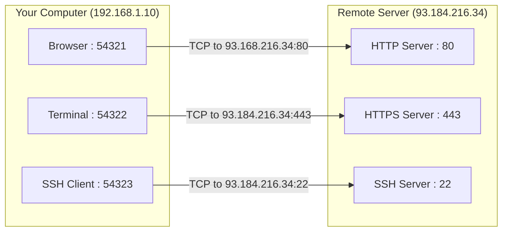
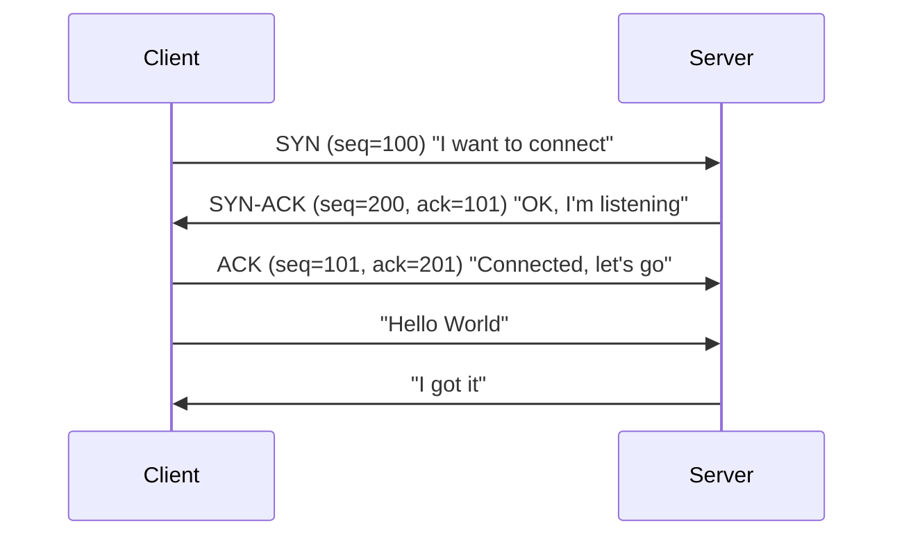
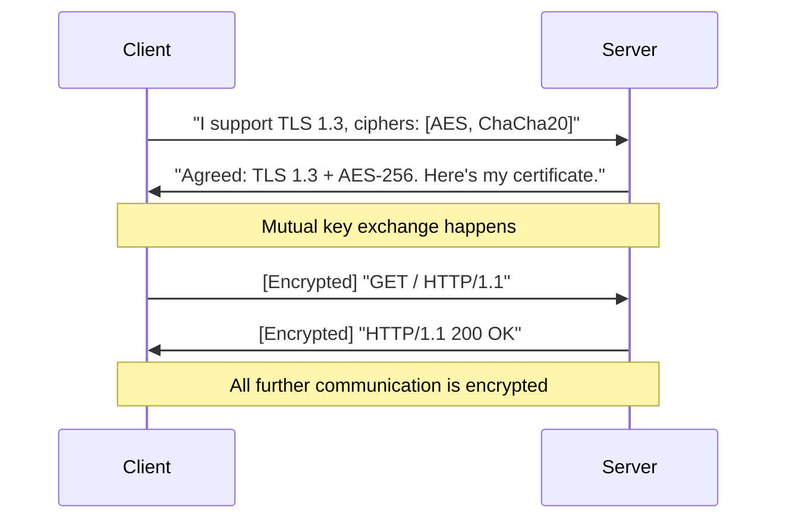
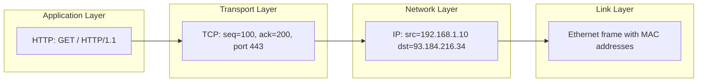

# Module 0: How The Internet Moves Data

Before understanding proxies, you need to understand how data travels across networks. This module covers the fundamentals — TCP connections, IP addresses, ports, and HTTP requests — using hands-on commands you can run right now.

---

## Lesson 1: IP Addresses and Ports

Every device on a network has an **IP address**. Every application on that device has a **port number**. Together they form a unique endpoint.

### Your Network Information

```bash
# See your own IP on the network
hostname -I

# See your public IP (what the internet sees)
curl ifconfig.me

# Find a specific service's port — HTTP is always port 80
ss -tlnp | grep :80

# Check what ports are actively listening
ss -tlnp
```

### The Addressing Model



**Why ports matter:** Without ports, the OS wouldn't know which process should receive incoming data. When a packet arrives at `192.168.1.10`, port 54321 tells the OS to send it to your browser, not your terminal.

---

## Lesson 2: TCP — The Reliable Connection

TCP guarantees that every byte you send arrives in order. It does this through a **handshake** before any data flows.

### The TCP 3-Way Handshake



### Watch It Happen — Netcat Demo

Let's create a simple TCP server and client to see this in action.

**Step 1:** Start a TCP listener (server) — open this in one terminal:

```bash
# This acts as our test TCP server on port 9999
socat TCP-LISTEN:9999,fork,reuseaddr SYSTEM:'echo "Server received: $REPLY"; cat'
```

**Step 2:** Connect from another terminal (client):

```bash
# This connects to our test server
echo "Hello from client" | ncat localhost 9999
```

You should see the server echo back what you sent. The connection was established automatically — that's TCP doing its job behind the scenes.

### See It at the Packet Level (If You Have Permissions)

```bash
# This captures TCP handshake packets on port 443
sudo tcpdump -i any -n 'tcp port 443 and (tcp[13] & 2 != 0)' -c 6
```

The flags being captured:
- `SYN` (bit 1) — connection request
- `SYN,ACK` (bits 1+2) — connection accepted
- `ACK` (bit 4) — confirmation

---

## Lesson 3: UDP — The Fast One

UDP skips the handshake. It just sends packets and hopes they arrive. No guarantees.

```mermaid
sequenceDiagram
    participant C as Client
    participant S as Server
    Note over C,S: No handshake for UDP
    C->>S: "Packet 1" (hop, hop, hope)
    C->>S: "Packet 2" (might arrive out of order)
    C->>S: "Packet 3" (might get lost entirely)
    S--x: "I got 1 and 3, where's 2?" (UDP doesn't ask)
```

### UDP Demo — DNS Queries

DNS is the most common UDP protocol. Every time you type a URL, your computer sends a UDP packet:

```bash
# DNS queries use UDP port 53
dig example.com +short

# Watch the raw DNS query
dig example.com @8.8.8.8 -v 2>&1 | head -20
```

Output will show:
```
;; ->>HEADER<<- opcode: QUERY, status: NOERROR, id: 12345
;; QUESTION SECTION:
;example.com.                    IN      A
```

The `id` is a random transaction ID — UDP has no connection state, so each query is independent.

### Speed Comparison — TCP vs UDP

```python
# Save as tcp_vs_udp_speed.py
import socket
import time
import threading

SERVER_PORT = 9999
DATA_SIZE = 1024 * 1024  # 1MB
ITERATIONS = 5

def udp_server():
    sock = socket.socket(socket.AF_INET, socket.SOCK_DGRAM)
    sock.bind(('127.0.0.1', SERVER_PORT))
    print("[UDP Server] Listening...")
    for i in range(ITERATIONS):
        data, addr = sock.recvfrom(DATA_SIZE + 1024)
        sock.sendto(data, addr)

def tcp_server():
    srv = socket.socket(socket.AF_INET, socket.SOCK_STREAM)
    srv.bind(('127.0.0.1', SERVER_PORT + 1))
    srv.listen(5)
    print("[TCP Server] Listening...")
    conn, _ = srv.accept()
    for i in range(ITERATIONS):
        data = conn.recv(DATA_SIZE)
        conn.sendall(data)
    conn.close()

def udp_client():
    sock = socket.socket(socket.AF_INET, socket.SOCK_DGRAM)
    times = []
    for i in range(ITERATIONS):
        payload = b'A' * DATA_SIZE
        t0 = time.time()
        sock.sendto(payload, ('127.0.0.1', SERVER_PORT))
        sock.recv(DATA_SIZE + 1024)
        times.append(time.time() - t0)
    sock.close()
    print(f"[UDP] Avg: {sum(times)/len(times)*1000:.1f}ms, Total: {sum(times)*1000:.1f}ms")

def tcp_client():
    sock = socket.socket(socket.AF_INET, socket.SOCK_STREAM)
    times = []
    for i in range(ITERATIONS):
        payload = b'A' * DATA_SIZE
        t0 = time.time()
        sock.connect(('127.0.0.1', SERVER_PORT + 1))  # Connect each time (new connection overhead)
        sock.sendall(payload)
        sock.recv(DATA_SIZE)
        times.append(time.time() - t0)
        sock.close()
    print(f"[TCP] Avg: {sum(times)/len(times)*1000:.1f}ms, Total: {sum(times)*1000:.1f}ms")

threading.Thread(target=udp_server, daemon=True).start()
threading.Thread(target=tcp_server, daemon=True).start()
time.sleep(0.5)

print("=== UDP ===")
udp_client()
print("\n=== TCP (with connect per send) ===")
tcp_client()
```

Run it:
```bash
python3 tcp_vs_udp_speed.py
```

**What you'll notice:** UDP is often faster for small data because there's no connection overhead. But if a packet is lost, you never get it back. TCP's handshake and retransmission add latency but guarantee delivery.

---

## Lesson 4: HTTP — The Language of the Web

HTTP is an application-layer protocol that runs on top of TCP. It defines how clients and servers communicate.

### A Real HTTP Request

```bash
# See the full HTTP request curl sends
curl -v https://httpbin.org/get 2>&1 | head -30
```

You'll see:
```
*   Trying 104.18.0.0:443...
* TCP connection established (TLS handshake happens here)
> GET /get HTTP/1.1
> Host: httpbin.org
> User-Agent: curl/8.23.0
> Accept: */*
>
```

Key parts:
- `GET /get HTTP/1.1` — the **request line** (method + path + version)
- `Host:` header — tells the server which domain you want (multiple sites share one IP via SNI)
- Everything after the blank line is the **body** (empty for GET requests)

### HTTP Request Anatomy

```mermaid
graph TD
    A[Request Line<br/>GET /path HTTP/1.1] --> B[Headers<br/>Host: example.com<br/>User-Agent: curl<br/>Authorization: Bearer xxx]
    B --> C{Body?}
    C -->|POST/PUT| D[JSON or form data]
    C -->|GET/DELETE| E[Empty body]
    
    F[Response Line<br/>HTTP/1.1 200 OK] --> G[Headers<br/>Content-Type: application/json<br/>Set-Cookie: session=xxx]
    G --> H[Body<br/>{ "key": "value" }]
```

### POST Request — Send Data to a Server

```bash
# POST with JSON body
curl -v -X POST https://httpbin.org/post \
  -H "Content-Type: application/json" \
  -d '{"name": "test", "value": 42}' 2>&1 | grep -A 5 '"json"'
```

The `-X POST` changes the method, `-H` adds headers, and `-d` sends a body.

---

## Lesson 5: TLS — Encrypting the Connection

HTTP is plaintext. Anyone on your network can read it. TLS (Transport Layer Security) encrypts everything between client and server.

### How TLS Changes Things



### Verify TLS on Any Website

```bash
# See the certificate details for a website
echo | openssl s_client -connect google.com:443 -servername google.com 2>/dev/null | \
  openssl x509 -noout -subject -issuer -dates

# Check which TLS version is used
echo | openssl s_client -connect google.com:443 -servername google.com 2>&1 | grep "Protocol"

# See the cipher in use
echo | openssl s_client -connect google.com:443 -servername google.com 2>&1 | grep "Cipher"
```

### TLS Handshake — What's Actually Sent

```bash
# Capture the TCP packets during a TLS handshake
curl -v https://example.com 2>&1 &
# In another terminal, capture packets (if you have permissions):
sudo tcpdump -i any host example.com -w tls_handshake.pcap -c 30
```

The handshake involves:
1. **Client Hello** — "I support these TLS versions and cipher suites"
2. **Server Hello** — "We'll use TLS 1.3 with AES-256-GCM. Here's my certificate."
3. **Key Exchange** — Both sides compute a shared secret (via Diffie-Hellman)
4. **Finished** — Encrypted communication begins

After this, all HTTP data is encrypted. A network observer sees only: `TCP to 93.184.216.34:443 with encrypted payload`. They can't see the URL path, headers, or body.

---

## Lesson 6: Putting It All Together — The Full Stack

Every web request goes through these layers:



### One Request, Every Layer

Let's trace what happens when you run `curl https://example.com`:

```bash
# Step 1: DNS resolution (UDP)
dig example.com +short
# → Outputs: 93.184.216.34

# Step 2: TCP handshake (TCP)
# curl opens a connection to 93.184.216.34:443
# Three-way SYN/SYN-ACK/ACK happens automatically

# Step 3: TLS handshake (TLS over TCP)
# Client hello → Server hello → key exchange → encrypted channel

# Step 4: HTTP request (HTTP over TLS)
curl -s https://example.com > /dev/null

# See which port curl used for this connection
ss -tlnp | grep ESTAB | grep :443
```

### The Complete Timeline

```bash
# Measure how long each phase takes
time curl -o /dev/null -s https://example.com
# Typical output: real 0.05x (50ms total)
# Breakdown: ~10ms DNS + ~20ms TCP/TLS handshake + ~20ms HTTP round-trip
```

---

## Exercises

### Exercise 1: Build a Tiny HTTP Server

```python
# Save as tiny_server.py
from http.server import HTTPServer, BaseHTTPRequestHandler
import json

class Handler(BaseHTTPRequestHandler):
    def do_GET(self):
        self.send_response(200)
        self.send_header('Content-Type', 'application/json')
        self.end_headers()
        response = {"message": "Hello from my server!", "path": self.path}
        self.wfile.write(json.dumps(response).encode())
    
    def do_POST(self):
        length = int(self.headers.get('Content-Length', 0))
        body = self.rfile.read(length) if length else b''
        self.send_response(201)
        self.send_header('Content-Type', 'application/json')
        self.end_headers()
        response = {"received": body.decode(), "method": "POST"}
        self.wfile.write(json.dumps(response).encode())

print("Server running on http://localhost:8888")
HTTPServer(('127.0.0.1', 8888), Handler).serve_forever()
```

Test it:
```bash
python3 tiny_server.py &
sleep 1
curl http://localhost:8888/hello
curl -X POST http://localhost:8888/submit -d '{"data": "test"}'
kill %1
```

### Exercise 2: Create a Raw TCP Chat

```bash
# Terminal 1 — Server
socat TCP-LISTEN:7777,reuseaddr SYSTEM:'while read line; do echo "Server: $line"; done | while read line; do echo "$line"; done'

# Terminal 2 — Client  
ncat localhost 7777
```

Type messages in both terminals. This demonstrates raw TCP — no HTTP, no TLS, just bytes flowing back and forth.

---

*Next: [Module 1: What Is a Proxy?](01_proxy-basics.md) — Understanding why we need proxies and how they work at the most basic level.*
