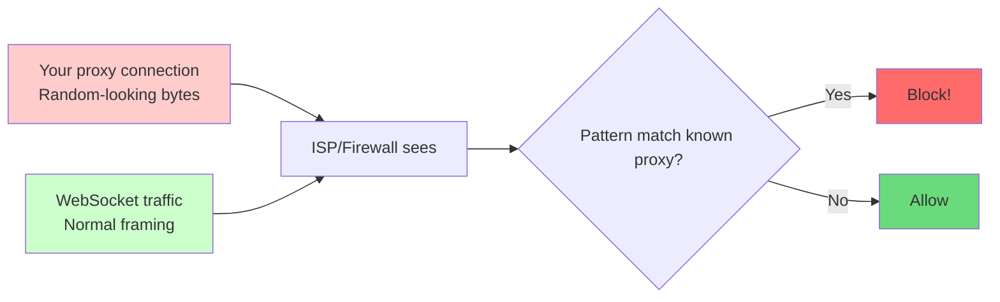
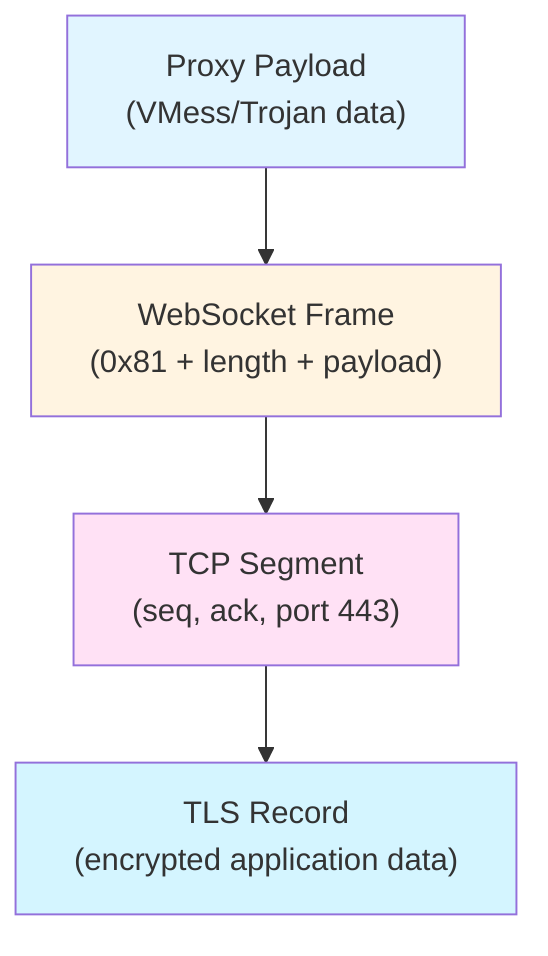
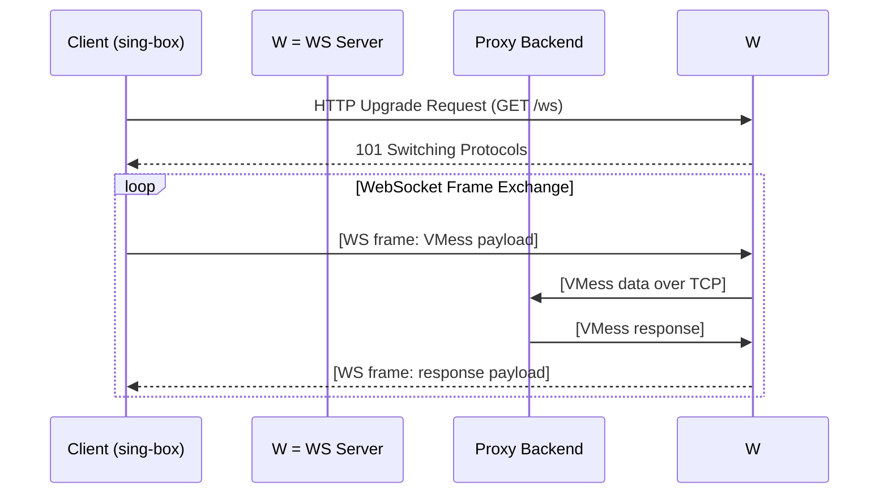
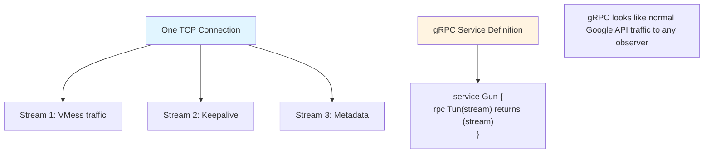
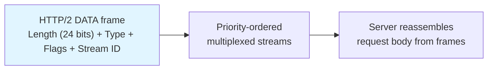
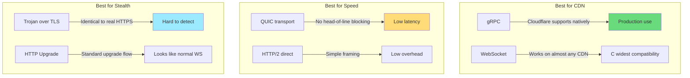

# Module 2: Transport Wrapping

This module explains how proxy traffic is hidden inside normal internet protocols. By wrapping your proxy data inside WebSocket, gRPC, or HTTP/2, it becomes indistinguishable from regular web traffic.

---

## Lesson 1: Why Wrap at All?

### The Detection Problem



If your proxy sends raw encrypted bytes, deep packet inspection (DPI) tools can identify the pattern and block it. But if that same data is wrapped inside a WebSocket connection, DPI sees only "a WebSocket chat" — nothing suspicious.

### The Wrapping Concept



Each layer adds its own header. To an observer at each layer, they only see what's meaningful to that layer:
- **TLS layer** sees encrypted bytes (doesn't know it's WebSocket)
- **TCP layer** sees port 443 traffic (looks like HTTPS)
- **Network observer** sees a connection to a CDN

---

## Lesson 2: WebSocket Wrapping

WebSocket starts as an HTTP request with an `Upgrade` header, then transitions into a persistent two-way channel.

### The HTTP Upgrade Handshake

```bash
# See how a real WebSocket connection starts — using wscat if installed, or curl:
curl -v -N \
  -H "Upgrade: websocket" \
  -H "Connection: Upgrade" \
  -H "Sec-WebSocket-Key: dGhlIHNhbXBsZSBub25jZQ==" \
  -H "Sec-WebSocket-Version: 13" \
  https://websocket.org/echo.sock 2>&1 | head -40
```

Output you'll see:
```
> GET /echo.sock HTTP/1.1
> Host: websocket.org
> Upgrade: websocket          ← Tell server: "switch to WS protocol"
> Connection: Upgrade          ← "keep this connection open"
> Sec-WebSocket-Key: dGhl...   ← Random base64 nonce
> Sec-WebSocket-Version: 13
< HTTP/1.1 101 Switching Protocols
< Upgrade: websocket
< Connection: Upgrade
```

The `101 Switching Protocols` response means: the server agreed. Now both sides can send data freely, framed in WebSocket protocol format.

### Building a WebSocket Server from Scratch

```python
# Save as ws_server.py
import socket
import hashlib
import base64
import struct
import threading

WS_OPcodes = {'TEXT': 0x1, 'BINARY': 0x2, 'CLOSE': 0x8, 'PING': 0x9, 'PONG': 0xa}

def handshake(client):
    """Perform the HTTP → WebSocket upgrade"""
    request = b''
    while b'\r\n\r\n' not in request:
        request += client.recv(4096)
    
    # Extract the Sec-WebSocket-Key
    key_line = [l for l in request.decode().split('\r\n') if 'Sec-WebSocket-Key:' in l][0]
    key = key_line.split('Sec-WebSocket-Key:')[1].strip()
    
    # The magic GUID that defines WebSocket (RFC 6455)
    MAGIC = "258EAFA5-E914-47DA-95CA-C5AB0DC85B11"
    accept = base64.b64encode(
        hashlib.sha1((key + MAGIC).encode()).digest()
    ).decode()
    
    # Response
    response = (
        "HTTP/1.1 101 Switching Protocols\r\n"
        "Upgrade: websocket\r\n"
        "Connection: Upgrade\r\n"
        f"Sec-WebSocket-Accept: {accept}\r\n"
        "\r\n"
    )
    client.sendall(response.encode())
    print("[WS] Handshake complete")

def frame(payload: bytes, opcode: int = WS_OPcodes['TEXT']) -> bytes:
    """Create a WebSocket frame"""
    length = len(payload)
    
    # First byte: fin bit + opcode
    first_byte = 0x80 | opcode  # FIN=1 (final frame), opcode
    
    if length < 126:
        header = struct.pack('!BB', first_byte, length)
    elif length < 65535:
        header = struct.pack('!BBH', first_byte, 126, length)
    else:
        header = struct.pack('!BBQ', first_byte, 127, length)
    
    return header + payload

def unframe(data: bytes) -> tuple:
    """Extract payload from a WebSocket frame"""
    if len(data) < 2:
        return None, None
    
    opcode = data[0] & 0x0f
    mask_bit = data[1] & 0x80
    length = data[1] & 0x7f
    
    offset = 2
    if length == 126:
        length = struct.unpack('!H', data[2:4])[0]
        offset = 4
    elif length == 127:
        length = struct.unpack('!Q', data[2:10])[0]
        offset = 10
    
    if mask_bit:
        mask_key = data[offset:offset+4]
        offset += 4
    
    payload = data[offset:offset+length]
    
    # Unmask (client frames are always masked)
    if mask_bit:
        payload = bytes([b ^ mask_key[i % 4] for i, b in enumerate(payload)])
    
    return opcode, payload

def handle_client(client, addr):
    """Handle a WebSocket connection"""
    print(f"[WS] {addr} connected")
    
    # Step 1: Upgrade the connection
    handshake(client)
    
    buffer = b''
    while True:
        data = client.recv(65536)
        if not data:
            break
        buffer += data
        
        # Process all complete frames in the buffer
        while len(buffer) >= 2:
            opcode, payload = unframe(buffer)
            if payload is None:
                break
            
            print(f"[WS] Received ({opcode}) {payload[:100]}...")
            
            # Echo back the message
            response_frame = frame(payload, opcode)
            client.sendall(response_frame)
            
            # Remove processed bytes from buffer
            frame_len = 2 + (4 if buffer[1] & 0x7f == 126 else 0) + (4 if len(buffer) > 2 and (buffer[1] & 0x7f >= 126) else 0) + len(payload)
            # Actually need proper offset calculation - simplified:
            if opcode == WS_OPcodes['CLOSE']:
                return
            buffer = buffer[frame_len:]

print("[WS Server] Listening on port 8765...")
server = socket.socket(socket.AF_INET, socket.SOCK_STREAM)
server.setsockopt(socket.SOL_SOCKET, socket.SO_REUSEADDR, 1)
server.bind(('127.0.0.1', 8765))
server.listen(5)

while True:
    client, addr = server.accept()
    threading.Thread(target=handle_client, args=(client, addr), daemon=True).start()
```

### Build a WebSocket Client to Test It

```python
# Save as ws_client.py
import socket
import hashlib
import base64
import struct
import uuid

def make_key():
    return base64.b64encode(uuid.uuid4().bytes).decode()

def frame(payload: bytes, opcode: int = 0x1) -> bytes:
    """Masked WebSocket frame (required by spec for client→server)"""
    length = len(payload)
    first_byte = 0x80 | opcode  # FIN + opcode, mask bit set
    
    if length < 126:
        header = struct.pack('!BB', first_byte, 0x80 | length)  # Mask bit + length
    elif length < 65535:
        header = struct.pack('!BBH', first_byte, 0x80 | 126, length)
    else:
        header = struct.pack('!BBQ', first_byte, 0x80 | 127, length)
    
    mask_key = struct.pack('!I', hash(payload) & 0xFFFFFFFF)[:4] or b'\x00\x00\x00\x00'
    masked = bytes([b ^ mask_key[i % 4] for i, b in enumerate(payload)])
    
    return header + mask_key + masked

def handshake(key):
    """HTTP Upgrade request"""
    return (
        f"GET / HTTP/1.1\r\n"
        f"Host: 127.0.0.1:8765\r\n"
        f"Upgrade: websocket\r\n"
        f"Connection: Upgrade\r\n"
        f"Sec-WebSocket-Key: {key}\r\n"
        f"Sec-WebSocket-Version: 13\r\n"
        f"\r\n"
    )

def unframe(data: bytes):
    if len(data) < 2:
        return None, None
    opcode = data[0] & 0x0f
    length = data[1] & 0x7f
    offset = 2
    if length == 126:
        length = struct.unpack('!H', data[2:4])[0]
        offset = 4
    elif length == 127:
        length = struct.unpack('!Q', data[2:10])[0]
        offset = 10
    mask_key = data[offset:offset+4]
    offset += 4
    payload = data[offset:offset+length]
    return opcode, bytes([b ^ mask_key[i % 4] for i, b in enumerate(payload)])

# Connect and exchange messages
sock = socket.socket(socket.AF_INET, socket.SOCK_STREAM)
sock.connect(('127.0.0.1', 8765))

key = make_key()
sock.sendall(handshake(key).encode())

# Wait for upgrade response
response = sock.recv(4096)
assert b'101 Switching Protocols' in response
print("[Client] Handshake successful!")

# Send and receive messages
for msg in ["Hello WebSocket!", "Testing frames", "Goodbye"]:
    sock.sendall(frame(msg.encode()))
    data = sock.recv(65536)
    opcode, payload = unframe(data)
    print(f"[Client] Received: {payload.decode()}")

sock.close()
print("[Client] Done!")
```

Test it:
```bash
# Terminal 1 — Server
python3 ws_server.py

# Terminal 2 — Client
python3 ws_client.py
```

### WebSocket in Real Proxy Use

In sing-box, a VMess or Trojan connection wrapped in WebSocket looks like this:



To the network observer, this is **just a WebSocket connection**. It could be a chat app, a real-time dashboard, or a stock ticker. There's no way to tell it's proxy traffic without deep inspection of the frame contents — and those are encrypted.

---

## Lesson 3: gRPC Wrapping

gRPC uses HTTP/2 as its transport. Each gRPC call is a stream within an HTTP/2 connection.

### What gRPC Traffic Looks Like on the Wire

```bash
# Make a real gRPC-like request over HTTP/2
curl --http2 -X POST https://grpc.statickubernetes.com:443 \
  -H "Content-Type: application/grpc+proto" \
  -H "Te: trailers" \
  -d '' -v 2>&1 | head -20
```

You'll see HTTP/2 headers:
```
> POST / HTTP/2
> content-type: application/grpc+proto
> te: trailers
```

HTTP/2 is binary — not text like HTTP/1.1. The framing is built into the protocol. This makes gRPC hard to distinguish from normal API calls.

### Why gRPC Is Great for Proxies



Key advantages:
1. **Multiplexed** — Multiple proxy connections share one TCP socket (no TLS overhead per connection)
2. **CDN-compatible** — Cloudflare, Fastly, and other CDNs handle gRPC natively
3. **Built-in keepalive** — HTTP/2 has ping frames for connection liveness checks

### How sing-box Implements gRPC Transport

From `transport/v2raygrpc/server.go`:

```go
type Server struct {
    ctx     context.Context
    logger  logger.ContextLogger
    handler adapter.V2RayServerTransportHandler
    server  *grpc.Server   // Standard Go gRPC server
}

func (s *Server) Tun(server GunService_TunServer) error {
    // Wrap the gRPC stream as a net.Conn
    conn := NewGRPCConn(server, nil)
    
    // Extract peer address and X-Forwarded-For if present
    var source M.Socksaddr
    if remotePeer, loaded := peer.FromContext(server.Context()); loaded {
        source = M.SocksaddrFromNet(remotePeer.Addr)
    }
    
    // Hand off to the proxy handler (VMess/Trojan/etc.)
    go s.handler.NewConnectionEx(
        log.ContextWithNewID(s.ctx), conn, source, M.Socksaddr{},
        N.OnceClose(func(it error) { close(done) }),
    )
    <-done
    return nil
}

func (s *Server) Network() []string {
    return []string{N.NetworkTCP}  // TCP-only transport
}
```

The `Tun` method receives a gRPC bidirectional stream and wraps it as a `net.Conn`. The proxy protocol (VMess, Trojan, etc.) then reads from and writes to this connection, completely unaware it's running over gRPC.

---

## Lesson 4: HTTP/2 Direct Transport

sing-box can also use raw HTTP/2 without gRPC overhead — just send data in HTTP/2 request/response bodies.

### Simulate HTTP/2 Request

```bash
# HTTP/2 request (curl handles the framing automatically)
curl --http2 -X POST https://httpbin.org/post \
  -H "Content-Type: application/octet-stream" \
  -d "$(python3 -c "import os; print(os.urandom(1024).hex())")" \
  -s | jq '.data' | head -c 80
```

In a real proxy scenario, the `-d` data would be your encrypted proxy payload. The server receives it in the HTTP request body and processes it.

### HTTP/2 Frame Structure



HTTP/2 allows multiple requests on one connection, each with different priorities. This is more efficient than opening a new TCP connection for every request.

---

## Lesson 5: Comparison — Which Transport to Use?



| Transport | CDN Support | Overhead | Stealth | Best Use Case |
|-----------|------------|----------|---------|---------------|
| **WebSocket** | Excellent | Low | Medium | General purpose, easiest to set up |
| **gRPC** | Good (Cloudflare) | Low-Medium | High | Production with Cloudflare |
| **HTTP/2 direct** | Good | Lowest | Medium | Direct hosting, low latency |
| **QUIC** | Limited | Low | Medium | Mobile networks, lossy connections |
| **HTTP Upgrade** | Excellent | Low | Medium | Maximum compatibility |

---

## Exercises

### Exercise 1: Watch WebSocket Frames in Real Time

```python
# Save as ws_analyzer.py — a mini Wireshark for WebSocket
import socket
import struct
import base64

def unframe_verbose(data: bytes, label: str):
    if len(data) < 2:
        return None
    opcode = data[0] & 0x0f
    mask_bit = data[1] & 0x80
    length = data[1] & 0x7f
    offset = 2
    
    opcode_names = {1: 'TEXT', 2: 'BINARY', 8: 'CLOSE', 9: 'PING', 10: 'PONG'}
    print(f"  [{label}] Opcode: {opcode_names.get(opcode, '?')}({opcode}), "
          f"Masked: {bool(mask_bit)}, Payload length: {length}")
    
    if length == 126:
        length = struct.unpack('!H', data[2:4])[0]
        offset = 4
        print(f"  [{label}] Extended length: {length}")
    elif length == 127:
        length = struct.unpack('!Q', data[2:10])[0]
        offset = 10
    
    if mask_bit:
        mask_key = data[offset:offset+4]
        print(f"  [{label}] Mask key: {base64.b64encode(mask_key).decode()}")
        offset += 4
    
    payload = data[offset:offset+min(length, 200)]
    if mask_bit:
        payload = bytes([b ^ mask_key[i % 4] for i, b in enumerate(payload)])
    
    try:
        print(f"  [{label}] Content: {payload.decode('utf-8', errors='replace')}")
    except:
        print(f"  [{label}] Content (hex): {payload.hex()}")
    
    return length + offset

# Connect to the WS server and analyze frames
sock = socket.socket(socket.AF_INET, socket.SOCK_STREAM)
sock.connect(('127.0.0.1', 8765))

# Send handshake (same as ws_client.py)
import hashlib, uuid
key = base64.b64encode(uuid.uuid4().bytes).decode()
sock.sendall(f"GET / HTTP/1.1\r\nHost: 127.0.0.1:8765\r\nUpgrade: websocket\r\n"
             f"Connection: Upgrade\r\nSec-WebSocket-Key: {key}\r\n"
             f"Sec-WebSocket-Version: 13\r\n\r\n".encode())

response = sock.recv(4096)
print("[Analyzer] Server response:")
unframe_verbose(response, "Response")

# Send a test message and capture the frame structure
print("\n[Analyzer] Sending 'Hello World':")
msg = b"Hello World"
first_byte = 0x81  # FIN + TEXT opcode
if len(msg) < 126:
    header = struct.pack('!BB', first_byte, 0x80 | len(msg))  # Masked
mask_key = b'\x01\x02\x03\x04'
masked = bytes([b ^ mask_key[i % 4] for i, b in enumerate(msg)])
frame = header + mask_key + masked
print("[Analyzer] Frame bytes to send:")
unframe_verbose(frame, "Client")

sock.sendall(frame)
data = sock.recv(65536)
print("\n[Analyzer] Response frame:")
unframe_verbose(data, "Server")

sock.close()
```

Run it (server must be running):
```bash
python3 ws_server.py &
sleep 1
python3 ws_analyzer.py
```

This shows you exactly how WebSocket frames are structured — opcode, length, mask key, payload.

### Exercise 2: Measure the Overhead of Each Transport Layer

```python
# Save as overhead_measure.py
import socket, struct, time, hashlib, base64, uuid

def ws_frame(payload, opcode=0x1):
    """WebSocket frame with masking"""
    length = len(payload)
    if length < 126:
        header = struct.pack('!BB', 0x80 | opcode, 0x80 | length)
    elif length < 65535:
        header = struct.pack('!BBH', 0x80 | opcode, 0x80 | 126, length)
    else:
        header = struct.pack('!BBQ', 0x80 | opcode, 0x80 | 127, length)
    mask_key = b'\xAB\xCD\xEF\x01'
    masked = bytes([b ^ mask_key[i % 4] for i, b in enumerate(payload)])
    return header + mask_key + masked

def raw_tcp_frame(payload):
    """Just the payload (no framing)"""
    return payload

payload_size = 1024  # 1KB of actual data
payload = b'X' * payload_size

overheads = {
    'Raw TCP': len(raw_tcp_frame(payload)),
    'WebSocket': len(ws_frame(payload)),
    'TCP header (min)': 20,  # IPv4 TCP header is always 20 bytes
    'TLS record (min)': 5,   # TLS record overhead
}

print(f"{'Transport':<20} {'Total Size':>12} {'Overhead':>10} {'Waste %':>10}")
print("-" * 55)
for name, total in sorted(overheads.items()):
    if 'header' in name or 'record' in name:
        waste = total / payload_size * 100
    else:
        waste = (total - payload_size) / payload_size * 100
    print(f"{name:<20} {total:>12} {(total - payload_size):>10} {waste:>9.1f}%")

print("\nConclusion: WebSocket adds ~6-7 bytes per frame for small messages.")
print("For large payloads (proxy data), this overhead is negligible.")
```

Run it:
```bash
python3 overhead_measure.py
```

This shows that framing overhead is tiny compared to the actual proxy payload — which is why wrapping works so well in practice.

---

*Next: [Module 3: Proxy Protocols](03_proxy-protocols.md) — Deep dive into VMess, VLESS, Trojan, Shadowsocks, and other proxy protocol internals.*
