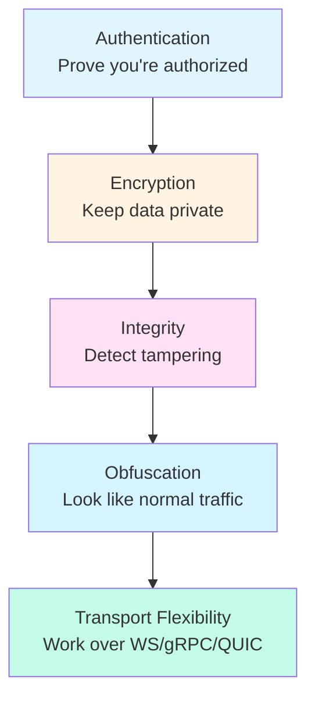
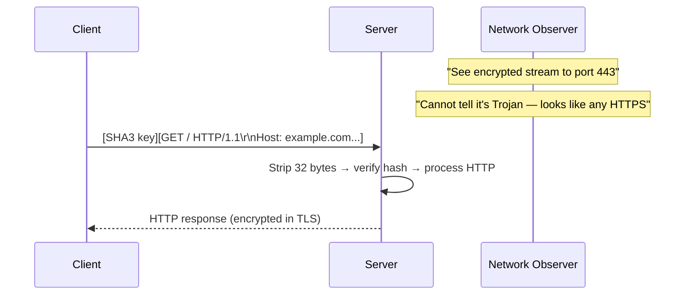
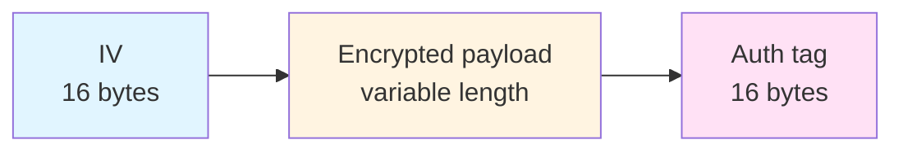
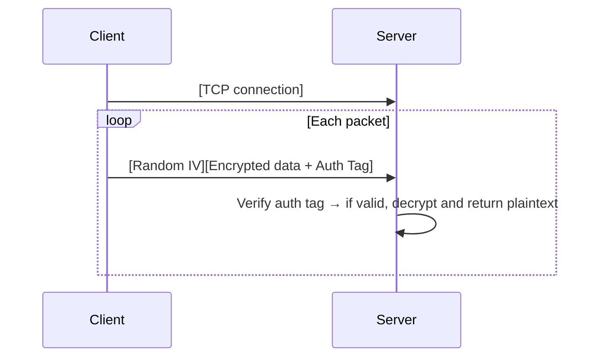
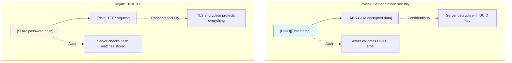
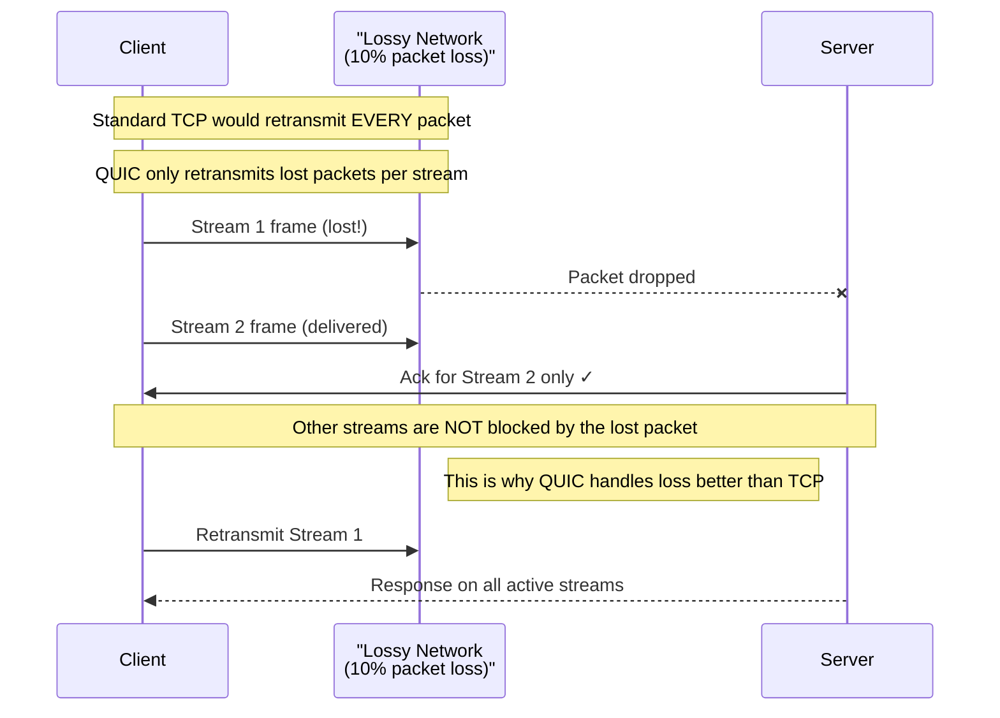
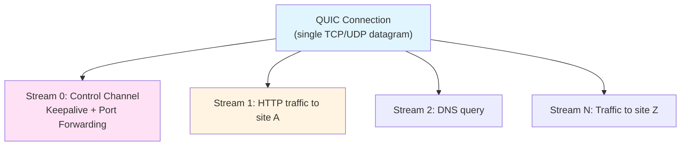
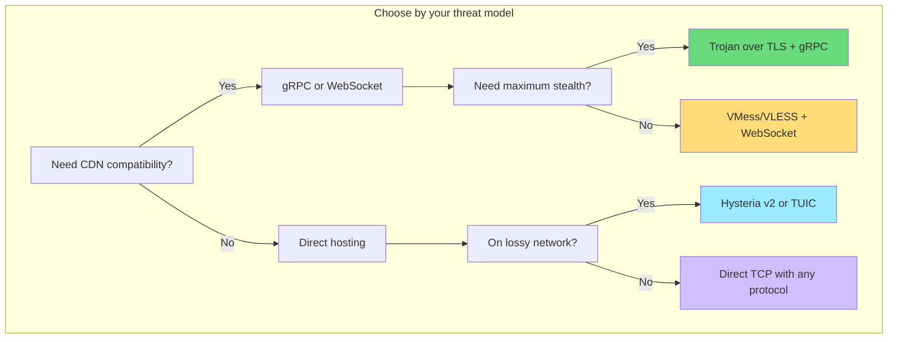

# Module 3: Proxy Protocols — The Rules of Exchange

A proxy protocol defines how client and server authenticate, encrypt, and exchange data. This module covers the major protocols used in sing-box — from the simple to the complex — with runnable examples.

---

## Lesson 1: Protocol Design Principles

Every proxy protocol needs to solve the same problems:



Different protocols solve these differently. Let's see how.

---

## Lesson 2: Trojan — Minimalist Design

Trojan's approach is famously simple: **prepend a SHA3-256 hash of the password to the HTTP request**.

### How Authentication Works

```python
# Save as trojan_auth.py
import hashlib
import hmac

def trojan_auth(password, target_url):
    """
    Trojan prepends a 256-bit key (SHA3-256 of password) 
    before sending any HTTP data.
    """
    # Server stores the hash, not the plain password
    key = hashlib.sha3_256(password.encode()).digest()
    
    # Client sends: [key][HTTP request]
    # Server strips the first 32 bytes and verifies they match the key
    
    http_request = f"GET {target_url} HTTP/1.1\r\nHost: example.com\r\n\r\n"
    authenticated_packet = key + http_request.encode()
    
    return authenticated_packet

# Demonstration
password = "my-secret-password"
packet = trojan_auth(password, "/")

print(f"Password hash (first 32 bytes): {packet[:32].hex()}")
print(f"HTTP request after hash: {packet[32:].decode()[:60]}...")

# Server-side verification
stored_hash = hashlib.sha3_256(password.encode()).digest()
received_hash = packet[:32]
if hmac.compare_digest(stored_hash, received_hash):
    print("\nAuthentication PASSED ✓")
else:
    print("\nAuthentication FAILED ✗")
```

### Why This Works



Trojan's brilliance is that **the payload IS a valid HTTP request**. If someone intercepts it, they see a normal HTTP GET. The only "secret" is the 32-byte key prepended before it, and that's just used for authentication — not encryption. The real protection comes from TLS wrapping.

### Running Trojan in sing-box

```jsonc
// Client config
{
  "outbounds": [{
    "type": "trojan",
    "tag": "trojan-out",
    "server": "proxy.example.com",
    "server_port": 443,
    "password": "my-secret-password",
    "tls": {
      "enabled": true,
      "server_name": "proxy.example.com"
    }
  }]
}
```

---

## Lesson 3: Shadowsocks — Stream Cipher Proxy

Shadowsocks uses AEAD (Authenticated Encryption with Associated Data) for each packet. Each packet has its own IV (initialization vector).

### Packet Structure



### Shadowsocks AEAD Demo

```python
# Save as shadowsocks_demo.py
from cryptography.hazmat.primitives.ciphers.aead import AESGCM
import os
import struct

def ss_aead_encrypt(key, plaintext):
    """
    Shadowsocks AEAD encryption:
    1. Generate a random IV
    2. Encrypt with AES-GCM (key + IV)
    3. Prepend IV to ciphertext
    """
    iv = os.urandom(16)  # Random per-packet IV
    aesgcm = AESGCM(key)
    
    # AEAD produces: ciphertext + 16-byte auth tag
    encrypted = aesgcm.encrypt(iv, plaintext, None)
    
    # [IV][ciphertext+auth_tag]
    return iv + encrypted

def ss_aead_decrypt(key, packet):
    """
    Reverse: extract IV, decrypt with AES-GCM
    Auth tag verification happens automatically — 
    if tampered, raises CryptographyError
    """
    iv = packet[:16]
    ciphertext_and_tag = packet[16:]
    
    aesgcm = AESGCM(key)
    try:
        plaintext = aesgcm.decrypt(iv, ciphertext_and_tag, None)
        return plaintext
    except Exception as e:
        return f"Decryption failed (auth tag mismatch): {e}"

# Demo
key = os.urandom(32)  # AES-256 key
plaintext = b"Hello from Shadowsocks!"

encrypted = ss_aead_encrypt(key, plaintext)
print(f"[Original]   {plaintext}")
print(f"[Encrypted]  ({len(encrypted)} bytes) {encrypted.hex()[:40]}...")
print(f"[IV used]    {encrypted[:16].hex()}")

decrypted = ss_aead_decrypt(key, encrypted)
print(f"[Decrypted]  {decrypted}")

# What happens with tampering?
tampered = encrypted[:-1] + bytes([(encrypted[-1] ^ 0xFF)])
print(f"\n[Tampered]   Decryption result: {ss_aead_decrypt(key, tampered)}")
```

Run it:
```bash
pip3 install cryptography
python3 shadowsocks_demo.py
```

Output will show each packet has a **different IV** (random), so identical plaintext produces different ciphertext every time. And if you tamper with even one byte of the encrypted data, decryption fails because the auth tag won't match.

### Shadowsocks Flow



**Key insight:** The IV is sent in the clear (it's not secret), but because it changes per packet, even identical data produces different encrypted outputs. This prevents pattern analysis.

---

## Lesson 4: VMess — Time + AEAD

VMess adds a time-based token to prevent replay attacks (someone recording and re-sending your traffic).

### VMess Request Structure

```python
# Save as vmess_demo.py
import os
import time
import hashlib
from cryptography.hazmat.primitives.ciphers.aead import AESGCM

def create_vmess_request(uuid_str, data):
    """
    Simplified VMess v1 request:
    
    Command byte (1) + UUID (16) + Timestamp (8) + nonce + encrypted payload
    """
    timestamp = int(time.time())
    
    # The options byte: security type, etc.
    options = bytes([0x01])  # Version 1
    
    # Build the header
    uuid_bytes = hashlib.md5(uuid_str.encode()).digest()[:16]
    
    # Create a random IV for this request
    iv = os.urandom(16)
    
    # Encrypt: AES-128-GCM with nonce derived from timestamp + options
    aesgcm = AESGCM(uuid_bytes)
    
    # The actual encrypted payload contains the real request data
    # (in real VMess, this is further encoded with option byte + length prefix)
    plaintext = options + data
    encrypted = aesgcm.encrypt(iv, plaintext, iv)  # IV used as nonce too
    
    return {
        'uuid': uuid_bytes.hex(),
        'iv': iv.hex(),
        'encrypted': encrypted.hex(),
        'timestamp': timestamp,
    }

def verify_vmess_timestamp(timestamp, tolerance=180):
    """
    VMess verifies that the server's timestamp is within 
    `tolerance` seconds of the client's timestamp.
    
    Default tolerance: 3 minutes (180 seconds)
    """
    now = int(time.time())
    diff = abs(now - timestamp)
    return diff <= tolerance

# Demo
request_data = b"GET / HTTP/1.1\r\nHost: example.com\r\n\r\n"
result = create_vmess_request("550e8400-e29b-41d4-a716-446655440000", request_data)

print(f"VMess Request:")
print(f"  UUID (first 16 bytes): {result['uuid']}")
print(f"  IV (encryption nonce): {result['iv']}")
print(f"  Encrypted payload:     {result['encrypted'][:40]}...")
print(f"  Timestamp:             {result['timestamp']}")

# Replay attack test
time.sleep(360)  # Wait 6 minutes
if verify_vmess_timestamp(result['timestamp'], tolerance=180):
    print("\n✓ Timestamp still valid (shouldn't happen in demo)")
else:
    print("\n✗ Replay blocked: timestamp expired (>3 min old)")
```

### VMess vs Trojan — Design Philosophy

| Aspect | VMess | Trojan |
|--------|-------|--------|
| **Auth** | UUID + time token | SHA3 password hash |
| **Encryption** | AES-128-GCM per request | None (relies on TLS) |
| **Replay protection** | Timestamp window | N/A (TLS provides it) |
| **Complexity** | More complex, self-contained | Minimalist, trusts TLS |



---

## Lesson 5: VLESS — The Simplified Successor

VLESS removes VMess's timestamp requirement and replaces it with flow-based control for XTLS (passing TLS directly to the proxy).

### VLESS Flow Modes

```python
# Save as vless_flow.py
"""
VLESS flow modes determine how TLS is handled:
  
  none         : Standard proxy — TLS terminates at proxy server
  xtls-rprx-direct : Direct with connection resumption (0-RTT)
  xtls-rprx-vision   : Full-duplex streams over QUIC-like transport
"""

FLOW_MODES = {
    'none': {
        'description': 'Standard TCP proxy over TLS',
        'connection': 'Single TCP stream, request/response model',
        'use_case': 'General purpose, highest compatibility',
    },
    'xtls-rprx-direct': {
        'description': 'Connection resumption with direct mode',
        'connection': 'Uses TLS 0-RTT resumption for fast reconnects',
        'use_case': 'Mobile clients that frequently reconnect',
    },
    'xtls-rprx-vision': {
        'description': 'Full-duplex over encrypted QUIC-like streams',
        'connection': 'Bidirectional streams, no request/response pairing',
        'use_case': 'Low-latency, high-throughput scenarios',
    }
}

for mode, info in FLOW_MODES.items():
    print(f"\n{mode}:")
    for key, value in info.items():
        print(f"  {key:20} {value}")
```

VLESS adds a **version byte** (VMess didn't have one) and uses the first few bytes to indicate the flow mode. This is how sing-box's VLESS outbound knows which transport strategy to use.

---

## Lesson 6: Hysteria v2 — Built for Bad Networks

Hysteria v2 is designed for high-latency, lossy connections (satellite, congested networks).

### Key Innovation: QUIC-Based with Obfuscation

```python
# Save as hysteria_concept.py
"""
Hysteria v2 runs on QUIC, which provides:
1. Multiplexed streams (no head-of-line blocking per stream)
2. Built-in connection migration
3. 0-RTT resumption
   
Plus its own obfuscation layer that makes traffic look like HTTP/2.
"""

import hashlib

def hysteria_obfuscate(payload, password):
    """
    Simplified version of Hysteria's obfuscation:
    
    XOR-based obfuscation: payload is XORed with a 
    SHA256-derived keystroke based on the connection password.
    
    This makes it look like random HTTP/2 frames to DPI tools.
    """
    key_stream = hashlib.sha256(password.encode() + b'\x00').digest()
    obfuscated = bytes([payload[i] ^ key_stream[i % len(key_stream)] 
                        for i in range(len(payload))])
    return obfuscated

# Demo
password = "hysteria-secret"
original = b"GET / HTTP/1.1\r\nHost: example.com\r\n\r\n" + b'\x00' * 50
obfuscated = hysteria_obfuscate(original, password)

print(f"[Original]   First 40 bytes: {original[:40].hex()}")
print(f"[Obfuscated] First 40 bytes: {obfuscated[:40].hex()}")
print(f"\nNotice: obfuscated data looks random to DPI scanners.")
print(f"Reversible: XOR with same key restores original.")
```

### Hysteria Flow on Lossy Networks



---

## Lesson 7: TUIC — QUIC-Native Proxy

TUIC runs directly on QUIC without any HTTP wrapper. Each "connection" is a QUIC connection with multiple multiplexed streams.

### TUIC Stream Model



Unlike other protocols that create one TCP connection per destination, TUIC keeps **everything on one QUIC connection**. This eliminates the TLS handshake overhead for each new destination.

---

## Lesson 8: MASQUE — The RFC Standard

MASQUE (RFC 9230) is an IETF standard for proxy over HTTP/MASQUE protocols. It's designed to work on ANY HTTP infrastructure.

### MASQUE Proxy Method

```
MASQUE uses the HTTP PROXY method (not CONNECT):
  
  PROXY /path HTTP/1.1
  Host: destination.example.com
  X-Forwarded-For: client-real-ip
  
  [request body]
```

This looks like a regular HTTP request to any intermediate server. The `X-Forwarded-For` header tells the MASQUE proxy who the original client was.

---

## Putting It All Together — Protocol Selection Matrix



---

## Exercises

### Exercise 1: Build a Minimal AEAD Proxy Packet

```python
# Save as min_proxy.py — the smallest possible proxy in ~30 lines
import os, hashlib
from cryptography.hazmat.primitives.ciphers.aead import AESGCM

class SimpleProxy:
    def __init__(self, password):
        self.key = hashlib.sha256(password.encode()).digest()  # 32 bytes = AES-256
    
    def send(self, plaintext):
        iv = os.urandom(16)
        encrypted = AESGCM(self.key).encrypt(iv, plaintext, None)
        return iv + encrypted  # [IV][ciphertext+tag]
    
    def receive(self, packet):
        iv = packet[:16]
        return AESGCM(self.key).decrypt(iv, packet[16:], None)

# Test it
proxy = SimpleProxy("my-secret")
original = b"Hello, this is proxied data!"
sent = proxy.send(original)
received = proxy.receive(sent)

print(f"Sent (encrypted): {sent.hex()[:40]}... ({len(sent)} bytes)")
print(f"Received: {received}")

# Verify different IVs each time
sent2 = proxy.send(original)
print(f"\nSecond encryption (different IV): {sent2.hex()[:40]}...")
assert sent != sent2, "IV changed even though plaintext is the same ✓"
```

### Exercise 2: Compare Encryption Overhead

```python
import os
from cryptography.hazmat.primitives.ciphers.aead import AESGCM

key = os.urandom(32)
payloads = [64, 256, 1024, 4096, 65536]

print(f"{'Payload':>10} {'IV':>4} {'Auth Tag':>8} {'Total':>8} {'Overhead':>10}")
print("-" * 45)

for size in payloads:
    data = b'X' * size
    iv = os.urandom(16)
    encrypted = AESGCM(key).encrypt(iv, data, None)
    overhead = len(encrypted) - size
    pct = overhead / size * 100
    print(f"{size:>10} {16:>4} {16:>8} {len(encrypted):>8} {overhead:>7} bytes ({pct:.1f}%)")

print("\nConclusion: AEAD adds 32 bytes (16 IV + 16 tag) regardless of payload size.")
print("For large proxy traffic, this is negligible overhead.")
```

Run it:
```bash
python3 min_proxy.py && python3 overhead_compare.py
```

---

*Next: [Module 4: Routing Engine](04_routing-engine.md) — How sing-box decides which outbound to use for each request.*
