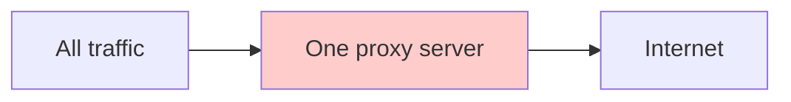
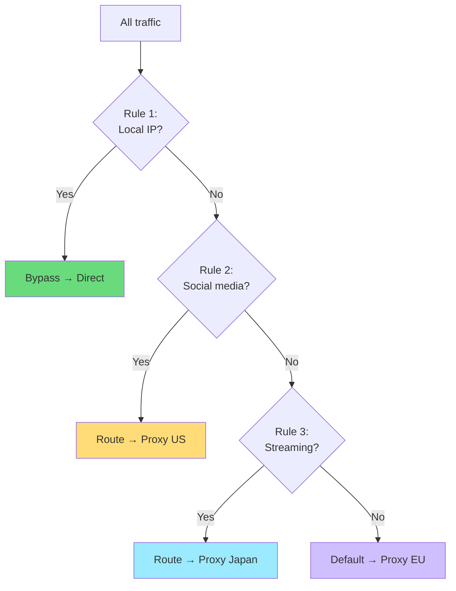
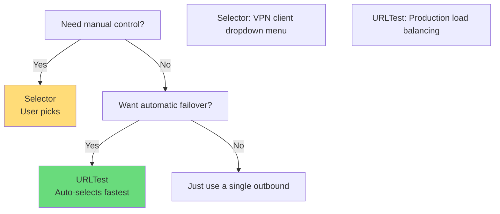

# Module 4: Routing Engine — The Traffic Cop

This module explains how sing-box decides where to send each request. You'll learn about rule-based routing, pre-match optimization, outbound groups, and metadata enrichment — with runnable examples.

---

## Lesson 1: The Problem Sing-Box Routing Solves

### Single Proxy Is Too Simple



Problems:
- If the proxy is slow, everything is slow
- Some destinations (local services) don't need a proxy
- You might want different proxies for different regions

### The Solution: Rule-Based Routing



This is **sing-box's routing engine**: ordered rules, first match wins.

---

## Lesson 2: Building a Simple Rule Engine

Let's build a mini routing engine from scratch to understand the concept.

```python
# Save as router.py — A minimal rule-based router
import re
from dataclasses import dataclass, field
from typing import List, Callable

@dataclass
class ConnectionMetadata:
    """What we know about a connection"""
    destination_domain: str = ""
    destination_ip: str = ""
    destination_port: int = 0
    source_port: int = 0
    network: str = "tcp"  # "tcp" or "udp"
    process_name: str = ""

@dataclass  
class Rule:
    name: str
    condition: Callable[[ConnectionMetadata], bool]
    action: str
    weight: int = 0  # For sorting rules by priority
    
    def matches(self, meta: ConnectionMetadata) -> bool:
        return self.condition(meta)

class Router:
    def __init__(self):
        self.rules: List[Rule] = []
    
    def add_rule(self, rule: Rule):
        self.rules.append(rule)
    
    def route(self, metadata: ConnectionMetadata) -> str:
        """Find the first matching rule and return its action"""
        for rule in self.rules:
            if rule.matches(metadata):
                print(f"  → Matched rule: {rule.name} (action: {rule.action})")
                return rule.action
        
        # Default action if no rule matches
        print("  → No rule matched. Using default.")
        return "direct"

# ===== Example Rules =====
router = Router()

# Rule: Bypass local networks
router.add_rule(Rule(
    name="bypass_local",
    condition=lambda m: m.destination_ip.startswith(("10.", "172.16.", "192.168.")),
    action="direct"
))

# Rule: DNS traffic (port 53) goes to direct
router.add_rule(Rule(
    name="bypass_dns", 
    condition=lambda m: m.destination_port == 53,
    action="direct"
))

# Rule: Block trackers by domain
tracker_pattern = re.compile(r'\.(ads?|tracker|analytics)\.')
router.add_rule(Rule(
    name="block_trackers",
    condition=lambda m: tracker_pattern.search(m.destination_domain) is not None,
    action="reject"
))

# Rule: Social media through US proxy
social_domains = {"facebook.com", "twitter.com", "instagram.com", "tiktok.com"}
router.add_rule(Rule(
    name="us_proxy_social",
    condition=lambda m: any(m.destination_domain.endswith(d) for d in social_domains),
    action="proxy_us"
))

# Rule: Chinese domains through local proxy
router.add_rule(Rule(
    name="cn_proxy_local",
    condition=lambda m: m.destination_domain.endswith((".cn", ".com.cn")),
    action="proxy_local"
))

# Default rule
router.add_rule(Rule(
    name="default_proxy",
    condition=lambda m: True,  # Always matches
    action="proxy_eu"
))

# ===== Test the Router =====
print("=== Routing Tests ===\n")

tests = [
    ConnectionMetadata(destination_ip="192.168.1.100", destination_port=80),
    ConnectionMetadata(destination_ip="8.8.8.8", destination_port=53),
    ConnectionMetadata(destination_domain="ads.google.com"),
    ConnectionMetadata(destination_domain="twitter.com"),
    ConnectionMetadata(destination_domain="baidu.cn"),
    ConnectionMetadata(destination_domain="github.com"),
]

for test in tests:
    print(f"Request: {test.destination_domain or test.destination_ip}:{test.destination_port}")
    action = router.route(test)
    print(f"  Result: {action}\n")
```

Run it:
```bash
python3 router.py
```

Output demonstrates the **ordered rule matching** principle — each request is evaluated top-to-bottom, and the first match wins.

---

## Lesson 3: Pre-Match — Fast-Path Decision Making

Before allocating a full connection, sing-box looks at the **first few packets** to make an early decision. This saves resources by not creating connections that will be rejected.

### The Pre-Match Flow

```mermaid
sequenceDiagram
    participant T as Traffic arrives
    participant S as Sniffer<br/>Reads first packets
    participant F as FakeIP Lookup<br/>Is this IP from our pool?
    participant P : Pre-Match Verdict
    
    T->>S: First 1-2 packets
    S->>P: "This is a TLS connection to example.com (SNI)"
    F->>P: "198.18.0.5 → example.com (FakeIP store)"
    
    alt Match rule "bypass_local"
        P-->>T: PreMatchBypass (no connection needed)
    else Match rule "route_proxy"
        P-->>T: PreMatchFlow (create connection)
    else Block list hit
        P-->>T: PreMatchReject (drop immediately)
    end
```

### What Sniffing Detects

```python
# Save as sniffer.py — Protocol sniffing from first packets
import struct

def sniff_tls_sni(data: bytes) -> str | None:
    """
    Extract the Server Name Indication (SNI) from a TLS Client Hello.
    
    The SNI tells the server which domain the client wants to visit.
    It's sent in plaintext even though the rest of the handshake is encrypted.
    """
    # TLS record: content_type(1) + version(2) + length(2)
    if len(data) < 5 or data[0] != 0x16:  # 0x16 = Handshake
        return None
    
    # Client Hello handshake: type(1) + length(3) + client_version(2)
    if len(data) < 42 or data[5] != 0x01:  # 0x01 = ClientHello
        return None
    
    # Find the extensions section
    offset = 42  # After basic Client Hello header
    while offset + 4 <= len(data):
        ext_type = struct.unpack('!H', data[offset:offset+2])[0]
        ext_len = struct.unpack('!H', data[offset+2:offset+4])[0]
        
        if ext_type == 0x0000:  # SNI extension
            offset += 4
            sni_list_len = struct.unpack('!H', data[offset:offset+2])[0]
            offset += 2
            
            while offset + 5 <= sni_list_len + (offset - 4):
                sni_type = data[offset]
                sni_len = struct.unpack('!H', data[offset+1:offset+3])[0]
                offset += 3
                
                if sni_type == 0x01:  # hostname type
                    sni = data[offset:offset+sni_len].decode('utf-8', errors='replace')
                    return sni
            
            break
        
        offset += 4 + ext_len
    
    return None

def sniff_http_host(data: bytes) -> str | None:
    """Extract the Host header from an HTTP request"""
    if data.startswith((b'GET ', b'POST ', b'PUT ', b'DELETE ')):
        lines = data.split(b'\r\n')
        for line in lines:
            if line.lower().startswith(b'host:'):
                return line[5:].strip().decode('utf-8', errors='replace').split(':')[0]
    return None

def sniff_quic_domain(data: bytes) -> str | None:
    """
    Extract domain from QUIC Initial packet (SNI is in the encrypted part,
    but some implementations leak it).
    
    This is simplified — real QUIC sniffing is more complex.
    """
    # QUIC packet header: version(4) if 0x0a0a0a0a
    if len(data) >= 4 and data[0] & 0xf0 == 0x50:  # QUIC long header
        return None  # SNI would need decryption
    
    return None

# Demo
print("=== Protocol Sniffing Demo ===\n")

# Test TLS SNI extraction (simulated Client Hello)
# In real use, this would be the first bytes from a TCP socket
tls_sample = bytes([
    0x16,                          # Content type: Handshake
    0x03, 0x03,                    # TLS 1.3
    0x00, 0xdc,                    # Length
    0x01,                          # ClientHello
    0x00, 0xd8, 0x00,              # Length + version (TLS 1.2 for compat)
    0x00, 0x00, 0x00, 0x00,        # Random bytes (32 bytes in real)
    0x00,                          # Session ID length
])

# Add SNI extension manually (simplified)
sni = b"example.com"
sni_ext = struct.pack('!HH', 0, 5 + 4 + len(sni))  # Extension type + length
sni_ext += struct.pack('!H', len(sni) + 3)          # SNI list length
sni_ext += struct.pack('!BH', 0x01, len(sni))       # Type: hostname + length
sni_ext += sni

# We'd need more bytes for a valid packet, but let's just test the concept
print(f"TLS SNI extraction from partial packet:")
print(f"  First byte (content type): 0x{tls_sample[0]:02x} ({'Handshake' if tls_sample[0] == 0x16 else 'Other'})")

# Test HTTP host extraction
http_sample = b"GET / HTTP/1.1\r\nHost: api.github.com\r\nUser-Agent: curl\r\n\r\n"
host = sniff_http_host(http_sample)
print(f"\nHTTP Host header: {host}")

# Real-world usage: sing-box does this on the first packet of every connection
print("\n=== How sing-box uses sniffing ===")
print("1. Connection arrives at TUN interface")
print("2. Read first 5-10 KB (before allocating full outbound)")
print("3. If TLS → extract SNI = destination domain")
print("4. If HTTP → extract Host header")  
print("5. If QUIC → attempt to extract domain from encrypted payload")
print("6. Match extracted domain against routing rules")
print("7. Decision made BEFORE creating outbound connection")
```

Run it:
```bash
python3 sniffer.py
```

**Why pre-match matters:** Without pre-match, sing-box would create a full TCP connection to the proxy **before** knowing if it should. If the destination is on your block list or local network, that's wasted time and bandwidth. Pre-match catches these cases in milliseconds.

---

## Lesson 4: Outbound Groups — Selector vs URLTest

### Selector — Manual Choice with History

```python
# Save as selector.py
class Selector:
    """Manual outbound selection with health tracking"""
    
    def __init__(self, tag, outbounds):
        self.tag = tag
        self.outbounds = {o['tag']: o for o in outbounds}
        self.selected_tag = None
        self.history = {}  # Health check results
    
    def select(self, tag):
        """User manually selects an outbound"""
        if tag not in self.outbounds:
            raise ValueError(f"Unknown outbound: {tag}")
        self.selected_tag = tag
        print(f"[Selector] '{self.tag}' → {tag} (manual)")
    
    def get(self) -> dict:
        """Get the currently selected outbound"""
        if not self.selected_tag:
            return None
        return self.outbounds.get(self.selected_tag)
    
    def mark_unhealthy(self, tag):
        """Mark an outbound as unhealthy"""
        self.history[tag] = 'unhealthy'
        
    def set_latency(self, tag, latency_ms):
        """Record latency from health check"""
        self.history[tag] = {
            'latency': latency_ms, 
            'status': 'healthy' if latency_ms < 5000 else 'degraded'
        }

# Demo
proxy_list = [
    {'tag': 'us-east', 'server': 'us.example.com', 'port': 443},
    {'tag': 'us-west', 'server': 'ca.example.com', 'port': 443},
    {'tag': 'eu-central', 'server': 'de.example.com', 'port': 443},
]

selector = Selector('load-balancer', proxy_list)
selector.select('us-east')
selector.set_latency('us-west', 120)
selector.set_latency('eu-central', 280)

selected = selector.get()
print(f"\nCurrently using: {selected}")
```

### URLTest — Automatic Health-Based Selection

```python
# Save as urltest.py
import random
import time

class URLTest:
    """Automatic selection based on latency and health"""
    
    def __init__(self, tag, outbounds, interval=30):
        self.tag = tag
        self.outbounds = {o['tag']: o for o in outbounds}
        self.latencies = {}  # {tag: avg_latency_ms}
        self.intervals = interval
    
    def simulate_health_check(self, tag):
        """Simulate measuring latency to an outbound"""
        # In real sing-box, this does a real TCP connect + proxy handshake
        return random.randint(20, 3000)  # ms
    
    def health_check_all(self):
        """Run health checks on all outbounds"""
        print(f"[URLTest] Running health checks...")
        for tag in self.outbounds:
            latency = self.simulate_health_check(tag)
            self.latencies[tag] = latency
            status = "✓" if latency < 2000 else ("⚠" if latency < 5000 else "✗")
            print(f"    {tag:15} {latency:6.0f}ms {status}")
    
    def get_best(self) -> str | None:
        """Return the outbound with lowest healthy latency"""
        healthy = {t: l for t, l in self.latencies.items() if l < 5000}
        if not healthy:
            return None
        return min(healthy, key=healthy.get)
    
    def get(self) -> dict | None:
        """Get the best outbound"""
        best = self.get_best()
        if best and best in self.outbounds:
            print(f"[URLTest] Selected: {best} ({self.latencies[best]}ms)")
            return self.outbounds[best]
        print("[URLTest] No healthy outbounds available")
        return None

# Demo
outbounds = [
    {'tag': 'us-east', 'server': 'us.example.com', 'port': 443},
    {'tag': 'us-west', 'server': 'ca.example.com', 'port': 443},
    {'tag': 'eu-central', 'server': 'de.example.com', 'port': 443},
    {'tag': 'asia-south', 'server': 'sg.example.com', 'port': 443},
]

tester = URLTest('auto-select', outbounds, interval=10)
tester.health_check_all()

print(f"\nBest choice: {tester.get()['tag']}")
```

Run it:
```bash
python3 urltest.py
```

### Selector vs URLTest — When to Use Which



---

## Lesson 5: Metadata Enrichment

Before matching rules, sing-box enriches each connection with extra data:

```python
# Save as enrichment.py
from dataclasses import dataclass
import re

@dataclass
class RichMetadata:
    """Connection metadata after full enrichment"""
    domain: str = ""
    ip: str = ""
    port: int = 0
    process_name: str = ""       # Who initiated the connection?
    source_ip: str = ""           # Source IP address
    source_mac: str = ""          # Source MAC (for device-based routing)
    network: str = "tcp"
    sniffed_protocol: str = ""    # What protocol was detected?

def enrich_with_process(metadata):
    """Determine which process owns this connection"""
    # In Linux, this reads /proc/net/tcp and matches to process files
    # For demo, we simulate it
    process_map = {
        '443': 'chrome',
        '80': ['firefox', 'curl'],
        '53': 'systemd-resolved',
    }
    return process_map.get(str(metadata.port), 'unknown')

def enrich_with_neighbor(metadata):
    """Look up source MAC from ARP table"""
    # In Linux: arp -n or ip neigh show
    mac_map = {
        '192.168.1.10': 'aa:bb:cc:dd:ee:01',  # Your laptop
        '192.168.1.20': 'aa:bb:cc:dd:ee:02',  # Your phone
    }
    return mac_map.get(metadata.source_ip, 'unknown')

# Demo enrichment flow
base_metadata = RichMetadata(
    domain="", ip="192.168.1.10", port=443, source_ip="192.168.1.10", network="tcp"
)

print("=== Enrichment Pipeline ===\n")
print(f"Base:  domain=?, port={base_metadata.port}, src_ip={base_metadata.source_ip}")

# Step 1: Sniffing (already done in pre-match)
base_metadata.domain = "example.com"  # Extracted from TLS SNI
base_metadata.sniffed_protocol = "tls"
print(f"After sniff: domain={base_metadata.domain}")

# Step 2: Process enrichment  
base_metadata.process_name = enrich_with_process(base_metadata)
print(f"After process: process={base_metadata.process_name}")

# Step 3: Neighbor (MAC) enrichment
base_metadata.source_mac = enrich_with_neighbor(base_metadata)
print(f"After neighbor: mac={base_metadata.source_mac}")

# Now match against enriched metadata
print(f"\n=== Enriched Metadata ===")
print(f"Domain:    {base_metadata.domain}")
print(f"Process:   {base_metadata.process_name}")  
print(f"Source MAC:{base_metadata.source_mac}")
print(f"Port:      {base_metadata.port}")

print("\nThis enriched metadata is what rules see:")
print(f"  Rule: 'process=chrome AND domain ends with facebook.com → use US proxy'")
```

---

## Exercises

### Exercise 1: Build a Complete Router

Combine everything from this module into a single routing system:

```python
# Save as full_router.py — put it in the course folder
import re, random, time
from dataclasses import dataclass
from typing import List, Callable, Dict

@dataclass
class Metadata:
    domain: str = ""
    ip: str = ""
    port: int = 0
    process: str = ""
    network: str = "tcp"

class Rule:
    def __init__(self, name: str, condition: Callable[[Metadata], bool], action: str):
        self.name = name
        self.condition = condition
        self.action = action
    
    def match(self, meta: Metadata) -> bool:
        return self.condition(meta)

class OutboundGroup:
    def __init__(self, tag: str, type_: str, outbounds: List[str]):
        self.tag = tag
        self.type = type_  # "selector" or "urltest"
        self.outbounds = outbounds
    
    def resolve(self) -> str:
        if self.type == "selector":
            return random.choice(self.outbounds)
        else:  # urltest — pick lowest latency
            latencies = {o: random.randint(20, 500) for o in self.outbounds}
            return min(latencies, key=latencies.get)

class FullRouter:
    def __init__(self):
        self.rules: List[Rule] = []
        self.groups: Dict[str, OutboundGroup] = {}
    
    def add_rule(self, rule: Rule):
        self.rules.append(rule)
    
    def add_group(self, group: OutboundGroup):
        self.groups[group.tag] = group
    
    def resolve_outbound(self, action_str: str) -> str:
        """If action references a group, resolve it"""
        if action_str in self.groups:
            return self.groups[action_str].resolve()
        return action_str
    
    def route(self, meta: Metadata) -> str:
        for rule in self.rules:
            if rule.match(meta):
                outbound = self.resolve_outbound(rule.action)
                print(f"  Rule: {rule.name} → Outbound: {outbound}")
                return outbound
        return "direct"

# ===== Setup =====
router = FullRouter()

# Define groups
router.add_group(OutboundGroup('auto', 'urltest', ['us1', 'us2', 'eu1']))
router.add_group(OutboundGroup('manual', 'selector', ['us1', 'eu1', 'asia1']))

# Define rules
router.add_rule(Rule("bypass_local", 
    lambda m: m.ip.startswith(("10.", "192.168.", "172.")), "direct"))
router.add_rule(Rule("dns_traffic",
    lambda m: m.port == 53, "direct"))
router.add_rule(Rule("block_ads",
    lambda m: re.search(r'(ads|tracker|analytics)', m.domain), "reject"))
router.add_rule(Rule("social_media",
    lambda m: any(m.domain.endswith(d) for d in ['facebook.com', 'twitter.com']), "manual"))
router.add_rule(Rule("default", lambda m: True, "auto"))

# Test
requests = [
    Metadata(ip="192.168.1.10", port=80),
    Metadata(domain="tracker.example.com"),
    Metadata(domain="facebook.com", process="chrome"),
    Metadata(domain="github.com"),
]

for req in requests:
    print(f"Request: {req.domain or req.ip}:{req.port}")
    router.route(req)
    print()
```

Run it:
```bash
python3 full_router.py
```

---

*Next: [Module 5: DNS System](05_dns-system.md) — FakeIP, DNS-over-HTTPS, and the rule-based DNS router.*
