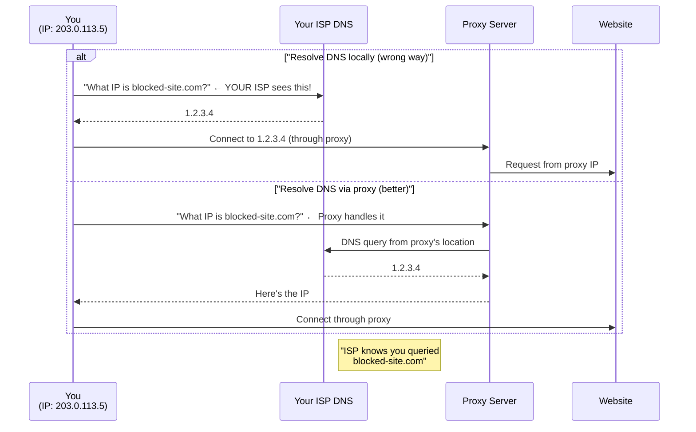
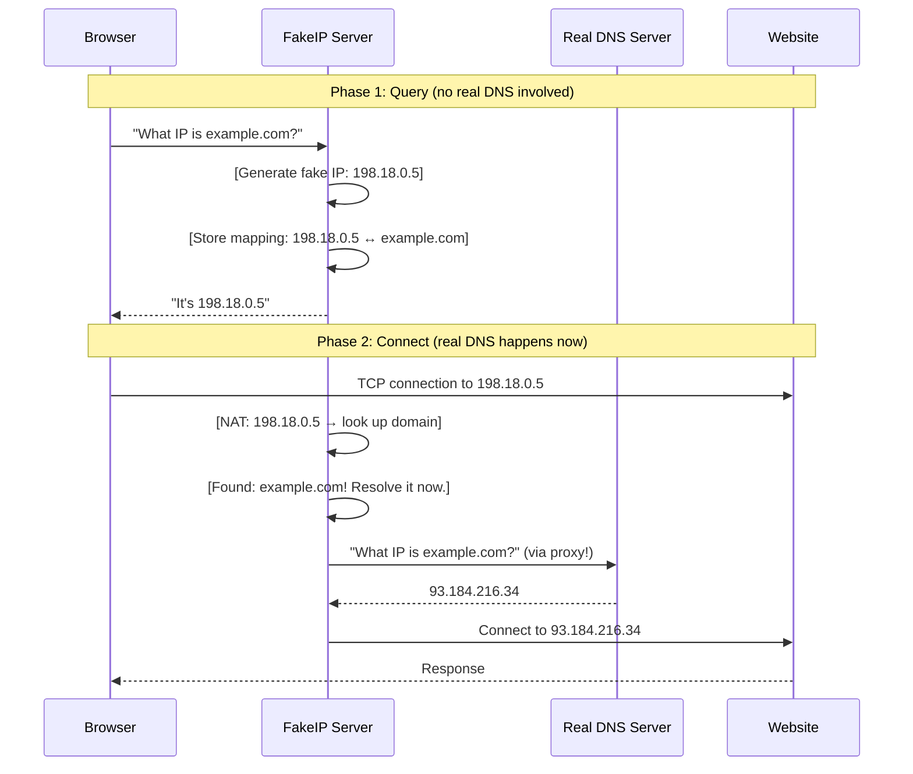

# Module 5: DNS System — The Address Book Problem

This module covers how sing-box handles DNS — from basic resolution to FakeIP deferral, encrypted DNS transports (DoH/DoT), and the rule-based DNS router. You'll run real `dig` commands and see DNS in action.

---

## Lesson 1: The DNS Problem for Proxies

### Why DNS Matters When Using a Proxy



**The leak:** When your device resolves DNS locally, your ISP (or firewall) sees the query. Even though the actual website traffic goes through the proxy, the DNS query reveals which sites you want to visit.

---

## Lesson 2: Hands-On DNS with dig

### Your First DNS Query

```bash
# Basic A record lookup (IPv4 address)
dig example.com +short
# Output: 93.184.216.34

# See the full query response with headers
dig example.com

# Query a specific DNS server
dig @8.8.8.8 example.com +short      # Google DNS
dig @1.1.1.1 example.com +short       # Cloudflare DNS
dig @208.67.222.222 example.com +short # OpenDNS

# Try different record types
dig example.com MX     # Mail servers
dig example.com TXT    # Text records (often used for verification)
dig example.com ANY    # All records (some DNS servers limit this)
```

### Understanding the dig Output

```bash
dig example.com +noall +answer +comments
```

Output:
```
;; ANSWER SECTION:
example.com.            300   IN  A   93.184.216.34

;; AUTHORITY SECTION:
example.com.            86400 IN  NS  a.iana-servers.net.
example.com.            86400 IN  NS  b.iana-servers.net.

;; ADDITIONAL SECTION:
a.iana-servers.net.     86400 IN  A   2001:500:2::c
```

- **ANSWER**: The records that directly answer your query
- **AUTHORITY**: NS (name server) records — who's authoritative for this domain
- **ADDITIONAL**: Extra info, like IP addresses of the name servers

---

## Lesson 3: DNS Tracing — How Resolution Actually Works

```bash
# Trace the full DNS resolution chain
dig example.com +trace 2>&1 | head -40
```

This shows every step:
```
;; Received 53 bytes from 198.41.0.4#53 (root server)
;; Received 76 bytes from a.gtld-servers.net#53 (TLD server for .com)
;; Received 46 bytes from a.dns.example.com#53 (authoritative server)
example.com.        300   IN  A   93.184.216.34
```

The chain: **Root → TLD (.com) → Authoritative (example.com)**

```mermaid
graph TD
    A[Your computer] -->|1. "Where is example.com?"| B[Your ISP DNS resolver]
    B -->|2. "Where is example.com?"| C[Root DNS<br/>9 root servers worldwide]
    C -->|3. ".com is at these servers: ..."| D[TLD DNS<br/>.com servers]
    D -->|4. "example.com is at..."| E[Authoritative NS<br/>for example.com]
    E -->|5. "It's 93.184.216.34"| D
    D --> B
    B --> A
    
    style A fill:#e1f5ff
    style C fill:#d0bfff
    style E fill:#69db7c
```

Each arrow is a DNS query traveling across the internet. This is what your ISP sees every time you visit a new domain.

---

## Lesson 4: Encrypted DNS — DoH, DoT, DoQ

### The Problem with Plain DNS

```bash
# See that DNS is unencrypted (use tcpdump if available)
sudo tcpdump -i any port 53 -c 2 -w /tmp/dns_capture.pcap 2>/dev/null && echo "Captured to /tmp/dns_capture.pcap"
echo "(Use Wireshark or: strings <(tcpdump -A -c 10 port 53))"

# Show DNS query in plaintext
dig example.com @8.8.8.8 +short
echo "Any network observer can see this query traveling to Google DNS"
```

### DNS-over-HTTPS (DoH) — Look Like a Web Request

```bash
# DoH: your DNS query is an HTTPS POST request
curl -X POST https://dns.google/resolve \
  -H "Accept application/dns-json" \
  -d '{"name":"example.com","type":"A"}' | jq .

# Output:
// {
//   "Answer": [
//     {
//       "name": "example.com",
//       "type": 1,
//       "data": "93.184.216.34",
//       "TTL": 299
//     }
//   ]
// }
```

The query is hidden inside an HTTPS request. Your ISP sees: `POST to dns.google` — but not what domain you queried.

### DNS-over-TLS (DoT) — Encrypted on Port 853

```bash
# DoT uses a dedicated port (853) with TLS encryption
echo | openssl s_client -connect dns.google:853 2>&1 | grep "Protocol"
# Shows: TLS 1.3 — confirming the connection is encrypted
```

DoT wraps DNS queries in a TLS connection on port 853. It looks like any other TLS connection.

### DNS-over-QUIC (DoQ) — The Future

```bash
# DoQ runs DNS over QUIC (UDP-based, multiplexed)
# Use dig with experimental QUIC support
dig +tcp example.com @dns.google 2>&1 | grep "Using TCP" || echo "TCP fallback (QUIC not available)"
```

DoQ is the newest encrypted DNS protocol, running over QUIC instead of TCP or plain UDP. It offers:
- Multiplexed queries on one connection
- Connection migration (change network without dropping)
- 0-RTT resumption for faster subsequent queries

---

## Lesson 5: FakeIP — The Deferred Resolution Technique

This is where sing-box's DNS system gets really interesting.

### How FakeIP Works



### Simulating FakeIP in Python

```python
# Save as fakeip.py — A minimal FakeIP implementation
import ipaddress
import random
from typing import Optional

class FakeIPStore:
    def __init__(self, ipv4_range="198.18.0.0/15", ipv6_range="fc00::/15"):
        self.ipv4_pool = ipaddress.ip_network(ipv4_range)
        self.ipv6_pool = ipaddress.ip_network(ipv6_range)
        self.domain_to_ip: dict[str, str] = {}    # domain → fake IP
        self.ip_to_domain: dict[str, str] = {}    # fake IP → domain
    
    def _random_ip(self, network: ipaddress.IPv4Network | ipaddress.IPv6Network) -> str:
        """Generate a random IP from the pool"""
        network_int = int(network.network_address)
        broadcast_int = int(network.broadcast_address)
        random_int = random.randint(network_int, broadcast_int)
        return str(ipaddress.ip_address(random_int))
    
    def assign(self, domain: str) -> str:
        """Assign a fake IP to a domain"""
        # Prefer IPv4 for common cases
        if domain in self.domain_to_ip:
            return self.domain_to_ip[domain]
        
        ip = self._random_ip(self.ipv4_pool)
        self.domain_to_ip[domain] = ip
        self.ip_to_domain[ip] = domain
        
        print(f"  [FakeIP] {domain} → {ip}")
        return ip
    
    def lookup(self, fake_ip: str) -> Optional[str]:
        """Reverse look up the domain from a fake IP"""
        domain = self.ip_to_domain.get(fake_ip)
        if domain:
            print(f"  [FakeIP] {fake_ip} → {domain} (reverse lookup)")
        return domain

# Demo
store = FakeIPStore()

domains = ["facebook.com", "twitter.com", "github.com", "example.com"]
print("=== Phase 1: Assigning Fake IPs ===")
for domain in domains:
    fake_ip = store.assign(domain)

print("\n=== Phase 2: Reverse lookup when traffic arrives ===")
# Later, when a connection to a fake IP arrives at the router
connections = ["198.18.0.5", "198.18.1.10", "198.18.2.15"]
for ip in connections:
    domain = store.lookup(ip)

print(f"\nFakeIP mappings created:")
print(f"  {len(store.domain_to_ip)} domains → fake IPs")
print(f"  Zero real DNS queries were made!")
```

Run it:
```bash
python3 fakeip.py
```

### Why FakeIP Is Powerful

| Aspect | Normal DNS | FakeIP |
|--------|-----------|--------|
| **When is real DNS queried?** | Immediately, when user types URL | Only when connection to that domain is needed |
| **DNS leak risk** | High — ISP sees every query | None — queries happen through the proxy |
| **Speed** | DNS lookup adds latency before connection | Instant response; DNS happens in background |
| **Domain-based routing** | Must resolve first, then route | Already know domain from FakeIP → route immediately |

---

## Lesson 6: DNS Caching — Avoiding Repeated Queries

```python
# Save as dns_cache.py
import time
from collections import OrderedDict

class LRUDNSCache:
    """Least Recently Used DNS cache with TTL"""
    
    def __init__(self, max_entries=1024, default_ttl=300):
        self.cache = OrderedDict()  # domain → (ip, expires_at)
        self.max_entries = max_entries
        self.default_ttl = default_ttl
        self.hits = 0
        self.misses = 0
    
    def get(self, domain: str) -> str | None:
        """Get cached IP if it exists and isn't expired"""
        if domain in self.cache:
            ip, expires_at = self.cache[domain]
            if time.time() < expires_at:
                self.cache.move_to_end(domain)  # Mark as recently used
                self.hits += 1
                return ip
            else:
                del self.cache[domain]  # Expired
        
        self.misses += 1
        return None
    
    def set(self, domain: str, ip: str, ttl: int = None):
        """Cache a DNS response"""
        if domain in self.cache:
            del self.cache[domain]
        
        self.cache[domain] = (ip, time.time() + (ttl or self.default_ttl))
        
        # Evict oldest entries if over capacity
        while len(self.cache) > self.max_entries:
            self.cache.popitem(last=False)
    
    def stats(self):
        total = self.hits + self.misses
        ratio = self.hits / total * 100 if total > 0 else 0
        return f"Cache: {self.hits} hits, {self.misses} misses ({ratio:.1f%} hit rate)"

# Demo — Simulate real browsing patterns
cache = LRUDNSCache(max_entries=5)
print("=== DNS Cache Simulation ===\n")

# Visit facebook.com multiple times (with caching)
result = cache.get("facebook.com") or "8.8.8.8"
cache.set("facebook.com", "157.240.1.35", ttl=60)
print(f"1st visit to facebook.com: {result} [CACHE MISS]")

result = cache.get("facebook.com") or "8.8.8.8"
print(f"2nd visit to facebook.com: {result} — {cache.stats()} [CACHE HIT]")

# Visit other sites (fill up the cache)
sites = [("twitter.com", "104.244.42.65"), ("github.com", "140.82.121.3")]
for domain, ip in sites:
    result = cache.get(domain) or ip
    cache.set(domain, ip)
    print(f"Visit {domain}: {result}")

# Eviction test — old entry (facebook.com) gets evicted when cache is full
print(f"\n{cache.stats()}")
result = cache.get("facebook.com")
print(f"After eviction: facebook.com = {result} [evicted, cache full]")
```

Run it:
```bash
python3 dns_cache.py
```

---

## Lesson 7: DNS Rules — Routing Queries to Different Servers

Just as traffic is routed with rules, DNS queries are also routed based on rules.

### DNS Rule Conditions

```python
# save as dns_rules.py
import re

class DNSRuleEngine:
    def __init__(self):
        self.rules = []
    
    def add_rule(self, condition_fn, action, server_name):
        self.rules.append({
            'condition': condition_fn,
            'action': action,
            'server': server_name,
        })
    
    def route_query(self, query_domain: str, query_type: str = "A") -> str:
        for rule in self.rules:
            if rule['condition'](query_domain, query_type):
                return f"Use {rule['server']}"
        return "Use default DNS"

engine = DNSRuleEngine()

# Route Google domains to Google DoH
engine.add_rule(
    lambda d, t: 'google.com' in d or 'youtube.com' in d,
    'route', 'Google_DoH'
)

# Block known ad domains via predefined response
engine.add_rule(
    lambda d, t: any(d.endswith(ad) for ad in ['.ads.google.com', 'doubleclick.net']),
    'respond', '0.0.0.0 (block)'
)

# Route Chinese domains to local DNS
engine.add_rule(
    lambda d, t: d.endswith('.cn') or d.endswith('.com.cn'),
    'route', 'local_server'
)

# Use DoH for everything else
engine.add_rule(lambda d, t: True, 'route', 'Cloudflare_DoH')

# Test queries
queries = [
    ("mail.google.com", "A"),
    ("ads.doubleclick.net", "A"),
    ("taobao.com.cn", "A"),
    ("github.com", "AAAA"),
    ("facebook.com", "A"),
]

for domain, qtype in queries:
    result = engine.route_query(domain, qtype)
    print(f"  {domain} ({qtype}) → {result}")
```

Run it:
```bash
python3 dns_rules.py
```

### How sing-box Implements DNS Rules

In sing-box, DNS rules support these advanced features beyond basic domain matching:

| Feature | What it does | Example |
|---------|-------------|---------|
| `response` | Match against previous DNS results | "If A record is 10.x.x.x, reject" |
| `query_type` | Match by DNS record type | Only match when querying AAAA records |
| `ip_version` | Match IPv4-only or IPv6-only queries | Route IPv6 through a specific server |
| `query_client_subnet` | Match based on EDNS0 SUBNET option | Different routing for different subnets |
| `response_rcode` | Match by DNS response code | "If response is NXDOMAIN, try another server" |
| `evaluate` | Store result by name for other rules to use | Query once, reference in later rules |

---

## Exercises

### Exercise 1: Measure Your DNS Speed

```bash
# Compare DNS resolution times across different servers
for server in "8.8.8.8" "1.1.1.1" "208.67.222.222"; do
    time (dig @"$server" example.com +short >/dev/null 2>&1)
done

# Compare DoH vs traditional DNS
echo "--- Traditional DNS ---"
time dig example.com +short >/dev/null

echo "--- DoH (Google) ---"
time curl -s "https://dns.google/resolve?name=example.com&type=A" | jq '.Answer[0].data' >/dev/null
```

### Exercise 2: See FakeIP in Action with sing-box

```bash
# If you have a running sing-box instance:
# Check the DNS log to see FakeIP assignments and real resolutions
journalctl -u sing-box --since "5 min ago" | grep -i "fakeip\|dns" | tail -20

# Or use the API if enabled:
curl http://localhost:9090/debug/dns 2>/dev/null | jq .
```

### Exercise 3: Simulate a DNS Cache with Real dig Output

```python
# save as real_dns_cache.py
import subprocess, time
from collections import OrderedDict

class RealDNSCache:
    def __init__(self):
        self.cache = OrderedDict()
    
    def resolve(self, domain, server="8.8.8.8"):
        if domain in self.cache:
            ip, _ = self.cache[domain]
            print(f"[CACHE HIT] {domain} → {ip}")
            return ip
        
        try:
            result = subprocess.run(
                ['dig', '+short', '+timeout=2', '+tries=1', domain],
                capture_output=True, text=True, timeout=5
            )
            ips = [line.strip() for line in result.stdout.strip().split('\n') if line.strip()]
            
            if ips:
                self.cache[domain] = (ips[0], time.time())
                print(f"[CACHE MISS] {domain} → {ips[0]}")
                return ips[0]
            else:
                print(f"[NXDOMAIN] {domain}")
                return None
        except subprocess.TimeoutExpired:
            print(f"[TIMEOUT] {domain}")
            return None

cache = RealDNSCache()

# First query — will hit real DNS
print("=== First query (real DNS) ===")
ip1 = cache.resolve("google.com")

# Second query — should be instant (from our cache)
print("\n=== Second query (cached) ===")
ip2 = cache.resolve("google.com")

# Different domain — also real DNS
print("\n=== Different domain ===")
cache.resolve("cloudflare.com")

print(f"\nCache state: {len(cache.cache)} entries stored")
```

Run it:
```bash
python3 real_dns_cache.py
```

---

*Next: [Module 6: TUN & VPN](06_tun-vpn.md) — How virtual network interfaces work and how sing-box captures all your traffic.*
