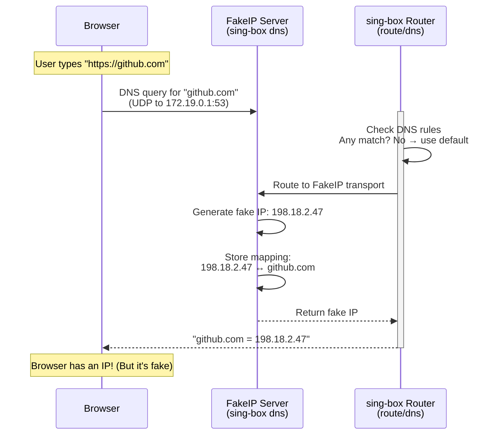
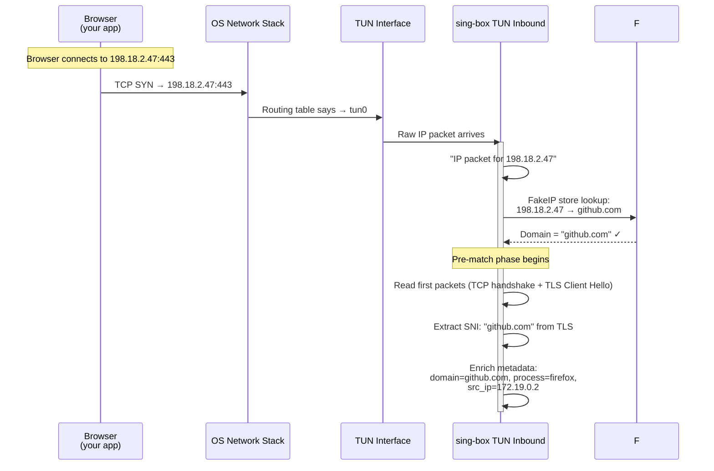
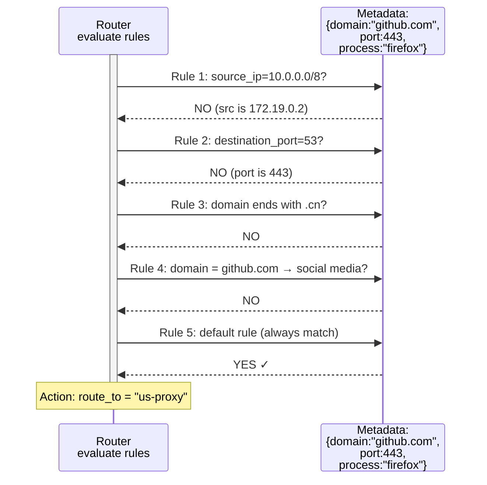
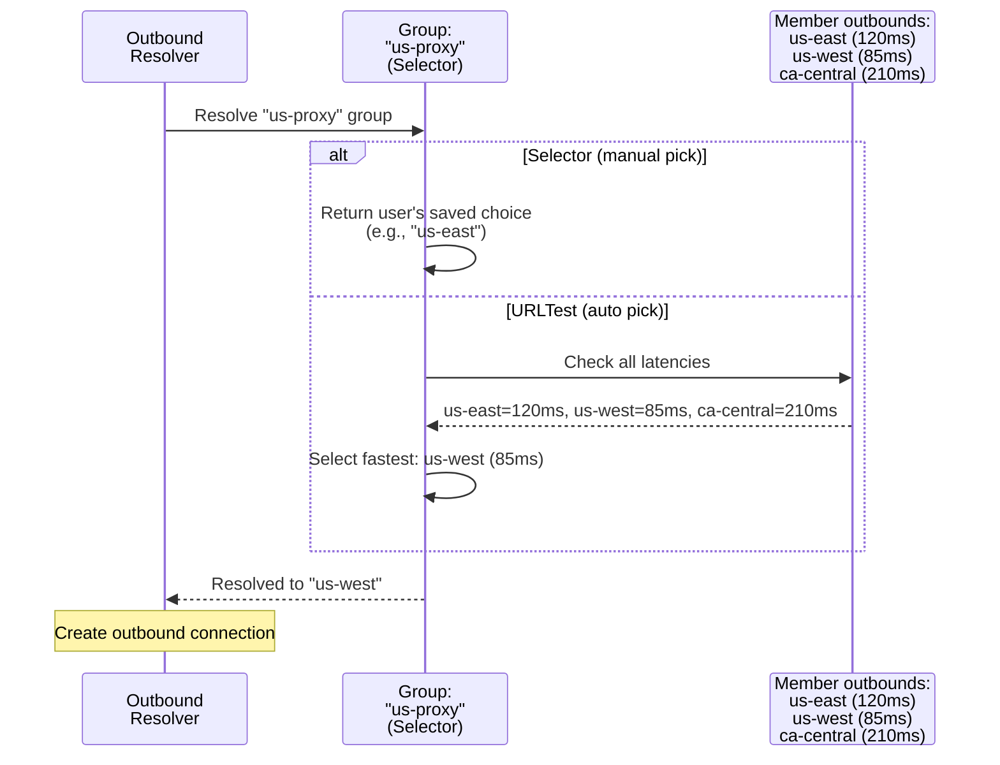
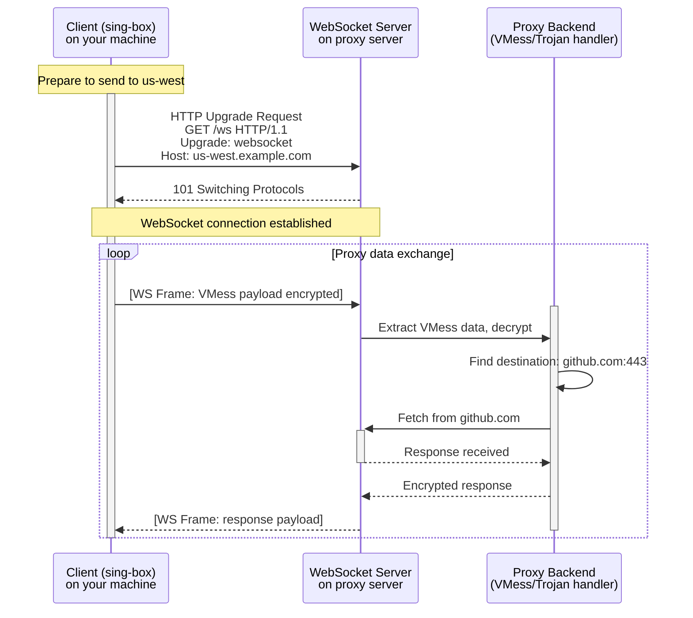
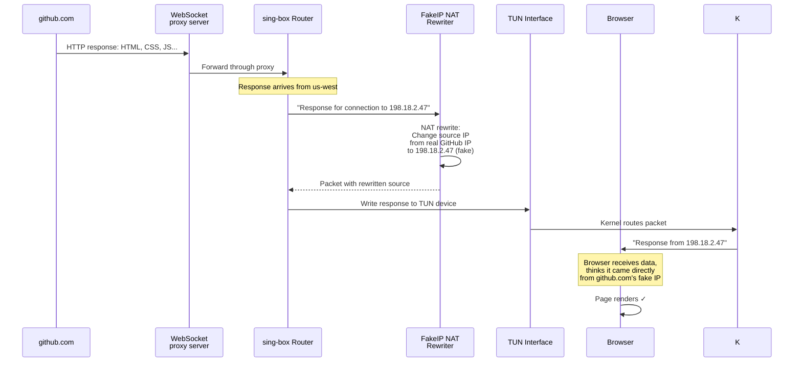
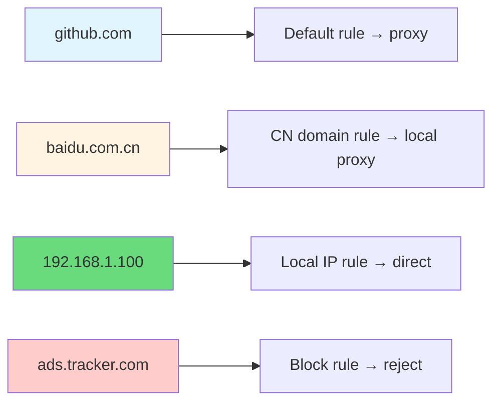
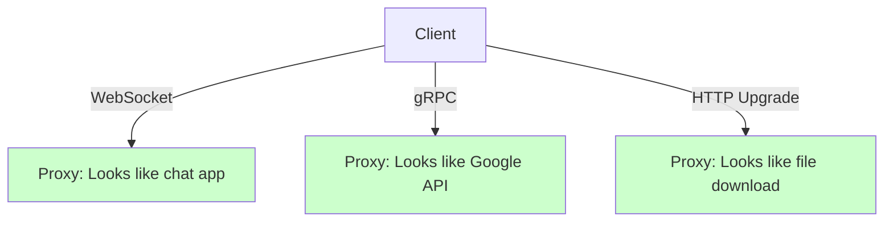
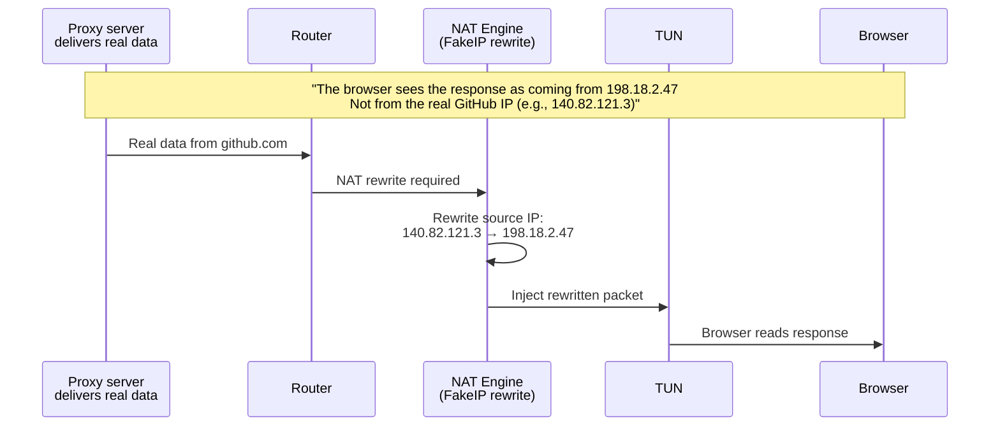
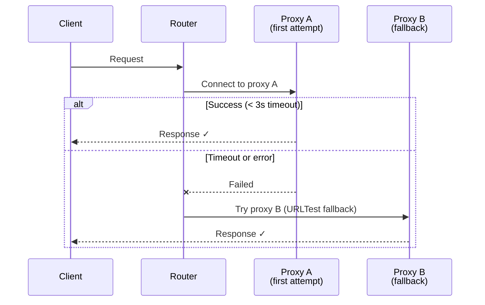

# Module 7: Complete Request Journey — End to End

This module traces a single web request through every layer of sing-box, from the moment you type a URL in your browser to the page loading on your screen. Every decision point, every transformation, every protocol exchange — all in one continuous flow.

---

## The Scenario

You configure sing-box with:
- TUN mode enabled (system-wide proxy)
- FakeIP DNS server active
- Multiple outbounds: `us-proxy`, `direct`, `block`
- Rules that route social media through US proxy, local traffic direct, everything else blocked

You type **`https://github.com`** in your browser. Let's trace every step.

---

## Phase 1: DNS Resolution (FakeIP)



**Key insight:** At no point did sing-box query a real DNS server for `github.com`. The FakeIP store now knows this domain, but won't resolve the real IP until actual traffic arrives.

---

## Phase 2: Connection Attempt



---

## Phase 3: Rule Matching



---

## Phase 4: Outbound Resolution



---

## Phase 5: Transport Encapsulation



---

## Phase 6: Response Return and NAT Rewriting



---

## Complete Timeline — Every Step in Order

```python
# save as timeline.py — A summary of the complete request journey
steps = [
    ("0ms",  "DNS Query",     "Browser asks for github.com"),
    ("1ms",  "FakeIP Assign", "198.18.2.47 ← github.com (stored, no real DNS)"),
    ("1ms",  "TCP SYN",       "Browser sends SYN to 198.18.2.47:443"),
    ("2ms",  "TUN Intercept", "OS routes packet through tun0 → sing-box"),
    ("2ms",  "FakeIP Lookup", "198.18.2.47 → github.com (domain found)"),
    ("3ms",  "Pre-Match",     "Read first packets, extract TLS SNI = 'github.com'"),
    ("3ms",  "Metadata Build","{domain:'github.com', process:'firefox', port:443}"),
    ("4ms",  "Rule Match",    "Default rule → route to 'us-proxy' group"),
    ("4ms",  "Group Resolve", "URLTest picks us-west (85ms, fastest)"),
    ("5ms",  "WS Handshake",  "HTTP Upgrade → 101 Switching Protocols"),
    ("8ms",  "Proxy Connect", "VMess payload through WebSocket to proxy server"),
    ("93ms", "Proxy Fetch",   "Proxy server fetches github.com:443 (85ms round-trip)"),
    ("94ms", "NAT Rewrite",   "Response source IP → 198.18.2.47 (fakeIP)"),
    ("95ms", "TUN Inject",    "Response written to TUN device"),
    ("96ms", "Browser Read",  "Browser receives page content ✓"),
]

print("=== Complete Request Timeline: 'https://github.com' ===\n")
print(f"{'Time':>8} | {'Phase':<20} | Description")
print("-" * 75)
for time, phase, desc in steps:
    print(f"{time:>8} | {phase:<20} | {desc}")

total = int(steps[-1][0].replace('ms', ''))
print(f"\nTotal time from DNS to page load: ~{total}ms")
print(f"Real DNS resolution would add:  +20-50ms (depends on DNS server)")
print(f"FakeIP advantage: eliminates upfront DNS delay entirely")
```

Run it:
```bash
python3 timeline.py
```

---

## Variations: What Changes?

### Same Request, Different Protocol

| If the outbound uses... | Step 5 changes to... |
|------------------------|----------------------|
| **WebSocket** | HTTP Upgrade → WS frames (as shown above) |
| **gRPC** | gRPC stream setup instead of WS upgrade |
| **Plain TCP** | Direct TLS connection, no wrapping |
| **QUIC** | QUIC handshake (UDP-based), one-step |
| **Trojan** | No transport wrapping — just SHA3 key + HTTP |

### Same Request, Different Rule Match



Each destination takes a completely different path through the system, determined by which rule matches first.

### Different Transport for Same Proxy Server



The proxy server backend is identical — same VMess/Trojan protocol. Only the transport layer (how data gets to the server) changes. This is why sing-box separates protocols from transports: **any protocol can use any transport**.

---

## Reverse Journey: The Response

The response follows the reverse path, but with one key transformation:



The NAT rewrite is what makes FakeIP seamless for the browser. The browser never learns that `github.com`'s real IP address — it only sees addresses from the FakeIP range, which belong to sing-box's internal network.

---

## What If Something Goes Wrong?

### Error Scenarios

| Failure Point | What Happens | How sing-box Handles It |
|--------------|-------------|------------------------|
| **FakeIP store full** | Can't assign new IPs | Falls back to real DNS resolution |
| **Rule match fails** | No matching rule | Uses default outbound (or blocks) |
| **Proxy server unreachable** | Connection timeout | URLTest switches to next best outbound |
| **WS server rejects** | 404/502 from proxy | Log error, try fallback outbound |
| **TLS handshake fails** | Certificate verification error | Depending on config: reject or skip verify |

### Timeout and Retry Flow



sing-box's URLTest group automatically tracks failures and avoids unhealthy outbounds for a configurable cooldown period.

---

## Exercises

### Exercise 1: Build a Complete Request Tracer

```python
# save as request_tracer.py — Track every phase of a request
import time
from dataclasses import dataclass, field
from typing import List

@dataclass
class TraceEntry:
    time: float
    phase: str
    detail: str
    duration: float = 0.0

class RequestTracer:
    def __init__(self):
        self.entries: List[TraceEntry] = []
        self._start = None
    
    def start(self):
        self._start = time.time()
    
    def step(self, phase: str, detail: str, duration: float = 0.0):
        elapsed = (time.time() - self._start) * 1000
        self.entries.append(TraceEntry(elapsed, phase, detail, duration))
    
    def print_trace(self):
        print(f"\n{'Elapsed':>10} | {'Phase':<25} | {'Detail'}")
        print("-" * 70)
        for e in self.entries:
            dur_str = f"+{e.duration*1000:.1f}ms" if e.duration > 0 else ""
            print(f"{e.time:>8.2f}ms | {e.phase:<25} | {e.detail} {dur_str}")

tracer = RequestTracer()
tracer.start()

# Simulate each phase of the request
tracer.step("DNS", "FakeIP assignment", 0.001)
tracer.step("DNS", "Stored: 198.18.2.47 → github.com")

tracer.step("TCP", "Browser → TUN interface", 0.002)
tracer.step("TUN", "Packet received by sing-box")

tracer.step("PreMatch", "SNI extraction: 'github.com'", 0.003)
tracer.step("PreMatch", "Metadata enriched (process, src_ip)")

tracer.step("Routing", "Rule 5 (default) matched")
tracer.step("Routing", "Group 'us-proxy' → URLTest selects us-west")

tracer.step("Transport", "WebSocket upgrade request sent")
tracer.step("Transport", "101 Switching Protocols received")

tracer.step("Proxy", "VMess payload encapsulated and sent")
tracer.step("Proxy", "Response received from proxy server", 0.085)

tracer.step("NAT", "Source IP rewritten: 140.82.121.3 → 198.18.2.47")
tracer.step("TUN", "Response injected into TUN device")
tracer.step("TCP", "Browser receives page data ✓")

tracer.print_trace()
```

Run it:
```bash
python3 request_tracer.py
```

---

*Next: [Module 8: Architecture Patterns](08_architecture-patterns.md) — Reusable design patterns from sing-box's codebase, glossary, and practice configurations.*
