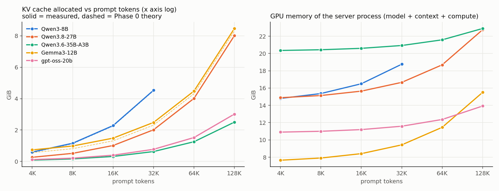
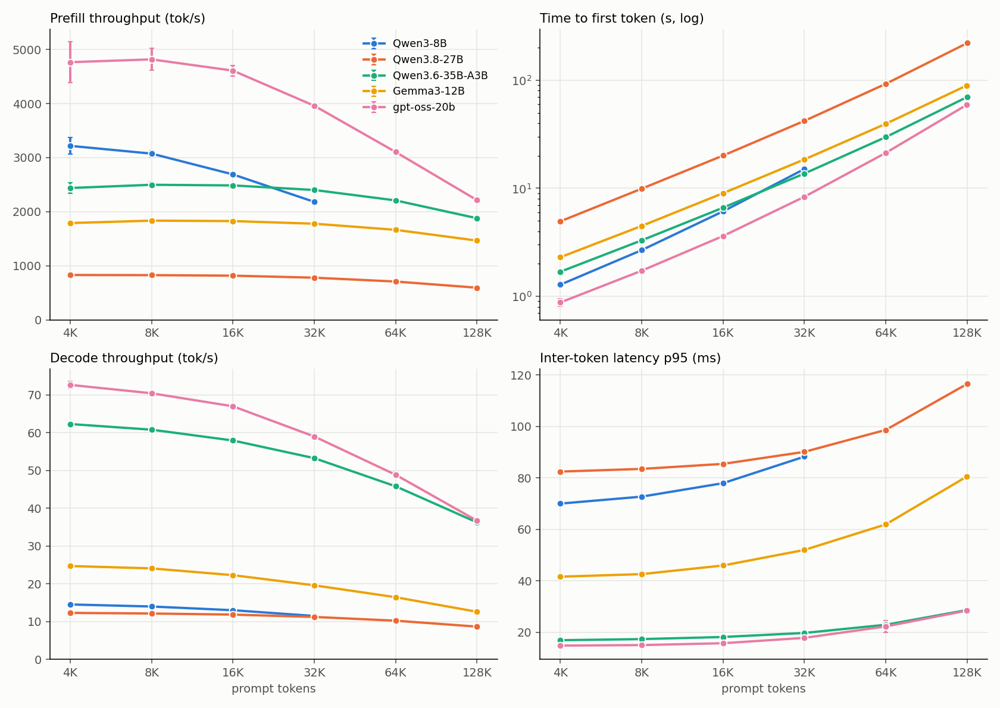
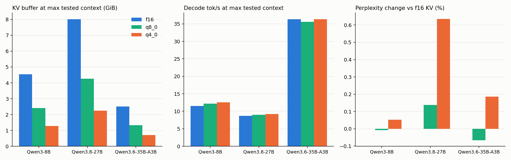
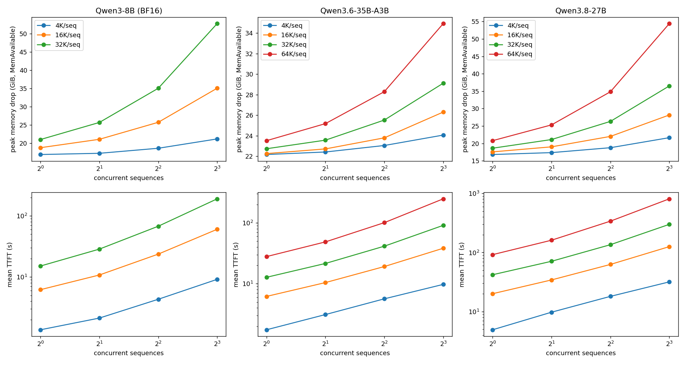

# The KV cache, measured: what long context and concurrency really cost on an NVIDIA DGX GB10

The weights of a model are a fixed price. The **KV cache** is the variable price: it grows with context length and with the number of simultaneous users, and it differs by up to **7×** between models of similar size. This post explains what it is, predicts its size from a model's metadata, then checks the prediction on a real machine (NVIDIA **GB10**, 121 GiB unified memory) with `llama.cpp`.

**Who this is for:** anyone deciding how much context or how many concurrent users a box can handle, or choosing between models/KV settings.

**How to read it.** Every result is labelled **MEASURED** (observed), **DERIVED** (arithmetic on measured values) or **THEORETICAL / INFERRED** (a model or an assumption). Where theory and measurement disagree, the disagreement is reported. Everything is machine-checked against `raw/`: tables and plots are generated from it.

## TL;DR

| Question | Answer (GB10, `llama.cpp`, f16 KV unless stated) |
|---|---|
| How big is the cache per token? | Qwen3-8B **144 KiB**, Qwen3.8-27B **64 KiB**, Gemma3-12B **64 KiB** (global layers), gpt-oss-20b **24 KiB**, Qwen3.6-35B-A3B **20 KiB**. MEASURED, and equal to the formula (§3) for all five. |
| What sets it? | Number of layers that *have* a KV cache × KV heads × head size × bytes per value. **Not** total parameters, MoE or not. A 35B MoE needs 7× less than an 8B dense model. |
| Cache at 128K tokens | 35B-A3B **2.5 GiB**, gpt-oss-20b **3.0 GiB**, 27B **8.0 GiB**, Gemma3-12B **8.0 GiB**; Qwen3-8B would need 18 GiB (DERIVED; its trained limit is 40K, measured 4.5 GiB at 32K). |
| When is the memory taken? | **At server start**, for the whole context size `-c`, whether or not anyone uses it (§4). |
| Does long context slow generation? | Decode speed falls to **58–70%** (Qwen hybrids) and **51%** (Gemma3, gpt-oss) of its 4K value at 128K. Prompt processing also slows. |
| Does quantising the cache help? | `q8_0` saves **46.9%** and `q4_0` **71.9%** of cache memory (MEASURED). Perplexity change: **≤ +0.14%** (q8_0) and **≤ +0.64%** (q4_0); needle-in-haystack accuracy unchanged. But exact output text diverges (§6). |
| How many users fit? | Memory is rarely the limit; **latency is.** 8 users × 64K on the 27B fit in 54 GiB peak but the mean time-to-first-token was **810 s** (§7). |
| Is more concurrency worth it? | At short context, yes: 27B at 4K goes from 345 to 590 tok/s aggregate (1 → 8 users). At long context, no: 27B at 64K falls from 654 to **298** tok/s and the worst wait reaches 29 min (§7.1, DERIVED; the main points were repeated three times, §7.3). |
| Why did I get "context size exceeded"? | Reproduced when in-flight requests need more cells than the unified pool holds (§7.2). |



---

## 1. What the KV cache is (no maths)

A transformer generates one token at a time. To decide the next token, every attention layer looks back at **all earlier tokens**. Recomputing them each step would be absurdly slow, so the model keeps, for each earlier token and each attention layer, two small vectors: a **K**ey and a **V**alue. That stored collection is the KV cache.

Consequences you can feel:

- It **grows with every token** (prompt + output), so long contexts cost memory.
- It is **per conversation**. Ten users means ten caches, unless they share a prompt prefix.
- Generating a token must **read the whole cache** for that conversation, so long contexts also make decoding slower (§5).
- It is separate from the weights. Quantising the weights does not shrink it (§6).

## 2. The test machine and models

| | |
|---|---|
| System | NVIDIA GB10 (Grace-Blackwell), 20 Arm cores, **121.7 GiB unified LPDDR5x** shared by CPU and GPU. |
| Software | `llama.cpp` commit `10a60cf` (CUDA 13.0, arch 121, Release), driver 580.173.02. Flags `-fa 1 -ngl 99`. Details: [`../llm-resource-requirements/raw2/environment.txt`](../llm-resource-requirements/raw2/environment.txt). |
| Method | One fresh `llama-server` per measured point, one benchmark at a time on the GPU, every HTTP response validated (status and token counts from the server, not from a tokenizer estimate), failed runs kept in `raw/`. |

| Model | Design | Params | Layers | Layers with KV | Q / KV heads | Head size (K=V) | Window |
|---|---|---|---:|---:|---|---:|---|
| Qwen3-8B (BF16) | dense, full attention (GQA) | 8B | 36 | 36 | 32 / 8 | 128 | none |
| Qwen3.8-27B (Q4_K_M) | dense, **hybrid** (attention + recurrent) | 27B | 64 (+1 unused MTP block) | 16 | 24 / 4 | 256 | none |
| Qwen3.6-35B-A3B (Q4_K_M) | **MoE**, hybrid | 35B total, ~3B active | 40 | 10 | 16 / 2 | 256 | none |
| Gemma3-12B (Q4_K_M) | dense, sliding window 5:1 | 12B | 48 | 48 (8 global, 40 windowed) | 16 / 8 | 256 | 1024 |
| gpt-oss-20b (MXFP4) | MoE, sliding window 1:1 | 20.9B total | 24 | 24 (12 global, 12 windowed) | 64 / 8 | 64 | 128 |
| Gemma4-26B-A4B (Q4_K_M) | MoE, window 5:1 | 26B total | 30 | 30 (5 global, 25 windowed) | 16 / 2 or 8 | 512 global, 256 windowed | 1024 |

Values are read from the GGUF metadata (`scripts/gguf_meta.py`, `meta_all.json`). **Gemma4 is theory only: it was not run.** The core set for every experiment is the first three rows; Gemma3 and gpt-oss were added in the memory and speed experiments.

## 3. Theory: how big should the cache be? (THEORETICAL)

For a model where every layer has ordinary attention:

```
bytes per token = layers_with_KV × KV_heads × (key_size + value_size) × bytes_per_value
```

Qwen3-8B: `36 × 8 × (128 + 128) × 2 B = 147,456 B = 144 KiB` per token. Each term matters, and the table below shows why models differ so much:

- **KV heads, not query heads.** *Grouped-query attention* (GQA) shares each K/V head among several query heads. Qwen3-8B has 32 query heads but stores only 8.
- **Layers with KV.** *Hybrid* models (Qwen3.6/3.8) replace three of every four attention layers with a recurrent layer that keeps a **fixed-size state** instead of a growing cache. Only 10 of 40 layers (35B) store KV.
- **Sliding window.** A windowed layer only attends to the last *W* tokens, so its cache stops growing at *W* (Gemma3: 1024, gpt-oss: 128). Only the "global" layers keep growing.
- **Value width.** f16 is 2 B/value; `q8_0` and `q4_0` are about 1.06 and 0.56 B/value (§6).
- **Not in the formula:** total parameter count, MoE routing, weight quantisation.

Not covered because no tested model uses them: multi-head latent attention (compresses K/V into a small latent; much smaller than the formula), and cross-layer cache sharing.

**One cell per token.** `llama.cpp` stores the cache as *cells*. A token occupies one cell in every KV layer; the pool is padded up to a multiple of 256 cells.

## 4. Measured: memory vs context (Experiment A)

One fresh server per point; contexts 4K to 128K; 3 repetitions at each point (1 for the largest config-(a) points), 155 runs in total. KV sizes are taken from `llama.cpp`'s own `KV buffer size` log lines (MEASURED), which are exact; system-level `MemAvailable` deltas are noisy because of the page cache and are shown only as a secondary column.

| model | KV layers (log) | theory global B/tok | measured global B/tok | match | SWA cache cells | SWA MiB | recurrent state MiB (1 seq) | runs ok/total |
|---|---|---|---|---|---|---|---|---|
| Qwen3-8B | 36 | 147456 | 147456 (intercept -0 B) | yes | [0] | [0.0] | 0.0 | 24/24 |
| Qwen3.6-35B-A3B | 10 | 20480 | 20480 (intercept 0 B) | yes | [0] | [0.0] | 62.8 | 31/32 |
| Qwen3.8-27B | 16 | 65536 | 65536 (intercept 0 B) | yes | [0] | [0.0] | 149.6 | 31/32 |
| Gemma3-12B | 8 | 65536 | 65536 (intercept 0 B) | yes | [1536] | [480.0] | 0.0 | 31/35 |
| gpt-oss-20b | 12 | 24576 | 24576 (intercept -0 B) | yes | [768] | [18.0] | 0.0 | 31/35 |

**Findings**

1. **The formula is exact** for Qwen3-8B, Qwen3.6-35B-A3B, Qwen3.8-27B, Gemma3-12B (global layers) and gpt-oss-20b (global layers): the fitted slope equals theory to the byte, with a zero intercept.
2. **Qwen3.8-27B matched theory once corrected.** My first theory script counted 17 layers with an `attn_k` tensor (69,632 B/token, 5.9% above the 65,536 measured). The 17th is block 64, a *next-token-prediction* (MTP) block that ships in the GGUF (`qwen35.nextn_predict_layers = 1`) but that `llama.cpp` ignores: its log says `n_layer = 64, n_layer_all = 65` and `model has unused tensor blk.64.nextn...`. Sixty-four layers with a full-attention layer every 4th (`full_attention_interval = 4`) gives 16, which is what was measured. The script now excludes trailing next-token-prediction layers (`scripts/kv_theory.py`), and all five tested models match theory exactly. The original discrepancy and its cause are kept here because a tensor scan alone will mislead for any model that ships an MTP head.
3. **The cache is allocated at load, for the whole `-c`**, sized by the context you ask for, not by tokens used. The same `-c` with a 4K prompt and with a 128K prompt has the same KV buffer. So the memory is reserved up front rather than appearing as the conversation grows.
4. **Windowed caches are fixed-size**: window + 512-token micro-batch, rounded up to 256 cells. Gemma3 1536 cells (**480 MiB**), gpt-oss 768 cells (**18 MiB**), at every context.
5. **Recurrent state is fixed per sequence**: **62.8 MiB** (35B) and **149.6 MiB** (27B). Small, but it multiplies with concurrent users (§7).

Detailed allocation table (config (b): `-c` = prompt + output, so it shows the slope of the allocation itself):

| model | prompt tokens | KV main MiB | KV SWA MiB | recurrent MiB | GPU self MiB (model+ctx+compute) | peak ctx MiB | sys MemAvailable delta after request GiB (mean of reps) |
|---|---|---|---|---|---|---|---|
| Qwen3-8B | 4096 | 612 | 0 | 0 | 15156 | 612 | 16.8 (n=3) |
| Qwen3-8B | 8192 | 1188 | 0 | 0 | 15736 | 1188 | 17.4 (n=3) |
| Qwen3-8B | 16384 | 2340 | 0 | 0 | 16896 | 2340 | 18.5 (n=3) |
| Qwen3-8B | 32768 | 4644 | 0 | 0 | 19216 | 4644 | 20.9 (n=3) |
| Qwen3.6-35B-A3B | 4096 | 85 | 0 | 63 | 20843 | 147 | 22.0 (n=3) |
| Qwen3.6-35B-A3B | 8192 | 165 | 0 | 63 | 20927 | 227 | 21.9 (n=3) |
| Qwen3.6-35B-A3B | 16384 | 325 | 0 | 63 | 21095 | 387 | 22.3 (n=3) |
| Qwen3.6-35B-A3B | 32768 | 645 | 0 | 63 | 21431 | 707 | 22.7 (n=3) |
| Qwen3.6-35B-A3B | 65536 | 1285 | 0 | 63 | 22103 | 1347 | 23.4 (n=3) |
| Qwen3.6-35B-A3B | 131072 | 2565 | 0 | 63 | 23447 | 2627 | 24.9 (n=3) |
| Qwen3.8-27B | 4096 | 272 | 0 | 150 | 15242 | 421 | 16.7 (n=3) |
| Qwen3.8-27B | 8192 | 528 | 0 | 150 | 15502 | 677 | 16.9 (n=3) |
| Qwen3.8-27B | 16384 | 1040 | 0 | 150 | 16022 | 1189 | 17.5 (n=3) |
| Qwen3.8-27B | 32768 | 2064 | 0 | 150 | 17062 | 2213 | 18.6 (n=3) |
| Qwen3.8-27B | 65536 | 4112 | 0 | 150 | 19142 | 4261 | 20.7 (n=3) |
| Qwen3.8-27B | 131072 | 8208 | 0 | 150 | 23302 | 8357 | 24.9 (n=3) |
| Gemma3-12B | 4096 | 272 | 480 | 0 | 7834 | 752 | 9.8 (n=3) |
| Gemma3-12B | 8192 | 528 | 480 | 0 | 8094 | 1008 | 9.8 (n=3) |
| Gemma3-12B | 16384 | 1040 | 480 | 0 | 8614 | 1520 | 10.4 (n=3) |
| Gemma3-12B | 32768 | 2064 | 480 | 0 | 9654 | 2544 | 11.5 (n=3) |
| Gemma3-12B | 65536 | 4112 | 480 | 0 | 11734 | 4592 | 13.6 (n=3) |
| Gemma3-12B | 131000 | 8192 | 480 | 0 | 15877 | 8672 | 17.8 (n=3) |
| gpt-oss-20b | 4096 | 102 | 18 | 0 | 11164 | 120 | 12.5 (n=3) |
| gpt-oss-20b | 8192 | 198 | 18 | 0 | 11264 | 216 | 12.3 (n=3) |
| gpt-oss-20b | 16384 | 390 | 18 | 0 | 11464 | 408 | 12.6 (n=3) |
| gpt-oss-20b | 32768 | 774 | 18 | 0 | 11864 | 792 | 13.1 (n=3) |
| gpt-oss-20b | 65536 | 1542 | 18 | 0 | 12664 | 1560 | 14.0 (n=3) |
| gpt-oss-20b | 131000 | 3072 | 18 | 0 | 14258 | 3090 | 15.8 (n=3) |

**Deviations kept in `raw/`:** the largest config-(a) points have one repetition; Gemma3 and gpt-oss "128K" runs use a 131,000-token prompt (trained limit 131,072; Gemma3 adds a BOS token); a request of exactly 131,072 tokens failed as too large and is kept as a record.

## 5. Measured: speed vs context (Experiment A, speed)

The cache is read on every decoded token, so decode slows as the context fills. 5 repetitions per point, single request, streaming, f16 KV.

| model | prompt tokens | n | TTFT s (mean±sd) | prefill tok/s | decode tok/s (server) | decode tok/s (client) | ITL mean ms | ITL p50 | ITL p95 | decode vs 4K |
|---|---|---|---|---|---|---|---|---|---|---|
| Qwen3-8B | 4096 | 5 | 1.28±0.07 | 3218±156 | 14.56±0.02 | 14.56 | 68.7 | 68.6 | 70.0 | 100% |
| Qwen3-8B | 8192 | 5 | 2.68±0.05 | 3074±60 | 14.02±0.02 | 14.02 | 71.3 | 71.2 | 72.7 | 96% |
| Qwen3-8B | 16384 | 5 | 6.12±0.04 | 2690±18 | 13.03±0.04 | 13.03 | 76.7 | 76.7 | 77.9 | 90% |
| Qwen3-8B | 32768 | 5 | 15.08±0.06 | 2181±7 | 11.51±0.02 | 11.51 | 86.8 | 86.7 | 88.3 | 79% |
| Qwen3.8-27B | 4096 | 5 | 4.95±0.04 | 830±7 | 12.33±0.06 | 12.33 | 81.1 | 80.9 | 82.4 | 100% |
| Qwen3.8-27B | 8192 | 5 | 9.92±0.11 | 827±9 | 12.16±0.02 | 12.16 | 82.2 | 82.1 | 83.5 | 99% |
| Qwen3.8-27B | 16384 | 5 | 20.09±0.03 | 817±1 | 11.88±0.01 | 11.88 | 84.2 | 84.1 | 85.4 | 96% |
| Qwen3.8-27B | 32768 | 5 | 42.07±0.06 | 780±1 | 11.25±0.04 | 11.25 | 88.9 | 88.6 | 90.1 | 91% |
| Qwen3.8-27B | 65536 | 5 | 92.60±0.37 | 708±3 | 10.26±0.01 | 10.26 | 97.5 | 97.2 | 98.6 | 83% |
| Qwen3.8-27B | 131072 | 5 | 220.59±2.24 | 595±6 | 8.69±0.02 | 8.69 | 115.1 | 114.9 | 116.5 | 70% |
| Qwen3.6-35B-A3B | 4096 | 5 | 1.69±0.08 | 2438±102 | 62.32±0.12 | 62.33 | 16.0 | 15.9 | 16.9 | 100% |
| Qwen3.6-35B-A3B | 8192 | 5 | 3.30±0.07 | 2498±50 | 60.82±0.30 | 60.83 | 16.4 | 16.4 | 17.3 | 98% |
| Qwen3.6-35B-A3B | 16384 | 5 | 6.62±0.07 | 2486±25 | 57.96±0.57 | 57.96 | 17.3 | 17.2 | 18.1 | 93% |
| Qwen3.6-35B-A3B | 32768 | 5 | 13.69±0.07 | 2401±12 | 53.29±0.35 | 53.29 | 18.8 | 18.6 | 19.7 | 86% |
| Qwen3.6-35B-A3B | 65536 | 5 | 29.77±0.09 | 2209±6 | 45.83±0.14 | 45.83 | 21.8 | 21.7 | 22.9 | 74% |
| Qwen3.6-35B-A3B | 131072 | 5 | 69.93±0.22 | 1879±6 | 36.28±0.24 | 36.28 | 27.6 | 27.5 | 28.6 | 58% |
| Gemma3-12B | 4096 | 5 | 2.30±0.04 | 1790±33 | 24.73±0.06 | 24.73 | 40.4 | 40.3 | 41.6 | 100% |
| Gemma3-12B | 8192 | 5 | 4.49±0.04 | 1835±17 | 24.10±0.13 | 24.10 | 41.5 | 41.3 | 42.6 | 97% |
| Gemma3-12B | 16384 | 5 | 9.01±0.07 | 1827±14 | 22.31±0.08 | 22.32 | 44.8 | 44.7 | 45.9 | 90% |
| Gemma3-12B | 32768 | 5 | 18.51±0.05 | 1778±4 | 19.62±0.07 | 19.62 | 51.0 | 50.9 | 52.0 | 79% |
| Gemma3-12B | 65536 | 5 | 39.53±0.03 | 1665±1 | 16.48±0.05 | 16.48 | 60.7 | 60.6 | 61.9 | 67% |
| Gemma3-12B | 130816 | 5 | 89.60±0.09 | 1466±1 | 12.63±0.02 | 12.63 | 79.2 | 79.0 | 80.5 | 51% |
| gpt-oss-20b | 4096 | 5 | 0.88±0.07 | 4765±378 | 72.68±0.95 | 72.68 | 13.8 | 13.7 | 14.8 | 100% |
| gpt-oss-20b | 8192 | 5 | 1.73±0.07 | 4817±202 | 70.46±0.55 | 70.46 | 14.2 | 14.1 | 15.0 | 97% |
| gpt-oss-20b | 16384 | 5 | 3.62±0.08 | 4609±99 | 67.01±0.60 | 67.02 | 14.9 | 14.9 | 15.7 | 92% |
| gpt-oss-20b | 32768 | 5 | 8.35±0.08 | 3959±37 | 59.02±0.28 | 59.02 | 16.9 | 16.9 | 17.8 | 81% |
| gpt-oss-20b | 65536 | 5 | 21.28±0.07 | 3104±10 | 48.88±0.81 | 48.88 | 20.5 | 20.3 | 22.2 | 67% |
| gpt-oss-20b | 130816 | 5 | 59.33±0.10 | 2216±4 | 36.76±0.07 | 36.75 | 27.2 | 27.1 | 28.4 | 51% |



**Findings**

- At 128K, decode speed relative to 4K: **35B-A3B 58%**, **27B 70%**, **Gemma3-12B 51%**, **gpt-oss-20b 51%**. Qwen3-8B stops at 32K (79%).
- Prompt processing slows too, but less: prefill at 128K is 77% (35B), 72% (27B) and 46% (gpt-oss) of its 4K rate. A 128K prompt on the 27B takes **221 s** before the first token (MEASURED).
- **Slope check (DERIVED).** Fitting decode time per token against context gives a per-1K-token cost; dividing the KV bytes read per 1K tokens by an assumed 273 GB/s peak gives a floor. The measured slope is **1.05–1.28×** that floor:

| model | fitted slope (µs per 1K ctx tokens) | intercept ms/token | theory KV read (µs per 1K tokens @273 GB/s) | measured/theory |
|---|---|---|---|---|
| Qwen3-8B | 648.0 | 66.2 | 553.1 | 1.17x |
| Qwen3.8-27B | 274.2 | 80.0 | 261.2 | 1.05x |
| Qwen3.6-35B-A3B | 92.9 | 15.7 | 76.8 | 1.21x |
| Gemma3-12B | 313.4 | 39.8 | 245.8 | 1.28x |
| gpt-oss-20b | 109.2 | 13.3 | 92.2 | 1.18x |

  So long-context slowdown is *mostly* explained by the extra KV bytes read, plus 5–28% other cost. The 273 GB/s is the nominal peak, not a measured value, so this is a consistency check, not a proof. The server and `llama-bench` agree within a few percent:

| model | depth | llama-bench decode tok/s | server decode tok/s (same depth) |
|---|---|---|---|
| Qwen3-8B | 0 | 15.22±0.02 | – |
| Qwen3-8B | 4096 | 14.62±0.01 | 14.56 |
| Qwen3-8B | 8192 | 14.09±0.02 | 14.02 |
| Qwen3-8B | 16384 | 12.89±0.40 | 13.03 |
| Qwen3-8B | 32768 | 11.22±0.64 | 11.51 |
| Qwen3.8-27B | 0 | 12.61±0.14 | – |
| Qwen3.8-27B | 4096 | 12.39±0.14 | 12.33 |
| Qwen3.8-27B | 8192 | 12.37±0.00 | 12.16 |
| Qwen3.8-27B | 16384 | 12.04±0.01 | 11.88 |
| Qwen3.8-27B | 32768 | 11.43±0.01 | 11.25 |
| Qwen3.8-27B | 65536 | 10.39±0.01 | 10.26 |
| Qwen3.8-27B | 131072 | 8.80±0.00 | 8.69 |
| Qwen3.6-35B-A3B | 0 | 67.64±0.35 | – |
| Qwen3.6-35B-A3B | 4096 | 65.99±0.22 | 62.32 |
| Qwen3.6-35B-A3B | 8192 | 64.19±0.14 | 60.82 |
| Qwen3.6-35B-A3B | 16384 | 58.43±3.64 | 57.96 |
| Qwen3.6-35B-A3B | 32768 | 56.54±0.17 | 53.29 |
| Qwen3.6-35B-A3B | 65536 | 49.02±0.07 | 45.83 |
| Qwen3.6-35B-A3B | 131072 | 38.42±0.18 | 36.28 |

- The windowed models (Gemma3, gpt-oss) still slow down by half at 128K: the global layers dominate the read, and the weights are read per token regardless.

## 6. Quantising the cache (Experiment, KV precision)

`llama.cpp` can store K and V as `q8_0` or `q4_0` instead of f16 (flags `-ctk`/`-ctv`). Both K and V were set to the same type, tested on the core three models.

**Memory (MEASURED, from the KV buffer line).** `q8_0` is **-46.9%** and `q4_0` is **-71.9%** of the f16 cache, for every model and context. At 128K on the 27B: 8208 → 4360 → 2308 MiB.

**Speed (MEASURED, 5 reps).** Prefill is 0–10% slower, decode is -2% to +9% (faster for the model with a large cache, Qwen3-8B at 32K: +5.7% / +8.9%; unchanged within noise for the hybrids). Full table below.

**Quality.**
- *Perplexity* on wikitext-2 (context 4096; 1 pass each; ± is the tool's standard error, which applies to the absolute value; the paired difference is likely smaller but I did not compute it):

| model | KV type | PPL ± se | Δ vs f16 | Δ % |
|---|---|---|---|---|
| Qwen3-8B | f16 | 8.3051±0.0621 | – | – |
| Qwen3-8B | q8_0 | 8.3045±0.0621 | -0.0006 | -0.01% |
| Qwen3-8B | q4_0 | 8.3094±0.0614 | +0.0043 | +0.05% |
| Qwen3.8-27B | f16 | 6.3742±0.0415 | – | – |
| Qwen3.8-27B | q8_0 | 6.3830±0.0416 | +0.0088 | +0.14% |
| Qwen3.8-27B | q4_0 | 6.4147±0.0419 | +0.0405 | +0.64% |
| Qwen3.6-35B-A3B | f16 | 5.7572±0.0356 | – | – |
| Qwen3.6-35B-A3B | q8_0 | 5.7534±0.0355 | -0.0038 | -0.07% |
| Qwen3.6-35B-A3B | q4_0 | 5.7679±0.0356 | +0.0107 | +0.19% |

- *Needle-in-a-haystack* (a fact hidden at 0/25/50/75/100% depth; 100 trials per cell, 20 per depth, except the 27B at 32K with 50 trials, 10 per depth). No quantisation level moved accuracy outside the 95% interval. The 27B at 32K scores only ~86–88% **even at f16**: that is a model limitation, not quantisation.

| model | context | KV type | overall | 95% CI | by depth 0/25/50/75/100% | errors |
|---|---|---|---|---|---|---|
| Qwen3-8B | 8192 | f16 | 100/100 (100%) | 96–100% | 20/20 / 20/20 / 20/20 / 20/20 / 20/20 | 0 |
| Qwen3-8B | 8192 | q8_0 | 100/100 (100%) | 96–100% | 20/20 / 20/20 / 20/20 / 20/20 / 20/20 | 0 |
| Qwen3-8B | 8192 | q4_0 | 100/100 (100%) | 96–100% | 20/20 / 20/20 / 20/20 / 20/20 / 20/20 | 0 |
| Qwen3-8B | 32768 | f16 | 100/100 (100%) | 96–100% | 20/20 / 20/20 / 20/20 / 20/20 / 20/20 | 0 |
| Qwen3-8B | 32768 | q8_0 | 100/100 (100%) | 96–100% | 20/20 / 20/20 / 20/20 / 20/20 / 20/20 | 0 |
| Qwen3-8B | 32768 | q4_0 | 100/100 (100%) | 96–100% | 20/20 / 20/20 / 20/20 / 20/20 / 20/20 | 0 |
| Qwen3.8-27B | 8192 | f16 | 100/100 (100%) | 96–100% | 20/20 / 20/20 / 20/20 / 20/20 / 20/20 | 0 |
| Qwen3.8-27B | 8192 | q8_0 | 99/100 (99%) | 95–100% | 20/20 / 20/20 / 20/20 / 19/20 / 20/20 | 0 |
| Qwen3.8-27B | 8192 | q4_0 | 99/100 (99%) | 95–100% | 20/20 / 19/20 / 20/20 / 20/20 / 20/20 | 0 |
| Qwen3.8-27B | 32768 | f16 | 43/50 (86%) | 74–93% | 6/10 / 8/10 / 10/10 / 9/10 / 10/10 | 0 |
| Qwen3.8-27B | 32768 | q8_0 | 44/50 (88%) | 76–94% | 7/10 / 8/10 / 10/10 / 9/10 / 10/10 | 0 |
| Qwen3.8-27B | 32768 | q4_0 | 44/50 (88%) | 76–94% | 7/10 / 8/10 / 10/10 / 9/10 / 10/10 | 0 |
| Qwen3.6-35B-A3B | 8192 | f16 | 100/100 (100%) | 96–100% | 20/20 / 20/20 / 20/20 / 20/20 / 20/20 | 0 |
| Qwen3.6-35B-A3B | 8192 | q8_0 | 100/100 (100%) | 96–100% | 20/20 / 20/20 / 20/20 / 20/20 / 20/20 | 0 |
| Qwen3.6-35B-A3B | 8192 | q4_0 | 100/100 (100%) | 96–100% | 20/20 / 20/20 / 20/20 / 20/20 / 20/20 | 0 |
| Qwen3.6-35B-A3B | 32768 | f16 | 100/100 (100%) | 96–100% | 20/20 / 20/20 / 20/20 / 20/20 / 20/20 | 0 |
| Qwen3.6-35B-A3B | 32768 | q8_0 | 100/100 (100%) | 96–100% | 20/20 / 20/20 / 20/20 / 20/20 / 20/20 | 0 |
| Qwen3.6-35B-A3B | 32768 | q4_0 | 100/100 (100%) | 96–100% | 20/20 / 20/20 / 20/20 / 20/20 / 20/20 | 0 |

- *Greedy agreement*: the same prompt at temperature 0 produces the same text as f16 only sometimes. q8_0 identical on 5/8 (8B), 4/8 (27B) and **1/8** (35B) prompts; q4_0 never:

| model | KV type | prompts identical to f16 | mean first-divergence token (of 256) | mean tokens matching before first divergence |
|---|---|---|---|---|
| Qwen3-8B | q8_0 | 5/8 | 181 | 71% |
| Qwen3-8B | q4_0 | 0/8 | 14 | 6% |
| Qwen3.8-27B | q8_0 | 4/8 | 197 | 77% |
| Qwen3.8-27B | q4_0 | 0/8 | 98 | 38% |
| Qwen3.6-35B-A3B | q8_0 | 1/8 | 121 | 47% |
| Qwen3.6-35B-A3B | q4_0 | 0/8 | 62 | 24% |

  This does **not** mean quality is worse, only that the text *differs*: with greedy decoding one flipped near-tie changes everything after it. Perplexity and the needle test show no loss on these metrics. No task-quality benchmark (reasoning, code) was run, so "no measurable harm" is limited to those two metrics.

**A first-order verdict (INFERRED):** `q8_0` halves the cache for a small cost; `q4_0` is the one to try when memory is the limit, and test your own workload first. Weights quantisation is a separate decision.

Full performance table:

| model | prompt | KV type | KV buffer MiB | vs f16 | prefill tok/s | vs f16 | decode tok/s | vs f16 | TTFT s | ITL p95 ms | n |
|---|---|---|---|---|---|---|---|---|---|---|---|
| Qwen3-8B | 4096 | f16 | 612 | – | 3218±156 | – | 14.56±0.02 | – | 1.28 | 70.0 | 5 |
| Qwen3-8B | 8192 | f16 | 1188 | – | 3074±60 | – | 14.02±0.02 | – | 2.68 | 72.7 | 5 |
| Qwen3-8B | 8192 | q8_0 | 631 | -46.9% | 2888±45 | -6.1% | 14.27±0.04 | +1.8% | 2.85 | 71.3 | 5 |
| Qwen3-8B | 8192 | q4_0 | 334 | -71.9% | 2913±48 | -5.2% | 14.37±0.04 | +2.5% | 2.82 | 71.0 | 5 |
| Qwen3-8B | 16384 | f16 | 2340 | – | 2690±18 | – | 13.03±0.04 | – | 6.12 | 77.9 | 5 |
| Qwen3-8B | 32768 | f16 | 4644 | – | 2181±7 | – | 11.51±0.02 | – | 15.08 | 88.3 | 5 |
| Qwen3-8B | 32768 | q8_0 | 2467 | -46.9% | 1972±3 | -9.6% | 12.17±0.02 | +5.7% | 16.67 | 83.6 | 5 |
| Qwen3-8B | 32768 | q4_0 | 1306 | -71.9% | 2005±7 | -8.1% | 12.54±0.03 | +8.9% | 16.40 | 81.0 | 5 |
| Qwen3.8-27B | 4096 | f16 | 272 | – | 830±7 | – | 12.33±0.06 | – | 4.95 | 82.4 | 5 |
| Qwen3.8-27B | 8192 | f16 | 528 | – | 827±9 | – | 12.16±0.02 | – | 9.92 | 83.5 | 5 |
| Qwen3.8-27B | 8192 | q8_0 | 280 | -46.9% | 822±2 | -0.7% | 12.20±0.03 | +0.3% | 9.99 | 83.0 | 5 |
| Qwen3.8-27B | 8192 | q4_0 | 148 | -71.9% | 825±1 | -0.2% | 12.27±0.02 | +0.9% | 9.94 | 82.6 | 5 |
| Qwen3.8-27B | 16384 | f16 | 1040 | – | 817±1 | – | 11.88±0.01 | – | 20.09 | 85.4 | 5 |
| Qwen3.8-27B | 32768 | f16 | 2064 | – | 780±1 | – | 11.25±0.04 | – | 42.07 | 90.1 | 5 |
| Qwen3.8-27B | 32768 | q8_0 | 1096 | -46.9% | 771±1 | -1.1% | 11.40±0.02 | +1.3% | 42.58 | 88.9 | 5 |
| Qwen3.8-27B | 32768 | q4_0 | 580 | -71.9% | 773±1 | -0.8% | 11.52±0.03 | +2.4% | 42.42 | 88.0 | 5 |
| Qwen3.8-27B | 65536 | f16 | 4112 | – | 708±3 | – | 10.26±0.01 | – | 92.60 | 98.6 | 5 |
| Qwen3.8-27B | 131072 | f16 | 8208 | – | 595±6 | – | 8.69±0.02 | – | 220.59 | 116.5 | 5 |
| Qwen3.8-27B | 131072 | q8_0 | 4360 | -46.9% | 580±1 | -2.5% | 9.00±0.02 | +3.6% | 226.27 | 113.2 | 5 |
| Qwen3.8-27B | 131072 | q4_0 | 2308 | -71.9% | 587±1 | -1.4% | 9.23±0.02 | +6.2% | 223.65 | 110.3 | 5 |
| Qwen3.6-35B-A3B | 4096 | f16 | 85 | – | 2438±102 | – | 62.32±0.12 | – | 1.69 | 16.9 | 5 |
| Qwen3.6-35B-A3B | 8192 | f16 | 165 | – | 2498±50 | – | 60.82±0.30 | – | 3.30 | 17.3 | 5 |
| Qwen3.6-35B-A3B | 8192 | q8_0 | 88 | -46.9% | 2462±60 | -1.5% | 60.46±0.65 | -0.6% | 3.34 | 17.3 | 5 |
| Qwen3.6-35B-A3B | 8192 | q4_0 | 46 | -71.9% | 2462±53 | -1.5% | 60.19±0.63 | -1.0% | 3.35 | 17.6 | 5 |
| Qwen3.6-35B-A3B | 16384 | f16 | 325 | – | 2486±25 | – | 57.96±0.57 | – | 6.62 | 18.1 | 5 |
| Qwen3.6-35B-A3B | 32768 | f16 | 645 | – | 2401±12 | – | 53.29±0.35 | – | 13.69 | 19.7 | 5 |
| Qwen3.6-35B-A3B | 32768 | q8_0 | 343 | -46.9% | 2353±12 | -2.0% | 53.32±0.64 | +0.1% | 13.97 | 19.6 | 5 |
| Qwen3.6-35B-A3B | 32768 | q4_0 | 181 | -71.9% | 2356±13 | -1.9% | 52.89±0.21 | -0.7% | 13.96 | 19.9 | 5 |
| Qwen3.6-35B-A3B | 65536 | f16 | 1285 | – | 2209±6 | – | 45.83±0.14 | – | 29.77 | 22.9 | 5 |
| Qwen3.6-35B-A3B | 131072 | f16 | 2565 | – | 1879±6 | – | 36.28±0.24 | – | 69.93 | 28.6 | 5 |
| Qwen3.6-35B-A3B | 131072 | q8_0 | 1363 | -46.9% | 1824±1 | -2.9% | 35.57±0.11 | -2.0% | 72.05 | 29.2 | 5 |
| Qwen3.6-35B-A3B | 131072 | q4_0 | 721 | -71.9% | 1822±9 | -3.0% | 36.32±0.18 | +0.1% | 72.11 | 28.8 | 5 |



## 7. Many users at once (Experiment, concurrency × context)

`-np N --kv-unified`: N slots share one pool of `N × (prompt + 64 + 8)` cells (unified KV, the production default). N simultaneous *distinct* prompts, each prompt tokens long, 64 generated. The 44-point matrix is **one run per point**; ten of the points that matter most were repeated twice more (n=3, §7.3).

### 7.1 The matrix (MEASURED)



KV bytes per cell stayed identical to Experiment A at every one of the 44 points; recurrent state is exactly linear in the number of sequences:

| model | KV bytes per cell, cells padded to 256 (min - max) | recurrent MiB per sequence (min - max) |
|---|---|---|
| Qwen3-8B (BF16) | 147456 - 147456 | none (no recurrent layers) |
| Qwen3.6-35B-A3B | 20480 - 20480 | 62.8 - 62.8 |
| Qwen3.8-27B | 65536 - 65536 | 149.6 - 149.6 |

### Qwen3-8B (BF16)

| seqs | prompt/seq | total cells | KV GiB | recurrent MiB (per seq) | peak MemAvail drop GiB | wall s | TTFT mean / max s | decode tok/s per request | ok |
|---|---|---|---|---|---|---|---|---|---|
| 1 | 4096 | 4168 | 0.60 | - | 16.8 | 8 | 1.4 / 1.4 | 14.6 | 1/1 |
| 2 | 4096 | 8336 | 1.16 | - | 17.2 | 10 | 2.1 / 2.9 | 12.1 | 2/2 |
| 4 | 4096 | 16672 | 2.32 | - | 18.6 | 13 | 4.3 / 6.3 | 9.7 | 4/4 |
| 8 | 4096 | 33344 | 4.61 | - | 21.1 | 23 | 9.1 / 15.3 | 6.3 | 8/8 |
| 1 | 16384 | 16456 | 2.29 | - | 18.7 | 13 | 6.2 / 6.2 | 13.0 | 1/1 |
| 2 | 16384 | 32912 | 4.54 | - | 21.0 | 23 | 10.8 / 15.3 | 7.9 | 2/2 |
| 4 | 16384 | 65824 | 9.07 | - | 25.7 | 50 | 23.7 / 41.3 | 4.0 | 4/4 |
| 8 | 16384 | 131648 | 18.11 | - | 35.1 | 139 | 60.3 / 127.7 | 1.6 | 8/8 |
| 1 | 32768 | 32840 | 4.54 | - | 21.0 | 23 | 15.1 / 15.1 | 11.5 | 1/1 |
| 2 | 32768 | 65680 | 9.04 | - | 25.7 | 51 | 28.5 / 41.8 | 5.6 | 2/2 |
| 4 | 32768 | 131360 | 18.07 | - | 35.0 | 139 | 67.6 / 127.1 | 2.3 | 4/4 |
| 8 | 32768 | 262720 | 36.11 | - | 52.8 | 453 | 189.7 / 436.6 | 0.8 | 8/8 |

### Qwen3.6-35B-A3B

| seqs | prompt/seq | total cells | KV GiB | recurrent MiB (per seq) | peak MemAvail drop GiB | wall s | TTFT mean / max s | decode tok/s per request | ok |
|---|---|---|---|---|---|---|---|---|---|
| 1 | 4096 | 4168 | 0.08 | 62.8 (62.8) | 22.2 | 5 | 1.8 / 1.8 | 62.8 | 1/1 |
| 2 | 4096 | 8336 | 0.16 | 125.6 (62.8) | 22.4 | 7 | 3.1 / 3.3 | 44.5 | 2/2 |
| 4 | 4096 | 16672 | 0.32 | 251.2 (62.8) | 23.0 | 11 | 5.7 / 6.7 | 24.4 | 4/4 |
| 8 | 4096 | 33344 | 0.64 | 502.5 (62.8) | 24.1 | 19 | 9.7 / 14.2 | 12.1 | 8/8 |
| 1 | 16384 | 16456 | 0.32 | 62.8 (62.8) | 22.3 | 9 | 6.2 / 6.2 | 57.9 | 1/1 |
| 2 | 16384 | 32912 | 0.63 | 125.6 (62.8) | 22.7 | 17 | 10.4 / 13.1 | 26.0 | 2/2 |
| 4 | 16384 | 65824 | 1.26 | 251.2 (62.8) | 23.8 | 33 | 19.1 / 29.2 | 11.6 | 4/4 |
| 8 | 16384 | 131648 | 2.51 | 502.5 (62.8) | 26.3 | 75 | 38.2 / 70.1 | 4.8 | 8/8 |
| 1 | 32768 | 32840 | 0.63 | 62.8 (62.8) | 22.7 | 16 | 12.7 / 12.7 | 53.7 | 1/1 |
| 2 | 32768 | 65680 | 1.25 | 125.6 (62.8) | 23.6 | 32 | 21.5 / 28.4 | 21.8 | 2/2 |
| 4 | 32768 | 131360 | 2.51 | 251.2 (62.8) | 25.5 | 72 | 41.3 / 68.3 | 8.6 | 4/4 |
| 8 | 32768 | 262720 | 5.01 | 502.5 (62.8) | 29.1 | 187 | 90.7 / 182.3 | 3.4 | 8/8 |
| 1 | 65536 | 65608 | 1.25 | 62.8 (62.8) | 23.5 | 31 | 27.9 / 27.9 | 47.2 | 1/1 |
| 2 | 65536 | 131216 | 2.50 | 125.6 (62.8) | 25.2 | 71 | 48.6 / 67.0 | 17.5 | 2/2 |
| 4 | 65536 | 262432 | 5.01 | 251.2 (62.8) | 28.3 | 184 | 100.5 / 179.4 | 6.5 | 4/4 |
| 8 | 65536 | 524864 | 10.01 | 502.5 (62.8) | 34.9 | 542 | 247.2 / 535.4 | 2.3 | 8/8 |

### Qwen3.8-27B

| seqs | prompt/seq | total cells | KV GiB | recurrent MiB (per seq) | peak MemAvail drop GiB | wall s | TTFT mean / max s | decode tok/s per request | ok |
|---|---|---|---|---|---|---|---|---|---|
| 1 | 4096 | 4168 | 0.27 | 149.6 (149.6) | 16.8 | 12 | 4.9 / 4.9 | 12.3 | 1/1 |
| 2 | 4096 | 8336 | 0.52 | 299.2 (149.6) | 17.4 | 18 | 9.8 / 10.3 | 10.6 | 2/2 |
| 4 | 4096 | 16672 | 1.03 | 598.5 (149.6) | 18.8 | 30 | 18.1 / 21.4 | 7.5 | 4/4 |
| 8 | 4096 | 33344 | 2.05 | 1197.0 (149.6) | 21.7 | 56 | 31.8 / 46.5 | 4.0 | 8/8 |
| 1 | 16384 | 16456 | 1.02 | 149.6 (149.6) | 17.6 | 27 | 20.1 / 20.1 | 11.8 | 1/1 |
| 2 | 16384 | 32912 | 2.02 | 299.2 (149.6) | 19.0 | 51 | 34.3 / 43.1 | 6.7 | 2/2 |
| 4 | 16384 | 65824 | 4.03 | 598.5 (149.6) | 22.0 | 105 | 62.8 / 96.2 | 3.4 | 4/4 |
| 8 | 16384 | 131648 | 8.05 | 1197.0 (149.6) | 28.2 | 241 | 125.8 / 230.6 | 1.5 | 8/8 |
| 1 | 32768 | 32840 | 2.02 | 149.6 (149.6) | 18.6 | 50 | 42.1 / 42.1 | 11.2 | 1/1 |
| 2 | 32768 | 65680 | 4.02 | 299.2 (149.6) | 21.1 | 103 | 71.1 / 94.2 | 5.5 | 2/2 |
| 4 | 32768 | 131360 | 8.03 | 598.5 (149.6) | 26.3 | 236 | 135.6 / 226.3 | 2.4 | 4/4 |
| 8 | 32768 | 262720 | 16.05 | 1197.0 (149.6) | 36.5 | 609 | 299.7 / 596.5 | 1.0 | 8/8 |
| 1 | 65536 | 65608 | 4.02 | 149.6 (149.6) | 20.8 | 100 | 92.0 / 92.0 | 10.2 | 1/1 |
| 2 | 65536 | 131216 | 8.02 | 299.2 (149.6) | 25.3 | 233 | 161.5 / 223.5 | 4.5 | 2/2 |
| 4 | 65536 | 262432 | 16.03 | 598.5 (149.6) | 34.8 | 615 | 339.5 / 603.4 | 1.8 | 4/4 |
| 8 | 65536 | 524864 | 32.05 | 1197.0 (149.6) | 54.4 | 1763 | 810.3 / 1747.2 | 0.7 | 8/8 |

**What it says**

- **Memory is almost exactly "weights + N × (context cache + recurrent state)".** KV cells do the arithmetic you expect; the peak `MemAvailable` drop is that plus transient buffers.
- **No point failed from memory**, even 27B × 8 × 64K (32 GiB of KV, 54 GiB peak, 59 GiB of free memory remained at the minimum).
- **Latency is the limit.** The same point took **1763 s** end to end. The wait is very uneven: the fastest of the 8 users got a first token after **103 s**, the median after **725 s**, the last after **1747 s** (mean 810 s). With 8 requests a p95 is just the maximum, so min / median / max are reported instead (table below).
- **Aggregate throughput (DERIVED).** Aggregate prefill speed *falls* as users are added at long context (27B at 64K: 712 tok/s for one user, 300 for eight), so extra users cost more than just queueing. At short context the opposite holds: 27B at 4K reaches 590 tok/s total at 8 users vs 345 alone. Cause not investigated.
- **Per-request decode speed falls with N** (35B at 4K: 62.8 tok/s alone, 12.1 at N=8) but this was measured while other requests were still prefilling. **It is not an aggregate throughput figure; I did not measure aggregate throughput.**

Per-request spread and aggregate throughput (DERIVED from the same 44 runs; aggregate prefill = users × prompt ÷ time until the last first token, total = users × (prompt+generated) ÷ wall time):

### Qwen3-8B (BF16)

| seqs | prompt/seq | TTFT min / median / max s | aggregate prefill tok/s | aggregate (prompt+gen) tok/s over wall | ok |
|---|---|---|---|---|---|
| 1 | 4096 | 1.4 / 1.4 / 1.4 | 2996 | 541 | 1/1 |
| 2 | 4096 | 1.4 / 2.1 / 2.9 | 2846 | 872 | 2/2 |
| 4 | 4096 | 2.1 / 4.4 / 6.3 | 2593 | 1248 | 4/4 |
| 8 | 4096 | 2.0 / 9.3 / 15.3 | 2144 | 1440 | 8/8 |
| 1 | 16384 | 6.2 / 6.2 / 6.2 | 2646 | 1262 | 1/1 |
| 2 | 16384 | 6.2 / 10.8 / 15.3 | 2142 | 1436 | 2/2 |
| 4 | 16384 | 7.1 / 23.1 / 41.3 | 1588 | 1309 | 4/4 |
| 8 | 16384 | 7.3 / 54.7 / 127.7 | 1026 | 945 | 8/8 |
| 1 | 32768 | 15.1 / 15.1 / 15.1 | 2171 | 1453 | 1/1 |
| 2 | 32768 | 15.3 / 28.5 / 41.8 | 1568 | 1295 | 2/2 |
| 4 | 32768 | 16.3 / 63.5 / 127.1 | 1031 | 948 | 4/4 |
| 8 | 32768 | 16.5 / 163.9 / 436.6 | 600 | 580 | 8/8 |

### Qwen3.6-35B-A3B

| seqs | prompt/seq | TTFT min / median / max s | aggregate prefill tok/s | aggregate (prompt+gen) tok/s over wall | ok |
|---|---|---|---|---|---|
| 1 | 4096 | 1.8 / 1.8 / 1.8 | 2334 | 874 | 1/1 |
| 2 | 4096 | 3.0 / 3.1 / 3.3 | 2503 | 1267 | 2/2 |
| 4 | 4096 | 3.9 / 6.0 / 6.7 | 2452 | 1570 | 4/4 |
| 8 | 4096 | 3.9 / 10.1 / 14.2 | 2308 | 1757 | 8/8 |
| 1 | 16384 | 6.2 / 6.2 / 6.2 | 2647 | 1772 | 1/1 |
| 2 | 16384 | 7.8 / 10.4 / 13.1 | 2508 | 1987 | 2/2 |
| 4 | 16384 | 8.7 / 19.3 / 29.2 | 2243 | 1981 | 4/4 |
| 8 | 16384 | 8.7 / 37.2 / 70.1 | 1871 | 1757 | 8/8 |
| 1 | 32768 | 12.7 / 12.7 / 12.7 | 2571 | 2059 | 1/1 |
| 2 | 32768 | 14.6 / 21.5 / 28.4 | 2305 | 2049 | 2/2 |
| 4 | 32768 | 15.5 / 40.7 / 68.3 | 1920 | 1812 | 4/4 |
| 8 | 32768 | 15.4 / 84.4 / 182.3 | 1438 | 1402 | 8/8 |
| 1 | 65536 | 27.9 / 27.9 / 27.9 | 2351 | 2099 | 1/1 |
| 2 | 65536 | 30.2 / 48.6 / 67.0 | 1956 | 1849 | 2/2 |
| 4 | 65536 | 31.0 / 95.8 / 179.4 | 1461 | 1425 | 4/4 |
| 8 | 65536 | 31.1 / 220.9 / 535.4 | 979 | 969 | 8/8 |

### Qwen3.8-27B

| seqs | prompt/seq | TTFT min / median / max s | aggregate prefill tok/s | aggregate (prompt+gen) tok/s over wall | ok |
|---|---|---|---|---|---|
| 1 | 4096 | 4.9 / 4.9 / 4.9 | 832 | 345 | 1/1 |
| 2 | 4096 | 9.3 / 9.8 / 10.3 | 798 | 467 | 2/2 |
| 4 | 4096 | 12.4 / 19.3 / 21.4 | 764 | 561 | 4/4 |
| 8 | 4096 | 12.4 / 33.0 / 46.5 | 704 | 590 | 8/8 |
| 1 | 16384 | 20.1 / 20.1 / 20.1 | 816 | 600 | 1/1 |
| 2 | 16384 | 25.5 / 34.3 / 43.1 | 759 | 644 | 2/2 |
| 4 | 16384 | 28.1 / 63.5 / 96.2 | 681 | 626 | 4/4 |
| 8 | 16384 | 28.2 / 122.6 / 230.6 | 568 | 545 | 8/8 |
| 1 | 32768 | 42.1 / 42.1 / 42.1 | 779 | 661 | 1/1 |
| 2 | 32768 | 48.0 / 71.1 / 94.2 | 696 | 640 | 2/2 |
| 4 | 32768 | 51.0 / 132.6 / 226.3 | 579 | 556 | 4/4 |
| 8 | 32768 | 51.1 / 282.0 / 596.5 | 439 | 432 | 8/8 |
| 1 | 65536 | 92.0 / 92.0 / 92.0 | 712 | 654 | 1/1 |
| 2 | 65536 | 99.6 / 161.5 / 223.5 | 586 | 563 | 2/2 |
| 4 | 65536 | 103.5 / 325.5 / 603.4 | 434 | 426 | 4/4 |
| 8 | 65536 | 102.8 / 725.4 / 1747.2 | 300 | 298 | 8/8 |

**Operating points (DERIVED from the matrix; the points near the limits were repeated, §7.3).** Largest number of simultaneous equal-length prompts (from the 1/2/4/8 tested) whose *worst* time-to-first-token stays within a budget. Read it as "at most this many arriving at once":

| model | prompt/seq | max seqs with worst TTFT ≤ 10 s | max seqs with worst TTFT ≤ 30 s | max seqs with worst TTFT ≤ 120 s |
|---|---|---|---|---|
| Qwen3-8B (BF16) | 4K | 4 | 8 | 8 |
| Qwen3-8B (BF16) | 16K | 1 | 2 | 4 |
| Qwen3-8B (BF16) | 32K | 0 (one alone is slower) | 1 | 2 |
| Qwen3.6-35B-A3B | 4K | 4 | 8 | 8 |
| Qwen3.6-35B-A3B | 16K | 1 | 4 | 8 |
| Qwen3.6-35B-A3B | 32K | 0 (one alone is slower) | 2 | 4 |
| Qwen3.6-35B-A3B | 64K | 0 (one alone is slower) | 1 | 2 |
| Qwen3.8-27B | 4K | 1 | 4 | 8 |
| Qwen3.8-27B | 16K | 0 (one alone is slower) | 1 | 4 |
| Qwen3.8-27B | 32K | 0 (one alone is slower) | 0 (one alone is slower) | 2 |
| Qwen3.8-27B | 64K | 0 (one alone is slower) | 0 (one alone is slower) | 1 |

With ~121 GiB total and weights of ~15 GiB (27B) or ~21 GiB (35B), the memory-only ceiling is far above what latency allows, so plan by the wait you can tolerate, then check memory. The repeats in §7.3 show these numbers are stable on this machine, but they are all with one prompt set and one build.

### 7.2 "Context size has been exceeded" (HTTP 500)

This 500 had been seen in production flags (35B, `-c 131072`, 4 slots, unified, `--cache-reuse 256`). One trial per row, repeats not done:

| Trial | Requests | Result |
|---|---|---|
| A/E | a 130K prompt, then 4 × 8K afterwards | all 200 (OK) |
| B | 4 × 8K arriving **during** the 130K prefill | 4 of 5 got 500, **including the 130K one** |
| C | 4 × 32K at once (128K total) | all 200 |
| D | 4 × 40K at once (160K > pool) | all four 500 |

The server log shows `failed to find free space in the KV cache`, after which **every request in flight failed, even one at 129,996 tokens**. **INFERRED, not demonstrated:** the server admits more concurrent tokens than the unified pool can hold, then fails all of them. Filling the pool alone is harmless. **Practical rule (INFERRED from these trials):** keep the sum of tokens of all requests in flight ≤ `-c`, and set `-c` for the maximum *aggregate*, not the maximum single request.

### 7.3 Are the numbers reproducible? Does the batch size matter?

Ten points were rerun twice more (n=3 including the original) at default flags (`-b 2048 -ub 512`). **Criterion fixed before running:** a point is reproducible if every repeat's worst TTFT is within ±10% of the mean. **All ten met it, and the largest spread was under 5%** (35B 8×64K: 513-535 s; 27B 8×64K: 1738-1759 s, i.e. the 29-minute worst wait is not a one-off).

| model | seqs × prompt | reps | max TTFT s: mean (min-max) | median TTFT s | min TTFT s | aggregate prefill tok/s | wall s | max-TTFT within ±10% of mean |
|---|---|---|---|---|---|---|---|---|
| Qwen3.6-35B-A3B | 8 × 4K | 3 | 14.2 (14.1-14.2) | 10.0 (10.0-10.1) | 3.9 (3.9-3.9) | 2315 (2308-2322) | 19 (19-19) | yes |
| Qwen3.6-35B-A3B | 4 × 16K | 3 | 29.1 (29.0-29.2) | 19.2 (19.2-19.3) | 8.6 (8.6-8.7) | 2252 (2243-2259) | 33 (33-33) | yes |
| Qwen3.6-35B-A3B | 4 × 32K | 3 | 68.1 (68.0-68.3) | 40.6 (40.6-40.7) | 15.4 (15.4-15.5) | 1925 (1920-1929) | 72 (72-72) | yes |
| Qwen3.6-35B-A3B | 4 × 64K | 3 | 176.7 (175.1-179.4) | 95.5 (95.2-95.8) | 31.0 (31.0-31.1) | 1484 (1461-1497) | 181 (180-184) | yes |
| Qwen3.6-35B-A3B | 8 × 64K | 3 | 521.3 (512.8-535.4) | 217.2 (215.4-220.9) | 31.0 (31.0-31.1) | 1006 (979-1022) | 527 (519-542) | yes |
| Qwen3.8-27B | 8 × 4K | 3 | 46.2 (46.1-46.5) | 32.9 (32.9-33.0) | 12.4 (12.4-12.4) | 709 (704-711) | 56 (56-56) | yes |
| Qwen3.8-27B | 4 × 16K | 3 | 96.4 (96.2-96.7) | 63.7 (63.5-63.9) | 28.2 (28.1-28.3) | 680 (678-681) | 105 (105-106) | yes |
| Qwen3.8-27B | 4 × 32K | 3 | 226.2 (225.4-227.0) | 134.1 (132.6-134.9) | 51.0 (51.0-51.0) | 579 (577-582) | 236 (235-237) | yes |
| Qwen3.8-27B | 2 × 64K | 3 | 222.5 (220.7-223.5) | 161.0 (160.0-161.5) | 99.4 (99.4-99.6) | 589 (586-594) | 232 (230-233) | yes |
| Qwen3.8-27B | 8 × 64K | 3 | 1748.0 (1738.0-1759.0) | 734.5 (725.4-743.6) | 105.3 (102.8-106.6) | 300 (298-302) | 1764 (1754-1775) | yes |

Then three of those points were rerun three times with a larger physical batch (`-b 2048 -ub 2048`) to test whether the long-context collapse is an artefact of the prefill chunk size:

| model | seqs × prompt | setting | reps | max TTFT s: mean (min-max) | median TTFT s | aggregate prefill tok/s | wall s |
|---|---|---|---|---|---|---|---|
| Qwen3.6-35B-A3B | 4 × 64K | default (-b 2048 -ub 512) | 3 | 176.7 (175.1-179.4) | 95.5 (95.2-95.8) | 1484 (1461-1497) | 181 (180-184) |
| Qwen3.6-35B-A3B | 4 × 64K | -b 2048 -ub 2048 | 3 | 160.0 (158.5-162.7) | 85.5 (85.2-85.9) | 1639 (1611-1654) | 165 (163-167) |
| Qwen3.8-27B | 8 × 4K | default (-b 2048 -ub 512) | 3 | 46.2 (46.1-46.5) | 32.9 (32.9-33.0) | 709 (704-711) | 56 (56-56) |
| Qwen3.8-27B | 8 × 4K | -b 2048 -ub 2048 | 3 | 44.8 (44.7-44.9) | 32.0 (31.9-32.1) | 731 (729-733) | 55 (55-55) |
| Qwen3.8-27B | 4 × 32K | default (-b 2048 -ub 512) | 3 | 226.2 (225.4-227.0) | 134.1 (132.6-134.9) | 579 (577-582) | 236 (235-237) |
| Qwen3.8-27B | 4 × 32K | -b 2048 -ub 2048 | 3 | 212.9 (212.3-213.4) | 127.9 (127.5-128.4) | 616 (614-617) | 223 (222-223) |

The larger micro-batch helps modestly and consistently: aggregate prefill is **+3% to +10%** higher (35B 4×64K: 1484 → 1639 tok/s; 27B 4×32K: 579 → 616) and the worst wait **3-10%** shorter. It does **not** remove the effect: 27B 4×32K still runs at 616 tok/s aggregate against 779 for one user alone. So in this configuration the collapse is not explained by the micro-batch size. Other scheduler or kernel settings were not tested, and the cause is not established. Tuning `-ub` is a cheap win to try, but it does not change the planning rule that long prompts at high concurrency are a latency problem.

## 8. Practical guidance

1. **Estimate per model.** `KiB/token × context` is the cache for one user; add the recurrent state per user (hybrids) and the weights. Use §3 and the table in §4; don't use parameter count.
2. **Prefer models with cheap caches for long context**: hybrid and windowed designs (the 35B-A3B at 20 KiB/token) fit 128K for 2.5 GiB where a classic GQA 8B (144 KiB) needs 18 GiB.
3. **Set `-c` for the aggregate**, because it is reserved at startup (and a large `-c` costs memory even when idle).
4. **`q8_0` KV is a safe-looking default for saving half the cache**; `q4_0` saves 72% with a small measured perplexity cost. Verify on your own task.
5. **Plan for latency, not memory, when sharing a box.** Long prompts hurt everyone's time-to-first-token (§7.1; earlier measurements in [`../llm-resource-requirements/`](../llm-resource-requirements/README.md)).

### Quick picks for a GB10 (DERIVED from §4-§7; adjust to your latency budget)

| Goal | Pick |
|---|---|
| Chat, several users, ≤ 16K each | 35B-A3B (4K × 8 users: worst wait 14 s; 16K × 4: 29 s). 27B only if quality needs it: 4K × 4 users already waits 21 s. |
| One user, 128K context | 35B-A3B (2.5 GiB cache, 36 tok/s at 128K, 70 s to first token) or gpt-oss-20b; the 27B takes 221 s to first token. |
| Several users at 32K+ | Expect waits of minutes; limit arrivals or queue them (35B at 32K: worst wait 28 s for 2 users, 68 s for 4). Memory will not be the problem. |
| Memory tight | `q8_0` KV (half the cache, no measured quality cost on perplexity or needle) before `q4_0`. |
| Set `-c` | to the sum of tokens of all requests you allow in flight (§7.2), not the longest single request. |

## 9. What was and was not done

**Done on the physical GB10:** everything in §4–§7 (280 raw records in `raw/`).

**Not done / limits:**
- **Gemma4-26B-A4B**: theory only (§2), not run.
- Mixed K/V types (e.g. `q8_0` K with `q4_0` V) not tested.
- Perplexity: one pass, one corpus (wikitext-2), no paired statistics; no task-quality suite.
- Needle at 128K not run; 27B at 32K scores lower than at 8K (model behaviour, shown at f16 too).
- Concurrency: the 44-point matrix is n=1 per point (ten points repeated to n=3, §7.3, with the same prompts each time, so that is a test-retest of the system, not of prompt variety); one alternative batch setting only; no quantised KV or other pool sizes; the 500-error trials were not repeated and the mechanism is inferred.
- Prompt speed varied ~12% between sessions in the earlier study; not re-checked here (experiments were run in separate sessions, so cross-experiment comparisons carry that uncertainty).
- A first needle run was invalid (a 12-token answer cap cut off answers; the f16 baseline scored 6/20); it is kept in `raw/superseded/` and was rerun with 64 tokens.

## 10. Reproduce

Scripts are in `scripts/`; each driver skips points whose raw file exists and aborts if a stray `llama-server` is running. Python: `python -I`.

```bash
python -I scripts/gguf_meta.py && python -I scripts/kv_theory.py      # §3 (no GPU)
bash scripts/run_phase1.sh   && python -I scripts/analyze_phase1.py   # §4
bash scripts/run_phase2.sh   && bash scripts/run_bench_depth.sh && python -I scripts/analyze_phase2.py   # §5
bash scripts/run_phase3_perf.sh && bash scripts/run_phase3_quality.sh && python -I scripts/analyze_phase3.py  # §6
bash scripts/run_phase4.sh   && python -I scripts/repro_500.py && python -I scripts/analyze_phase4.py       # §7
python -I scripts/analyze_phase4_extra.py .                                               # §7.1 latency/operating tables
bash scripts/run_phase4_repeats.sh && python -I scripts/analyze_phase4_repeats.py .                      # §7.3
python -I scripts/build_readme.py .                                    # regenerate this file
```

Server logs (`logs/`, 18 MB) are not published; the KV sizes quoted come from them and are also recorded in each `raw/` JSON. `llama-perplexity` was built out of tree from the same commit (`cmake -DGGML_CUDA=ON -DCMAKE_CUDA_ARCHITECTURES=121 --target llama-perplexity`). Model files and hashes: see `meta_all.json` and [`../llm-resource-requirements/raw2/model_sha256.txt`](../llm-resource-requirements/raw2/model_sha256.txt). Production models were unloaded for each experiment and reloaded afterwards.
