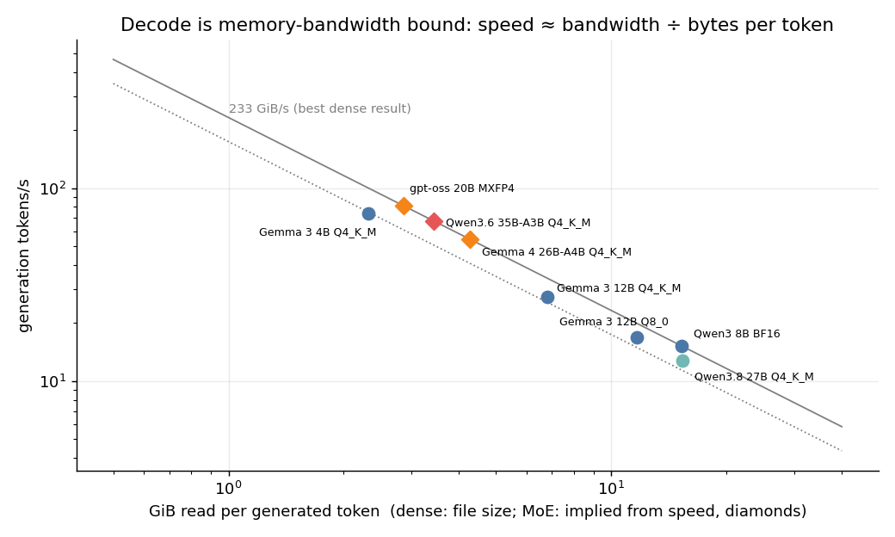

# What does it actually cost to run an LLM? Measurements on an NVIDIA DGX GB10

"How much RAM do I need for a 30B model?" is the wrong first question, and the honest answer is "it depends on three different things". This post breaks down where the memory goes and where the time goes. It is based on measurements of 8 models on a single DGX Spark-class machine (NVIDIA **GB10**, 121 GiB unified memory), run with `llama.cpp`.

**Who this is for:** anyone deciding what hardware to buy, or which model and quantization to deploy, who wants numbers instead of folklore.

## TL;DR

| Question | Answer (measured on GB10) |
|---|---|
| RAM for a ~30B model at 4-bit? | **~15–21 GiB** for weights, plus **+2.6 to +8 GiB** for a 128k context on the hybrid architectures tested (**+18 GiB** for a conventional one). Measured totals at 128k: **~23 GiB**. |
| What decides memory? | Weights (bits per weight × params) and the KV cache (context × architecture). Almost nothing else. |
| What decides generation speed? | **Memory bandwidth ÷ bytes read per token.** Not FLOPs. |
| What decides prompt-processing speed? | **Compute** (~45–55 TFLOP/s effective here). Roughly `23,000 ÷ params(B)` tokens/s for dense models. |
| Dense 27B vs MoE 35B-A3B at 4-bit | The MoE is **5.3× faster at generation** (67.7 vs 12.8 tok/s) and **2.8× faster at prompt processing**, with a bigger file. |
| Does a 128k context blow up memory? | Depends entirely on the architecture: **+2.6 GiB** (Qwen3.6-35B-A3B) vs **+8 GiB** (Qwen3.8-27B) vs **+18 GiB** (a conventional 8B). |
| Does concurrency help? | Yes. The dense 27B goes from 12.7 → 67.9 tok/s aggregate with 8 streams (5.3×). The MoE goes from 66 → 206 tok/s (3.1×). |


---

## 1. The test machine

| | |
|---|---|
| System | NVIDIA GB10 (Grace-Blackwell), 20 Arm cores (10× Cortex-X925 + 10× Cortex-A725) |
| Memory | **121.7 GiB unified LPDDR5x**, shared by CPU and GPU. There is no separate VRAM. |
| Software | `llama.cpp` build `10a60cf` (CUDA, compute capability 12.1), driver 580.173, CUDA 13.0 |
| Flags | `-fa 1 -ngl 99` (flash attention, all layers on GPU), same as the production server |

Two things matter about this machine:

1. **Unified memory.** "GPU memory" and "system RAM" are the same pool. A model that fits can use nearly all of the 121 GiB, which is far more than any single consumer GPU offers. What you give up is bandwidth (see §4).
2. **The bandwidth/compute ratio is the story.** Plenty of capacity, moderate bandwidth. That makes this box very good at *fitting* big models and mediocre at *streaming* big dense ones.

### Models tested

| Model | Type | Quant | Params (B) | File (GiB) | Bits/weight |
|---|---|---|---:|---:|---:|
| Gemma 3 4B | dense | Q4_K_M | 3.9 | 2.3 | 5.1 |
| Gemma 3 12B | dense | Q4_K_M | 11.8 | 6.8 | 4.9 |
| Gemma 3 12B | dense | Q8_0 | 11.8 | 11.6 | 8.5 |
| Qwen3 8B | dense | BF16 | 8.2 | 15.3 | 16.0 |
| Qwen3.8 27B | dense, hybrid attention | Q4_K_M | 27.3 | 15.3 | 4.8 |
| gpt-oss 20B | MoE (32 experts, 4 active) | MXFP4 | 20.9 | 11.3 | 4.6 |
| Gemma 4 26B-A4B | MoE | Q4_K_M | 25.2 | 15.8 | 5.4 |
| Qwen3.6 35B-A3B | MoE (256 experts, 8 active), hybrid attention | Q4_K_M | 34.7 | 20.6 | 5.1 |

"Q4_K_M" is not 4 bits: it averages about **4.8–5.1 bits per weight** because some tensors are kept at higher precision.

---

## 2. Where the memory goes

Memory for a running model is, to a good approximation:

```
memory ≈ weights  +  KV cache  +  small overhead (compute buffers, CUDA context, etc.)
```

### 2.1 Weights

```
weights (GiB) ≈ parameters × bits_per_weight / 8 / 2^30
```

For a 30B model:

| Quantization | bits/weight | ≈ weights for 30B |
|---|---:|---:|
| BF16 / FP16 | 16 | ~56 GiB |
| Q8_0 | 8.5 | ~30 GiB |
| Q4_K_M | ~4.9 | ~17 GiB |

This matches the measured files (Qwen3.8 27B at Q4_K_M: 15.3 GiB, which is 4.8 bits × 27.3B).

**Mixture-of-experts models still need all their weights resident.** Qwen3.6-35B-A3B only *computes* with ~3B parameters per token, but all 34.7B live in memory (20.6 GiB). MoE saves compute and bandwidth, not capacity.

### 2.2 The KV cache

Every token in the context stores a key and a value vector at each attention layer:

```
KV bytes per token = attention_layers × kv_heads × head_dim × 2 (K and V) × bytes_per_element
```

Read from the GGUF headers, then confirmed by measurement (§2.4):

| Model | Layers with KV | KV heads × head dim | Predicted | **Measured** |
|---|---:|---|---:|---:|
| Qwen3 8B (conventional) | 36 of 36 | 8 × 128 | 144 KiB/token | **145 KiB/token** |
| Qwen3.8 27B (hybrid) | 16 of 65 | 4 × 256 | 64 KiB/token | **65 KiB/token** |
| Qwen3.6 35B-A3B (hybrid) | 10 of 40 | 2 × 256 | 20 KiB/token | **21 KiB/token** |

The two Qwen models are **hybrids**: only every 4th layer is full attention, and the rest are state-space layers whose state does not grow with context. That is why the 35B model needs a quarter of the KV memory of a "normal" 8B model.

Practical consequences at **131,072 tokens** of context:

- Conventional 8B: 145 KiB × 131k ≈ **18 GiB** of KV cache, more than the 4-bit weights of a 27B model.
- Qwen3.8 27B: ≈ **8 GiB**.
- Qwen3.6 35B-A3B: ≈ **2.6 GiB**.

**Parallel slots.** With a unified KV pool (`--kv-unified`, as configured here), parallel slots *share* one pool, so total context across all concurrent users is what costs memory, not `slots × context`.

### 2.3 Everything else

Compute buffers, the CUDA context, and (for vision models) the multimodal projector. The projectors here are small (~0.9 GB for each Qwen model). Prompt-cache snapshots in the server are 170–440 MiB each. Overhead is modest relative to the first two terms: within about ±1 GiB of the file size at short context for the models measured. (On a unified-memory system the per-process numbers from `nvidia-smi` do not partition perfectly between "GPU" and "host", so treat sub-GiB differences as noise.)

### 2.4 Measured: total process memory vs context window

Each point is a fresh `llama-server` with a single slot, one request served, memory read from `nvidia-smi`:


| Model | 4k | 32k | 128k | KV cost (KiB/token) |
|---|---:|---:|---:|---:|
| Gemma 3 4B Q4 | 2.8 | 3.4 | 5.4 | 21 |
| Gemma 3 12B Q4 | 7.8 | 9.6 | 15.7 | 65 |
| gpt-oss 20B MXFP4 | 11.1 | 11.8 | 14.1 | 25 |
| Gemma 4 26B-A4B Q4 | 16.5 | 17.0 | 19.0 | 21 |
| Qwen3.8 27B Q4 (hybrid) | 15.1 | 16.8 | 22.9 | 65 |
| Qwen3.6 35B-A3B Q4 (hybrid) | 20.5 | 21.1 | 23.1 | 21 |
| Qwen3 8B BF16 | 15.0 | 18.9 | – (not run) | 145 |

(All values GiB. KV cost is fitted from the lowest and highest context measured for that model.)

Note the crossover: **at 4k the Qwen3.6 35B model needs 5.4 GiB more than the 27B; at 128k the gap is 0.2 GiB.** A "bigger" model can be cheaper to run at long context than a "smaller" one.

### 2.5 Shrinking the KV cache

Quantizing the KV cache trades quality for memory. Only the memory side was measured here (Gemma 3 12B at 128k context):

| KV cache type | Process memory (GiB) | Saving vs f16 |
|---|---:|---:|
| f16 (default) | 15.7 | – |
| q8_0 | 12.7 | −19% |
| q4_0 | 10.5 | −33% |

Quality impact was **not** evaluated in this post. Verify on your own task before using q4_0, and note that these savings matter most for conventional-attention models with large KV, and much less for the hybrids.

---

## 3. Where the time goes: two very different phases

An LLM request has two phases with different bottlenecks:

| Phase | What happens | Bottleneck | Metric |
|---|---|---|---|
| **Prefill** (prompt processing) | The whole prompt is processed in parallel | **Compute** | `pp` tokens/s |
| **Decode** (generation) | One token at a time; every step re-reads the weights | **Memory bandwidth** | `tg` tokens/s |

### 3.1 Prefill is compute-bound


For dense models, prompt speed times parameter count is nearly constant:

| Model | pp2048 (tok/s) | Params (B) | Effective compute (2 × params × tok/s) |
|---|---:|---:|---:|
| Gemma 3 4B Q4 | 5,695 | 3.9 | 44 TFLOP/s |
| Gemma 3 12B Q4 | 1,937 | 11.8 | 46 TFLOP/s |
| Qwen3 8B BF16 | 3,355 | 8.2 | 55 TFLOP/s |
| Qwen3.8 27B Q4 | 858 | 27.3 | 47 TFLOP/s |

So the rule of thumb for a dense model on this machine is **prompt tokens/s ≈ 23,000 ÷ params (B)**. It barely depends on quantization (Gemma 12B Q4 vs Q8: 1,937 vs 1,820 tok/s), because the work is arithmetic and not data movement. MoE models only compute with their *active* parameters, which is why a 35B-A3B processes prompts 2.8× faster than a dense 27B.

### 3.2 Decode is memory-bandwidth-bound



For each generated token the GPU must stream all (active) weights from memory. So:

```
tokens/s ≈ effective_bandwidth / bytes_read_per_token
```

Dense models, where bytes per token equals the file size, show it directly:

| Model | GiB read/token | tg (tok/s) | Effective bandwidth |
|---|---:|---:|---:|
| Gemma 3 4B Q4 | 2.3 | 74.1 | 171 GiB/s |
| Gemma 3 12B Q4 | 6.8 | 27.4 | 186 GiB/s |
| Gemma 3 12B Q8 | 11.6 | 17.0 | 198 GiB/s |
| Qwen3.8 27B Q4 | 15.3 | 12.8 | 195 GiB/s |
| Qwen3 8B BF16 | 15.3 | 15.2 | 233 GiB/s |

Every dense model lands at about **170–233 GiB/s** (≈ 185–250 GB/s), regardless of size. That is the machine's practical ceiling. (NVIDIA's published peak for GB10 is 273 GB/s; I did not measure raw bandwidth independently.) Smaller models reach a lower fraction of the ceiling because per-token fixed costs (kernel launches, sampling) take a bigger share.

**The consequence is the single most useful number in this post: on this machine, a dense 4-bit 27B model reads ~15 GiB per token and therefore generates at only about 13 tokens/s, however fast the compute is.**

MoE models break the link between *size* and *speed*. Using the ~233 GiB/s ceiling, the implied bytes touched per token are:

| Model | File (GiB) | tg (tok/s) | Implied GiB/token | % of file read per token |
|---|---:|---:|---:|---:|
| gpt-oss 20B MXFP4 | 11.3 | 81.3 | 2.86 | 25% |
| Gemma 4 26B-A4B Q4 | 15.8 | 54.5 | 4.27 | 27% |
| Qwen3.6 35B-A3B Q4 | 20.6 | 67.7 | 3.43 | 17% |

These implied figures are approximate, since they are derived assuming the best dense bandwidth, and they include always-read tensors (embeddings, attention, shared experts, output head) on top of the routed experts. The point stands: a 35B model that is 35% larger on disk than the dense 27B generates **5.3× faster**.

### 3.3 Context depth: how much slower with a long prompt in the cache?


Speed retained when 16k or 64k tokens are already in context (relative to empty context):

| Model | tg @16k | tg @64k | pp @16k | pp @64k |
|---|---:|---:|---:|---:|
| Gemma 3 12B Q4 | 84% | – | 92% | – |
| Qwen3 8B BF16 | 86% | – | 63% | – |
| gpt-oss 20B | 87% | – | 76% | – |
| Qwen3.8 27B (hybrid) | 95% | 81% | 89% | 68% |
| Qwen3.6 35B-A3B (hybrid) | 91% | 72% | 90% | 72% |

Long context costs something everywhere, since attention must read an ever-larger KV cache each step. At 64k the hybrids still hold 72–81% of their speed. (Models other than the two Qwens were only tested to 16k.)

### 3.4 Full speed table

| Model | Type | Quant | Params (B) | File (GiB) | pp @0 | tg @0 | pp @16k | tg @16k | pp @64k | tg @64k |
|---|---|---|---:|---:|---:|---:|---:|---:|---:|---:|
| Gemma 3 4B | dense | Q4_K_M | 3.9 | 2.3 | 5,695 | 74.1 | 5,290 | 64.9 | – | – |
| Gemma 3 12B | dense | Q4_K_M | 11.8 | 6.8 | 1,937 | 27.4 | 1,776 | 23.0 | – | – |
| Gemma 3 12B | dense | Q8_0 | 11.8 | 11.6 | 1,820 | 17.0 | 1,672 | 15.3 | – | – |
| Qwen3 8B | dense | BF16 | 8.2 | 15.3 | 3,355 | 15.2 | 2,128 | 13.1 | – | – |
| Qwen3.8 27B | dense (hybrid) | Q4_K_M | 27.3 | 15.3 | 858 | 12.8 | 767 | 12.1 | 587 | 10.4 |
| gpt-oss 20B | MoE | MXFP4 | 20.9 | 11.3 | 4,908 | 81.3 | 3,736 | 70.8 | – | – |
| Gemma 4 26B-A4B | MoE | Q4_K_M | 25.2 | 15.8 | 2,916 | 54.5 | 2,469 | 48.2 | – | – |
| Qwen3.6 35B-A3B | MoE (hybrid) | Q4_K_M | 34.7 | 20.6 | 2,439 | 67.7 | 2,195 | 61.5 | 1,762 | 48.6 |

`pp` = prompt tokens/s (2048-token prompt), `tg` = generated tokens/s (128 tokens), at the stated number of tokens already in context. All values are the mean of 3 repetitions after a warmup; run-to-run standard deviation is **below 1% for generation and below 5% for prompt processing** (raw data in `raw/speed/`).

---

## 4. What this means for real workloads

Benchmarks are abstract. Here is what the numbers mean per task, for the two models actually deployed on this machine (estimates computed from the measured rates; real servers add small overheads):

| Workload | Qwen3.8 27B (dense) | Qwen3.6 35B-A3B (MoE) |
|---|---:|---:|
| Chat: read a 500-token answer | ~39 s | ~7 s |
| Agent/RAG: ingest a 32k-token prompt | ~40–55 s | ~14–17 s |
| Then generate a 1,000-token answer from that prompt | ~85 s | ~18 s |
| Long document: ingest 64k tokens | ~95–110 s | ~33–37 s |

The shape of your workload decides which number matters:

- **Chat / code completion** (short prompt, long output): bandwidth-bound, so **tg** is what you feel. Favor MoE, or a smaller or more heavily quantized dense model.
- **RAG / agents / document analysis** (long prompt, short output): compute-bound, so **pp** dominates the latency before the first token. MoE helps here too (fewer active parameters).
- **Many users at once:** see below.

### Concurrency: batching is nearly free for decode

Because decode is limited by *reading weights*, serving several requests in one batch re-uses the same weight reads. Measured with `llama-batched-bench` (512-token prompt, 128 generated tokens each):


| Model | 1 stream | 2 | 4 | 8 | Scaling at 8 | Per-stream at 8 |
|---|---:|---:|---:|---:|---:|---:|
| Qwen3.8 27B (dense) | 12.7 | 23.8 | 42.9 | 67.9 | **5.3×** | 8.5 tok/s |
| Qwen3.6 35B-A3B (MoE) | 66.3 | 107.7 | 154.8 | 206.4 | 3.1× | 25.8 tok/s |
| gpt-oss 20B (MoE) | 78.3 | 123.6 | 180.4 | 242.3 | 3.1× | 30.3 tok/s |

(Aggregate generation tokens/s.) The dense model scales better because a dense step reads the same weights no matter how many tokens ride along. In an MoE, different tokens route to different experts, so a larger batch touches more of the weights and the free lunch shrinks. Even so, the MoE at 8 streams still delivers 3× the aggregate throughput of the dense model.

Memory-wise, extra concurrent streams only cost their KV cache (§2.2) because slots share the pool.

### Power and thermals

During the sustained benchmarks the GPU drew **31–52 W** on average (idle: ~7 W), peaked at **82 °C**, and reported **no throttle events** in any run. The dense 27B was the hottest and longest-running test.

---

## 5. Recommendations

1. **Budget memory as weights + KV cache + ~1 GiB.** Compute weights from `params × bits / 8`. Compute KV from the model's architecture (`layers × kv_heads × head_dim × 4 bytes` per token at f16; the GGUF header has all of it) and *your* planned context across all concurrent users.
2. **Check the architecture before choosing a context length.** Hybrid-attention models (Qwen3.5/3.6/3.8 family here) make 128k contexts cheap. Conventional ones can make long context cost more than the model itself.
3. **For interactive use on bandwidth-limited hardware, prefer MoE.** On this machine the 35B-A3B delivers 5× the generation speed of a dense 27B at similar quality class and only ~5 GiB more weights. Use dense models when you specifically need them, and plan on ~13 tok/s.
4. **Q4 is the sweet spot for speed per byte.** Q8_0 cost 1.7× the memory for 1.6× *lower* generation speed (27.4 → 17.0 tok/s) on Gemma 12B. BF16 is not worth it for inference on this class of hardware unless you are measuring quantization error.
5. **Serve concurrent users from one model instance.** Throughput scales 3–5× going from 1 to 8 streams. Do not run N copies of a model: you pay N× the weights for no extra bandwidth.
6. **Unified memory changes the shopping list.** A 121 GiB pool lets you keep several models resident at once (here: 24.3 GiB + 20.1 GiB resident, with ~62 GiB still available). Capacity is not the constraint, bandwidth is. If you need faster decode, you need more bandwidth, not more RAM.
7. **Consider KV quantization for long-context conventional models.** Save 19–33% total memory on Gemma 3 12B at 128k, but evaluate quality first.

---

## 6. Method and caveats

Reproduce everything with the scripts in [`scripts/`](scripts/) and the raw output in [`raw/`](raw/).

- **Speed:** `scripts/bench_speed.sh`: `llama-bench`, `-fa 1 -ngl 99`, prompts of 512 and 2048 tokens, 128 generated tokens, depths 0 / 16,384 (and 65,536 for the Qwen models), 1 warmup + 3 repetitions, one model at a time on an otherwise idle GPU. GPU clocks, power and throttle reasons were sampled every 2 s during each run (`raw/speed/*.gpu.csv`).
- **Memory:** `scripts/bench_memory.sh`: a fresh `llama-server` per (model, context) with the production flags and 1 slot, one short request, then per-process memory from `nvidia-smi` and RSS.
- **Concurrency:** `scripts/bench_concurrency.sh`: `llama-batched-bench`, 512-token prompt, 128 generated tokens, 1/2/4/8 parallel streams.
- **Figures and tables:** `scripts/analyze.py`.

Before measuring, the two models normally resident on the host were unloaded, so the baseline was 12.5 GiB used / 109.5 GiB available, with GPU utilization at 0%. They were reloaded afterwards.

**Limitations, stated plainly:**

- One machine, one `llama.cpp` build, one day. Numbers change with software versions (kernels improve quickly).
- `llama-bench` uses synthetic tokens with batch size 1. Real servers add sampling, templating and scheduling overhead, so expect slightly lower real-world rates.
- **No quality evaluation.** Quantization and KV-quantization are compared on memory and speed only. A faster, smaller configuration is only a win if its output is good enough for your task.
- Bandwidth figures are *derived* from throughput, not measured with a bandwidth microbenchmark. The MoE "implied bytes per token" values are approximations.
- Memory is per-process from `nvidia-smi` on a unified-memory system, where the GPU/host split is blurry, so differences under ~1 GiB should not be over-interpreted. The Qwen3 8B BF16 model was only measured to 32k context, and the 128k KV figure is inferred from the measured slope.
- The Gemma and gpt-oss speed rows were measured only to 16k depth.
- This is an idle host. Contention from other workloads on the same GPU will reduce all throughput numbers.
