# What does it actually cost to run an LLM? Measurements on an NVIDIA DGX GB10

"How much RAM do I need for a 30B model?" is the wrong first question. Memory, speed and *how many users you can serve* are three different costs, driven by three different things. This post measures all three on one machine (NVIDIA **GB10**, 121 GiB unified memory) with `llama.cpp`, for 8 models plus a quantization ladder, and tells you which numbers to trust and which not to.

**Who this is for:** anyone choosing hardware or a model/quantization to deploy, who wants numbers instead of folklore, and a method they can repeat.

**How to read it.** Every number is labelled **MEASURED** (observed directly), **DERIVED** (arithmetic on measured values) or **THEORETICAL / INFERRED** (a model or an assumption). Where they disagree, the disagreement is reported.

## TL;DR

| Question | Answer (GB10, `llama.cpp`) |
|---|---|
| RAM for a ~30B model at 4-bit? | **~15–21 GiB** of weights, plus a KV cache that depends on architecture: **+2.6 to +8 GiB** at 128k context for the hybrid-attention models tested, **+18 GiB** for a conventional one. Measured **GPU-process** memory at 128k: **~23 GiB**; counting host RSS, the server took **~26–32 GiB** of the machine for the two Qwen models (§2.6). |
| When is that memory taken? | **GPU-process memory: at launch.** It was flat from load to the end of every workload (±0.1 GiB): the server reserves the whole context pool up front, so `-c` sets that part. **Host RSS: it grows with use.** It rose from 0.8–1.3 GiB to 2.6–6.7 GiB and did not fall back (cause not isolated; consistent with the server's prompt cache). Budget both. |
| What decides generation speed? | For the configurations tested, **memory bandwidth ÷ bytes streamed per token** is the main limit. Predicted from a measured 216–243 GB/s streaming-kernel read bandwidth, the dense models landed at **78–109%** of prediction (median 93%). A first-order guide, not an exact predictor. This is about *speed*: capacity still decides what fits, how much context you can configure, and how many models stay resident. |
| What decides prompt-processing speed? | **Compute** (~45–55 TFLOP/s effective). Roughly `23,000 ÷ params(B)` tokens/s for dense models. |
| Dense 27B vs MoE 35B-A3B (4-bit) | The MoE is **5.3× faster at generation** (67.7 vs 12.8 tok/s) and **2.8× faster at prompt processing**, with a file 35% bigger. |
| Does quantizing hurt? | On wikitext-2 perplexity: Q8_0 **+0.29%**, Q4_K_M **+0.94%** vs BF16 (Qwen3-8B); Q4_K_M **+0.80%** vs Q8_0 (Gemma 3 12B). Perplexity only, not task quality. |
| How many users can it serve? | Far fewer than aggregate throughput suggests. With 4 slots and a stated SLO, a **preliminary** capacity bracket (§4.3 gives trials and spread) is **about 0.2–0.4 configured chat requests/s** for the 35B-A3B (every valid trial passed at 0.2, outcomes were mixed at 0.25–0.35, all failed at 0.4; by realized rate the boundary fell near 0.3 req/s) and **about 0.05–0.075** for the dense 27B (passed at 0.05 with P95 TTFT of 1.7–1.8 s against a 2 s limit, failed at 0.075). These are brackets from 3–4 trials per rate, not precise maxima. SLO-compliant output was **~40% of the batched-benchmark aggregate** (single-run comparison). |
| Do long prompts hurt other users? | Yes. At 0.08 long-context req/s the 35B-A3B's P95 inter-token latency went from 87 ms to **1.2 s** for everyone. |

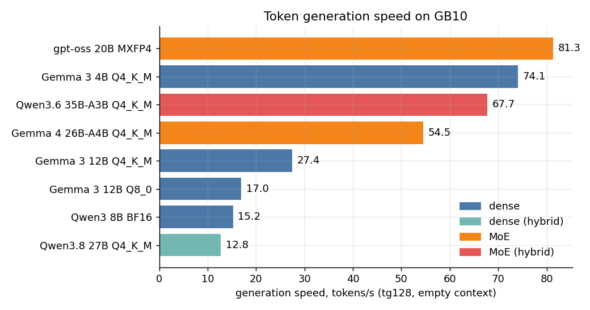

---

## 1. The test machine and the models

| | |
|---|---|
| System | NVIDIA GB10 (Grace-Blackwell), 20 Arm cores (10× Cortex-X925 + 10× Cortex-A725) |
| Memory | **121.7 GiB unified LPDDR5x**, shared by CPU and GPU. No separate VRAM. |
| Software | `llama.cpp` commit `10a60cf` (clean tree, CUDA 13.0, arch 121, Release), driver 580.173.02. Full record in [`raw2/environment.txt`](raw2/environment.txt). |
| Flags | `-fa 1 -ngl 99`, same as the production server. |

**Unified memory** means "GPU memory" and "system RAM" are one pool, so a model can use nearly all 121 GiB (far more than a consumer GPU), but streaming it is limited by the pool's bandwidth (§3). For *generation speed* on the configurations tested, bandwidth is the bottleneck, not capacity. Capacity still decides which models fit, how much context you can configure and how many models can stay resident together (§2, §4.3: with three production models resident, the machine was at ~89–93 GiB of 121.7 GiB).

| Model | Type | Quant | Params (B) | File (GiB) | Bits/weight |
|---|---|---|---:|---:|---:|
| Gemma 3 4B | dense | Q4_K_M | 3.9 | 2.3 | 5.1 |
| Gemma 3 12B | dense | Q4_K_M | 11.8 | 6.8 | 4.9 |
| Gemma 3 12B | dense | Q8_0 | 11.8 | 11.6 | 8.5 |
| Qwen3 8B | dense | BF16 / Q8_0 / Q4_K_M | 8.2 | 15.3 / 8.1 / 4.7 | 16 / 8.5 / 4.9 |
| Qwen3.8 27B | dense, hybrid attention | Q4_K_M | 27.3 | 15.3 | 4.8 |
| gpt-oss 20B | MoE (32 experts, 4 active) | MXFP4 | 20.9 | 11.3 | 4.6 |
| Gemma 4 26B-A4B | MoE | Q4_K_M | 25.2 | 15.8 | 5.4 |
| Qwen3.6 35B-A3B | MoE (256 experts, 8 active), hybrid attention | Q4_K_M | 34.7 | 20.6 | 5.1 |

"Q4_K_M" is not 4 bits: it averages **4.8–5.1 bits per weight**. Model hashes are in [`raw2/model_sha256.txt`](raw2/model_sha256.txt).

---

## 2. Where the memory goes

```
GPU-process memory ≈ weights + KV-cache pool + compute buffers      (reserved at launch)
system memory used ≈ GPU-process memory + host RSS                  (RSS grows with use)
```

Five different numbers get called "the memory", and they are not interchangeable. This post keeps them apart:

| Term | What it is | How it is obtained |
|---|---|---|
| **Weights** | The model's tensors | GGUF file size (MEASURED) or `params × bits / 8` (THEORETICAL) |
| **KV-cache allocation** | The context pool reserved at launch, `-c × bytes per token` | Formula from GGUF headers (THEORETICAL), slope checked in §2.4 |
| **Inference-process (GPU) memory** | Weights + KV pool + compute buffers, as `nvidia-smi` attributes to the process. On unified memory this is *not* isolated VRAM | MEASURED (§2.4, §2.6) |
| **Host RSS** | Resident host memory of the server process (runtime, prompt cache). Starts at ~1 GiB and **grows with use** | MEASURED (§2.6) |
| **Total system consumption** | Increase in the machine's "used" memory (`free`) while the server runs | MEASURED (§2.6); includes anything else on the machine |

Worked example from §2.6 for Qwen3.6 35B-A3B at 131k context: weights 20.6 GiB + KV pool ≈ 2.6 GiB ≈ 23.2 GiB, against a measured GPU-process 23.3 GiB; host RSS grew to 3.3 GiB; total system consumption peaked at +26.2 GiB. For the dense Qwen3.8 27B the same three figures were 23.4, 6.7 and +31.6 GiB. **Quoting only the GPU-process number understates what the server takes from the machine by 3–8 GiB.**

### 2.1 Weights (THEORETICAL, confirmed by file sizes)

```
weights (GiB) ≈ parameters × bits_per_weight / 8 / 2^30
```

| Quantization | bits/weight | ≈ weights for 30B |
|---|---:|---:|
| BF16 / FP16 | 16 | ~56 GiB |
| Q8_0 | 8.5 | ~30 GiB |
| Q4_K_M | ~4.9 | ~17 GiB |

**MoE models need all their weights resident.** Qwen3.6-35B-A3B computes with ~3B parameters per token but holds all 34.7B (20.6 GiB). MoE saves compute and bandwidth, not capacity.

### 2.2 The KV cache (THEORETICAL formula, MEASURED slopes)

Every token in context stores a key and a value at each attention layer:

```
KV bytes per token = attention_layers × kv_heads × head_dim × 2 (K and V) × bytes_per_element
```

Read from the GGUF headers, then compared with the measured slope (§2.4):

| Model | Layers with KV | KV heads × head dim | Predicted | **Measured** |
|---|---:|---|---:|---:|
| Qwen3 8B (conventional) | 36 of 36 | 8 × 128 | 144 KiB/token | **145 KiB/token** |
| Qwen3.8 27B (hybrid) | 16 of 65 | 4 × 256 | 64 KiB/token | **65 KiB/token** |
| Qwen3.6 35B-A3B (hybrid) | 10 of 40 | 2 × 256 | 20 KiB/token | **21 KiB/token** |

The two Qwen models are **hybrids**: only every 4th layer is full attention; the rest are state-space layers whose state does not grow with context. At **131,072 tokens** that is ≈ **18 GiB** of KV for a conventional 8B, ≈ **8 GiB** for Qwen3.8 27B and ≈ **2.6 GiB** for Qwen3.6 35B-A3B.

The formula was verified against headers for the three Qwen models only. For the other architectures (e.g. Gemma 3, which mixes sliding-window and global layers; gpt-oss) the slopes in §2.4 are fitted from two points and should not be assumed linear in general.

**Parallel slots.** With a unified KV pool (`--kv-unified`), slots *share* one pool, so total context across users costs memory, not `slots × context`.

### 2.3 Everything else

Compute buffers, CUDA context, the vision projector (~0.9 GB for each Qwen model here) and, on the host, a prompt cache (§2.6). At short context the process was within ±1 GiB of its file size for the models measured.

### 2.4 Measured: process memory vs context window

One fresh `llama-server` per point, one slot, one request, memory from `nvidia-smi` (round 1, single measurement per point):

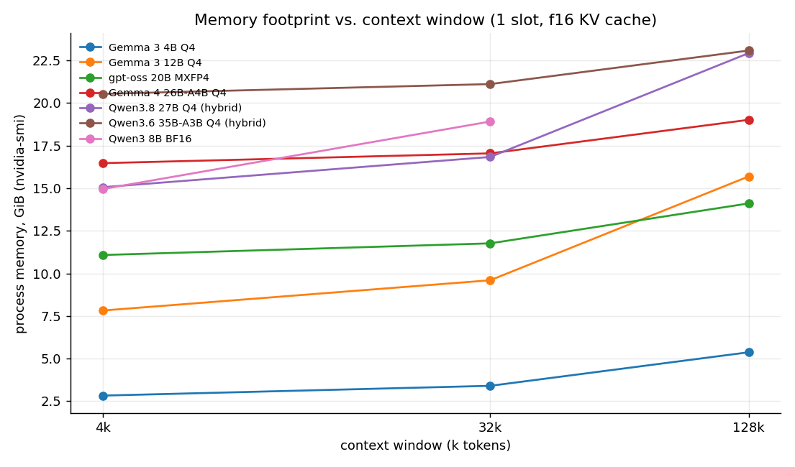

**Process memory (GiB) vs context, measured**

| Model | 4k | 32k | 128k | KV cost (KiB/token) |
|---|---:|---:|---:|---:|
| Gemma 3 4B Q4 | 2.8 | 3.4 | 5.4 | 21 |
| Gemma 3 12B Q4 | 7.8 | 9.6 | 15.7 | 65 |
| gpt-oss 20B MXFP4 | 11.1 | 11.8 | 14.1 | 25 |
| Gemma 4 26B-A4B Q4 | 16.5 | 17.0 | 19.0 | 21 |
| Qwen3.8 27B Q4 (hybrid) | 15.1 | 16.8 | 22.9 | 65 |
| Qwen3.6 35B-A3B Q4 (hybrid) | 20.5 | 21.1 | 23.1 | 21 |
| Qwen3 8B BF16 | 15.0 | 18.9 | – | 145 |

Note the crossover: at 4k the 35B-A3B needs 5.4 GiB more than the 27B; at 128k the gap is 0.2 GiB. A "bigger" model can be cheaper at long context than a "smaller" one.

### 2.5 Shrinking the KV cache

Memory side only (quality not evaluated):

**KV-cache quantization, Gemma 3 12B @128k**

| KV type | Process memory (GiB) |
|---|---:|
| f16 | 15.7 |
| q8_0 | 12.7 |
| q4_0 | 10.5 |

### 2.6 Memory over a server's lifetime (MEASURED, round 2)

Round 1 gave one number per configuration. Round 2 samples memory every 0.5 s through a server's whole life: load, idle, a 16k-token prefill, a 256-token generation, 4 concurrent requests, and one request that fills the entire 131k context pool. All requests were validated (exact token counts); the 4 models and 4 slots are in the table.

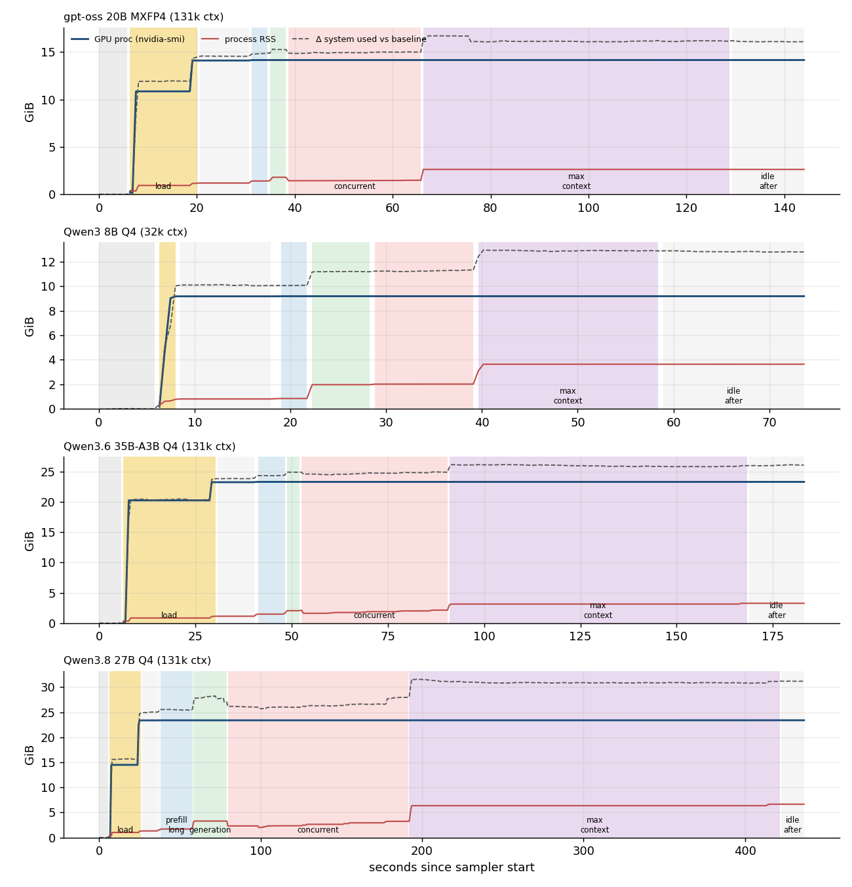

**Memory over the process lifecycle, 1 server with 4 slots (MEASURED; GiB unless noted)**

`GPU proc` = nvidia-smi per-process memory (on unified memory this is *not* isolated VRAM). `RSS` = host-resident memory of the process. `Δ system used` = peak `free` 'used' minus the pre-launch baseline (includes everything on the machine, not only the server). `PSI` = peak kernel memory-pressure stall, % of time (10 s average).

| Model | GPU proc at load | GPU proc peak | GPU proc after workload | RSS after load | RSS peak | Δ system used (peak) | Min available | Peak PSI % | All requests OK |
|---|---:|---:|---:|---:|---:|---:|---:|---:|---:|
| gpt-oss 20B MXFP4 (131k ctx) | 14.1 | 14.2 | 14.2 | 1.2 | 2.6 | +16.7 | 46 | 0.0 | yes |
| Qwen3 8B Q4 (32k ctx) | 9.2 | 9.2 | 9.2 | 0.8 | 3.6 | +12.9 | 51 | 0.0 | yes |
| Qwen3.6 35B-A3B Q4 (131k ctx) | 23.3 | 23.3 | 23.3 | 1.1 | 3.3 | +26.2 | 37 | 3.0 | yes |
| Qwen3.8 27B Q4 (131k ctx) | 23.4 | 23.4 | 23.4 | 1.3 | 6.7 | +31.6 | 32 | 4.3 | yes |

What the data shows:

- **GPU-process memory is reserved at launch, not consumed by traffic.** It rose in two steps during load (weights first, then KV cache and compute buffers) and then stayed flat to within 0.1 GiB through every workload, including the 130k-token request. That part is decided by `-c` and the model, not by how busy the server is. It is **not** the whole cost: see the next bullet.
- **Host memory does grow with use.** Process RSS started at 0.8–1.3 GiB and ended at 2.6–6.7 GiB, and did not fall after the work finished. That is consistent with the server's host-side prompt cache (`--cache-ram`, default 8192 MiB per the server's own help text), but I did not isolate the cause. Budget a few GiB of host memory per server on top of the GPU figure.
- **On this unified-memory system the two counters add up.** GPU-process memory plus RSS matched the machine-wide increase in "used" memory within 1.5 GiB for all four models, so they do not double-count.
- **No real memory pressure here, but not zero.** Minimum available memory stayed at about 32 GiB or more and the kernel's memory-pressure indicator (PSI) peaked at 3.0–4.3% during model load, then fell to 0. The machine also had ~10.5 GiB of swap in use before every run, from other workloads, and it barely moved.

**Per-phase peaks (MEASURED)**

| Model | Phase | Samples | GPU proc peak (GiB) | RSS peak (GiB) | Δ system used peak (GiB) |
|---|---:|---:|---:|---:|---:|
| gpt-oss 20B MXFP4 (131k ctx) | idle_after_load | 20 | 14.12 | 1.19 | +14.59 |
| gpt-oss 20B MXFP4 (131k ctx) | prefill_long | 7 | 14.16 | 1.40 | +14.90 |
| gpt-oss 20B MXFP4 (131k ctx) | generation | 7 | 14.16 | 1.80 | +15.31 |
| gpt-oss 20B MXFP4 (131k ctx) | concurrent | 51 | 14.17 | 1.48 | +15.03 |
| gpt-oss 20B MXFP4 (131k ctx) | max_context | 117 | 14.17 | 2.62 | +16.73 |
| gpt-oss 20B MXFP4 (131k ctx) | idle_after | 29 | 14.17 | 2.63 | +16.22 |
| Qwen3 8B Q4 (32k ctx) | idle_after_load | 19 | 9.17 | 0.80 | +10.12 |
| Qwen3 8B Q4 (32k ctx) | prefill_long | 6 | 9.18 | 0.83 | +10.07 |
| Qwen3 8B Q4 (32k ctx) | generation | 12 | 9.18 | 1.96 | +11.20 |
| Qwen3 8B Q4 (32k ctx) | concurrent | 20 | 9.18 | 2.01 | +11.32 |
| Qwen3 8B Q4 (32k ctx) | max_context | 36 | 9.18 | 3.63 | +12.94 |
| Qwen3 8B Q4 (32k ctx) | idle_after | 29 | 9.18 | 3.63 | +12.88 |
| Qwen3.6 35B-A3B Q4 (131k ctx) | idle_after_load | 19 | 23.27 | 1.14 | +23.94 |
| Qwen3.6 35B-A3B Q4 (131k ctx) | prefill_long | 14 | 23.32 | 1.61 | +24.43 |
| Qwen3.6 35B-A3B Q4 (131k ctx) | generation | 7 | 23.32 | 2.06 | +24.95 |
| Qwen3.6 35B-A3B Q4 (131k ctx) | concurrent | 72 | 23.32 | 2.15 | +24.96 |
| Qwen3.6 35B-A3B Q4 (131k ctx) | max_context | 146 | 23.32 | 3.28 | +26.18 |
| Qwen3.6 35B-A3B Q4 (131k ctx) | idle_after | 28 | 23.32 | 3.28 | +26.14 |
| Qwen3.8 27B Q4 (131k ctx) | idle_after_load | 19 | 23.37 | 1.32 | +25.06 |
| Qwen3.8 27B Q4 (131k ctx) | prefill_long | 38 | 23.38 | 2.00 | +25.63 |
| Qwen3.8 27B Q4 (131k ctx) | generation | 39 | 23.39 | 3.29 | +28.24 |
| Qwen3.8 27B Q4 (131k ctx) | concurrent | 210 | 23.40 | 3.23 | +28.01 |
| Qwen3.8 27B Q4 (131k ctx) | max_context | 431 | 23.40 | 6.65 | +31.64 |
| Qwen3.8 27B Q4 (131k ctx) | idle_after | 28 | 23.40 | 6.65 | +31.22 |

**A gotcha: a pool-sized request can crowd out others.** In my first lifecycle round the concurrent phase ran *after* the request that filled the 131k pool. Four concurrent requests using only half the pool then failed with HTTP 500 `Context size has been exceeded` on 3 of 4 models. Repeating the identical 8B configuration, 3 of 5 validated runs failed and 2 passed, so it is **intermittent**. I do not know the mechanism. In the final run the concurrent phase ran before the pool-filling request and all 32 requests succeeded. The failing runs are preserved in [`raw2/memlife_v2_concurrent_after_maxctx/`](raw2/memlife_v2_concurrent_after_maxctx/) and [`raw2/memlife_v1_diagnostic_runs/`](raw2/memlife_v1_diagnostic_runs/). Practical advice: with a shared pool, do not let one request approach the pool size if others need to run, and test your own concurrency pattern.

---

## 3. Where the time goes

| Phase | What happens | Bottleneck | Metric |
|---|---|---|---|
| **Prefill** (prompt processing) | whole prompt in parallel | **Compute** | `pp` tokens/s |
| **Decode** (generation) | one token at a time; each step re-reads the weights | **Memory bandwidth** | `tg` tokens/s |

### 3.1 Prefill is compute-bound

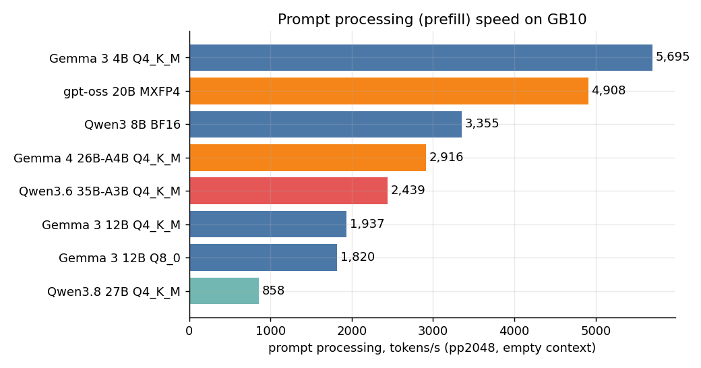

For dense models, prompt speed × parameter count is nearly constant (DERIVED):

| Model | pp2048 (tok/s) | Params (B) | 2 × params × tok/s |
|---|---:|---:|---:|
| Gemma 3 4B Q4 | 5,695 | 3.9 | 44 TFLOP/s |
| Gemma 3 12B Q4 | 1,937 | 11.8 | 46 TFLOP/s |
| Qwen3 8B BF16 | 3,355 | 8.2 | 55 TFLOP/s |
| Qwen3.8 27B Q4 | 858 | 27.3 | 47 TFLOP/s |

Rule of thumb for dense models here: **prompt tokens/s ≈ 23,000 ÷ params (B)**, nearly independent of quantization. MoE models compute with only their active parameters, hence 2.8× faster prompts for the 35B-A3B than the dense 27B.

**Caveat on stability.** Within a session prompt speed was steady (stddev ≤ 5%). Across sessions it was not: Qwen3 8B BF16 measured 3,355 tok/s in round 1 and 2,938 ± 154 tok/s in round 2 (5 repetitions, 12% lower). Round 2 ran with two other models resident but idle; I did not establish the cause. Generation speed, by contrast, agreed across sessions (15.2 vs 15.5 tok/s). Treat `pp` figures as ±10–15%.

### 3.2 Decode is memory-bandwidth-bound

The model: for each token the GPU streams the weights, so

```
tokens/s ≈ achievable_bandwidth / bytes_streamed_per_token        (THEORETICAL)
```

Round 1 *inferred* a bandwidth from throughput, which is circular. Round 2 **measures** it with a separate streaming kernel (`scripts/membw.cu`: 16-byte loads/stores, CUDA events, 20 iterations after 3 warm-ups):

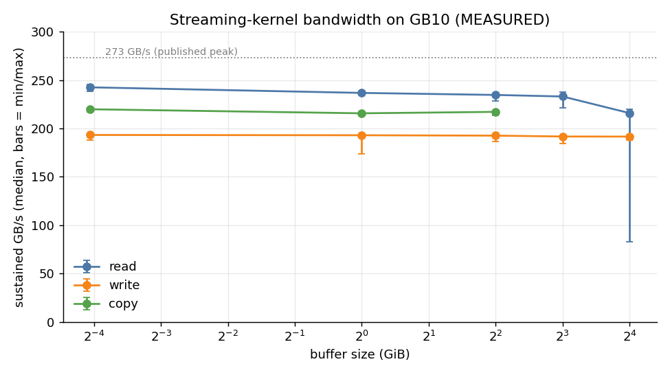

**Memory-bandwidth microbenchmark (MEASURED)**

| Kernel | Buffer (GiB) | Iters | Median GB/s | Min GB/s | Max GB/s | Median GiB/s | % of 273 GB/s spec |
|---|---:|---:|---:|---:|---:|---:|---:|
| read | 0.06 | 20 | 243 | 238 | 246 | 226 | 89% |
| write | 0.06 | 20 | 193 | 188 | 195 | 180 | 71% |
| copy | 0.06 | 20 | 220 | 217 | 222 | 205 | 81% |
| read | 1.00 | 20 | 237 | 235 | 238 | 220 | 87% |
| write | 1.00 | 20 | 193 | 174 | 193 | 180 | 71% |
| copy | 1.00 | 20 | 216 | 214 | 216 | 201 | 79% |
| read | 4.00 | 20 | 235 | 228 | 236 | 219 | 86% |
| write | 4.00 | 20 | 193 | 186 | 193 | 179 | 71% |
| copy | 4.00 | 20 | 217 | 213 | 218 | 202 | 80% |
| read | 8.00 | 20 | 233 | 222 | 237 | 217 | 85% |
| write | 8.00 | 20 | 192 | 184 | 192 | 178 | 70% |
| read | 16.00 | 20 | 216 | 83 | 220 | 201 | 79% |
| write | 16.00 | 20 | 192 | 188 | 192 | 178 | 70% |

Read bandwidth is **~243 GB/s on small buffers, falling to ~216 GB/s at 16 GiB**, i.e. 79–89% of the published 273 GB/s peak (THEORETICAL, from the spec sheet, not verified here). Writes reach about 193 GB/s. At 16 GiB, one iteration dropped to 83 GB/s; it is kept in the data, since no exclusion rule was defined in advance. This is a *simple streaming kernel*, an estimate of what a well-behaved kernel can pull, not the access pattern of llama.cpp's matrix kernels.

**Four different "bandwidths" appear in this section; they are not interchangeable:**

| Term | Value here | Status |
|---|---|---|
| Theoretical peak | 273 GB/s | Spec sheet; not verified here |
| Measured streaming-kernel bandwidth | ~243 GB/s (small buffers) to ~216 GB/s (16 GiB) read | MEASURED with `membw.cu`, a simple kernel, not llama.cpp's kernels |
| Inferred effective bandwidth | observed tok/s × bytes streamed per token | DERIVED; it is only as good as the bytes-per-token estimate and includes every non-bandwidth cost |
| Actual LLM throughput | tok/s from `llama-bench` | MEASURED |

The prediction compares the third and fourth against the second. The ratio is a model-fit check, not a hardware measurement: where it falls short (small models, Q4_K kernels) the gap is overhead or kernel efficiency, not a lower bandwidth ceiling.

**Bytes streamed per token (DERIVED from the GGUF tensor table).** Almost all weights are read once per token. The exception is the token-embedding table: only one row is looked up, unless the output head is *tied* to it (as in Gemma 3), in which case it is read in full. Excluding the embedding table saves 4–8% for untied models.

**Prediction vs observation, dense models:**

**Decode speed: theoretical prediction vs observation, dense models**

Columns: weights file (MEASURED), bytes streamed per token (DERIVED from the GGUF tensor table), microbenchmark read bandwidth at the nearest buffer size (MEASURED), predicted tok/s = bandwidth ÷ bytes (THEORETICAL), observed tok/s (MEASURED), effective bandwidth = observed × bytes (DERIVED, not a hardware measurement), observed ÷ predicted.

| Model | Tensors (GiB) | Streamed/token (GiB) | Output head | Microbench read GiB/s | Predicted tok/s | Observed tok/s | Effective GiB/s | Obs ÷ pred |
|---|---:|---:|---:|---:|---:|---:|---:|---:|
| Gemma 3 4B Q4_K_M | 2.31 | 2.31 | tied | 219 (@4 GiB) | 94.5 | 74.1 ± 0.2 (n=3) | 171 | 78% |
| Gemma 3 12B Q4_K_M | 6.79 | 6.79 | tied | 217 (@8 GiB) | 32.0 | 27.4 ± 0.1 (n=3) | 186 | 86% |
| Gemma 3 12B Q8_0 | 11.64 | 11.64 | tied | 201 (@16 GiB) | 17.3 | 17.0 ± 0.0 (n=3) | 198 | 98% |
| Qwen3 8B Q4_K_M | 4.68 | 4.35 | untied | 219 (@4 GiB) | 50.2 | 44.0 ± 0.1 (n=5) | 191 | 87% |
| Qwen3 8B Q8_0 | 8.11 | 7.49 | untied | 217 (@8 GiB) | 29.0 | 29.1 ± 0.1 (n=5) | 218 | 100% |
| Qwen3 8B BF16 | 15.26 | 14.10 | untied | 201 (@16 GiB) | 14.3 | 15.5 ± 0.0 (n=5) | 219 | 109% |
| Qwen3.8 27B Q4_K_M | 15.32 | 14.66 | untied | 201 (@16 GiB) | 13.7 | 12.8 ± 0.0 (n=3) | 187 | 93% |

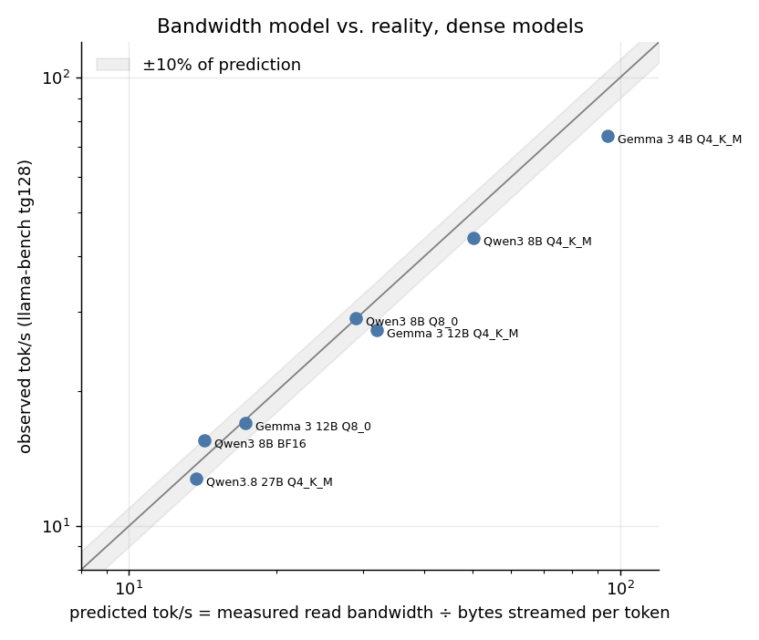

The model is useful and imperfect. Observed speed was **78%–109%** of the prediction (median 93%). It over-predicts the smallest model (Gemma 3 4B at 78%: fixed per-token costs matter more when the weights are small) and under-predicts BF16 (109%, where the 16 GiB microbenchmark point is the pessimistic, noisy one). Do not read it as "speed = bandwidth ÷ size to the percent".

**The quantization ladder (same weights, three precisions; 5 repetitions each):**

| Qwen3-8B | Tensors (GiB) | Generation (tok/s) | Speed vs BF16 | Effective GiB/s |
|---|---:|---:|---:|---:|
| BF16 | 15.26 | 15.5 | 1.00× | 219 |
| Q8_0 | 8.11 | 29.1 | 1.88× | 218 |
| Q4_K_M | 4.68 | 44.0 | 2.84× | 191 |

Weights shrink 3.3× from BF16 to Q4_K_M but speed rises only 2.8×: the Q4_K kernel reaches ~13% less effective bandwidth (DERIVED), plausibly dequantization overhead. Bytes are the first-order driver, kernel efficiency the second.

**MoE models** break the link between file size and speed. The table below is an **inference, not a measurement**: it divides the measured read bandwidth by the observed speed, and it lumps together routed experts, always-read tensors and any cache effects.

**MoE models: bytes touched per token INFERRED from speed (not measured)**

Inferred = measured read bandwidth (201–217 GiB/s, microbenchmark at 16 and 8 GiB) ÷ observed tok/s. This is an *inference*: it assumes the kernels run at the microbenchmark's bandwidth, and it lumps together routed experts, always-read tensors (attention, shared experts, output head) and any cache effects. Treat it as an order of magnitude, not a traffic measurement.

| Model | File (GiB) | Observed tok/s | Inferred GiB/token | Inferred share of file read per token |
|---|---:|---:|---:|---:|
| gpt-oss 20B MXFP4 | 11.3 | 81.3 ± 0.2 (n=3) | 2.5 – 2.7 | 22% – 24% |
| Gemma 4 26B-A4B Q4_K_M | 15.8 | 54.5 ± 0.2 (n=3) | 3.7 – 4.0 | 23% – 25% |
| Qwen3.6 35B-A3B Q4_K_M | 20.6 | 67.7 ± 0.2 (n=3) | 3.0 – 3.2 | 14% – 16% |

The robust conclusion is the observation itself: the 35B-A3B file is 35% larger than the dense 27B yet generates **5.3× faster**.

### 3.3 Context depth: speed with a long prompt already in the cache

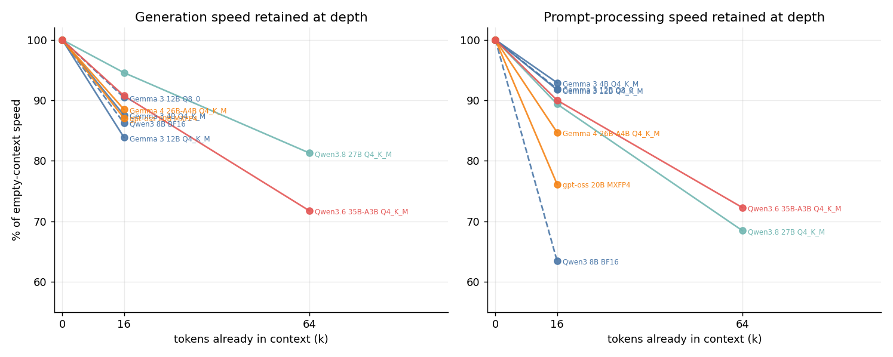

| Model | tg @16k | tg @64k | pp @16k | pp @64k |
|---|---:|---:|---:|---:|
| Gemma 3 12B Q4 | 84% | – | 92% | – |
| Qwen3 8B BF16 | 86% | – | 63% | – |
| gpt-oss 20B | 87% | – | 76% | – |
| Qwen3.8 27B (hybrid) | 95% | 81% | 89% | 68% |
| Qwen3.6 35B-A3B (hybrid) | 91% | 72% | 90% | 72% |

(% of empty-context speed, DERIVED.) At 64k the hybrids still hold 72–81% of generation speed. Models other than the two Qwens were tested only to 16k.

### 3.4 Full speed table (round 1, 3 repetitions)

**Speed**

| Model | Type | Quant | Params (B) | File (GiB) | pp @0 | tg @0 | pp @16k | tg @16k | pp @64k | tg @64k |
|---|---:|---:|---:|---:|---:|---:|---:|---:|---:|---:|
| Gemma 3 4B | dense | Q4_K_M | 3.9 | 2.3 | 5,695 | 74.1 | 5,290 | 64.9 | – | – |
| Gemma 3 12B | dense | Q4_K_M | 11.8 | 6.8 | 1,937 | 27.4 | 1,776 | 23.0 | – | – |
| Gemma 3 12B | dense | Q8_0 | 11.8 | 11.6 | 1,820 | 17.0 | 1,672 | 15.3 | – | – |
| Qwen3 8B | dense | BF16 | 8.2 | 15.3 | 3,355 | 15.2 | 2,128 | 13.1 | – | – |
| Qwen3.8 27B | dense (hybrid) | Q4_K_M | 27.3 | 15.3 | 858 | 12.8 | 767 | 12.1 | 587 | 10.4 |
| gpt-oss 20B | MoE | MXFP4 | 20.9 | 11.3 | 4,908 | 81.3 | 3,736 | 70.8 | – | – |
| Gemma 4 26B-A4B | MoE | Q4_K_M | 25.2 | 15.8 | 2,916 | 54.5 | 2,469 | 48.2 | – | – |
| Qwen3.6 35B-A3B | MoE (hybrid) | Q4_K_M | 34.7 | 20.6 | 2,439 | 67.7 | 2,195 | 61.5 | 1,762 | 48.6 |

`pp` = prompt tokens/s (2048-token prompt), `tg` = generated tokens/s (128 tokens), at the stated tokens already in context. Mean of 3 repetitions after a warm-up; within-session standard deviation was below 1% for generation and below 5% for prompt processing (raw data in `raw/speed/`).

---

## 4. What this means for real workloads

### 4.1 Single-user latency (ESTIMATED from measured rates)

| Workload | Qwen3.8 27B (dense) | Qwen3.6 35B-A3B (MoE) |
|---|---:|---:|
| Chat: read a 500-token answer | ~39 s | ~7 s |
| Agent/RAG: ingest a 32k-token prompt | ~40–55 s | ~14–17 s |
| Then generate a 1,000-token answer from that prompt | ~85 s | ~18 s |
| Long document: ingest 64k tokens | ~95–110 s | ~33–37 s |

Chat and code completion are bandwidth-bound (favor MoE or a smaller model). RAG and agents are compute-bound at the front (MoE helps there too).

### 4.2 Many users at once, batched (MEASURED, `llama-batched-bench`, n = 1 run each)

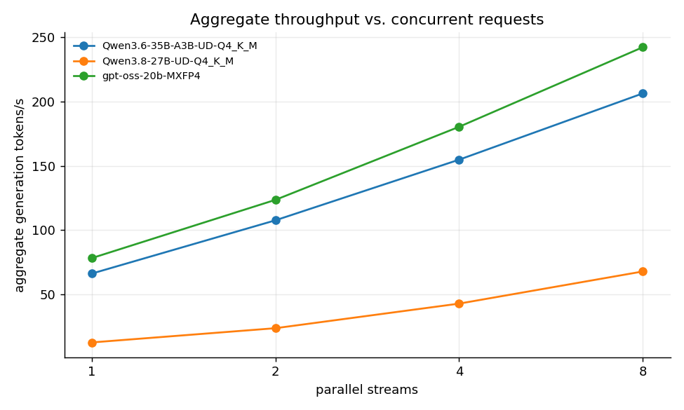

**Concurrency (aggregate tg)**

| Model | Streams | Aggregate t/s | Per-stream t/s |
|---|---:|---:|---:|
| Qwen3.6-35B-A3B-UD-Q4_K_M | 1 | 66.3 | 66.3 |
| Qwen3.6-35B-A3B-UD-Q4_K_M | 2 | 107.7 | 53.8 |
| Qwen3.6-35B-A3B-UD-Q4_K_M | 4 | 154.8 | 38.7 |
| Qwen3.6-35B-A3B-UD-Q4_K_M | 8 | 206.4 | 25.8 |
| Qwen3.8-27B-UD-Q4_K_M | 1 | 12.7 | 12.7 |
| Qwen3.8-27B-UD-Q4_K_M | 2 | 23.8 | 11.9 |
| Qwen3.8-27B-UD-Q4_K_M | 4 | 42.9 | 10.7 |
| Qwen3.8-27B-UD-Q4_K_M | 8 | 67.9 | 8.5 |
| gpt-oss-20b-MXFP4 | 1 | 78.3 | 78.3 |
| gpt-oss-20b-MXFP4 | 2 | 123.6 | 61.8 |
| gpt-oss-20b-MXFP4 | 4 | 180.4 | 45.1 |
| gpt-oss-20b-MXFP4 | 8 | 242.3 | 30.3 |

Batching decode is nearly free because decode is limited by *reading weights*, which a batch shares. The dense model scales better (5.3× at 8 streams) than the MoE (3.1×), since different tokens route to different experts and touch more of the weights. **But this benchmark is not serving capacity.** It sends identical, simultaneous, fixed-length requests and reports aggregate tokens/s, which says nothing about how long any one user waits.

### 4.3 Serving capacity under a latency target (MEASURED, round 2)

`scripts/load_test.py` sends requests with **Poisson arrivals** (open loop, so a slow server cannot slow the clients down), against a fresh `llama-server` with **4 slots and a 131k shared pool**. Prompts are cut from real text at random offsets with the prompt cache off; output lengths are forced so every model sees the same work. Per request it records time to first token (TTFT, which *includes* time queued for a slot), inter-token latency (ITL) and end-to-end latency.

**Workload profiles** (log-normal lengths, clipped):

| Profile | Prompt tokens (min / median / max) | Output tokens (min / median / max) |
|---|---|---|
| chat | 100 / 400 / 1,500 | 50 / 200 / 500 |
| long | 8,000 / 16,000 / 24,000 | 100 / 300 / 600 |
| mixed | 80% chat + 20% long | |

**SLOs, fixed before running and not tuned to results.** chat: P95 TTFT ≤ 2 s *and* P95 ITL ≤ 100 ms *and* zero failures. long and mixed: P95 TTFT ≤ 60 s *and* P95 ITL ≤ 200 ms *and* zero failures. A run is judged only if ≥ 20 requests completed.

**Repeats.** The first sweep used one run (seed 1) per rate. A follow-up (`bench_latency_repeat.sh`, same server flags and SLOs, fresh server) added seeds 1–4 at 0.2–0.4 req/s for the 35B-A3B (intermediate rates 0.25, 0.3, 0.35) and at 0.05–0.1 req/s for the 27B (intermediate rate 0.075). The seed sets arrival times, prompt/output lengths and prompt offsets, so trials with different seeds are independent. All 28 follow-up attempts completed; none failed to produce a summary (manifest: [`raw2/latency_rep/manifest.tsv`](raw2/latency_rep/manifest.tsv)). The original single runs are unchanged and count as seed 1 where applicable.

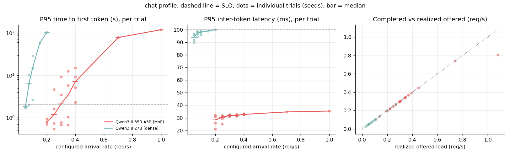

**Load test: chat profile (MEASURED)**

SLO: P95 TTFT ≤ 2 s, P95 ITL ≤ 100 ms, zero failures. Percentiles are shown only when ≥ 20 requests completed; `n/a` means too few samples to judge.

| Model | Offered req/s | Seed | Dur (s) | Sent | Done | Failed | Realized offered req/s | Out tok/s | TTFT p50 (s) | TTFT p95 (s) | TTFT p99 (s) | ITL p50 (ms) | ITL p95 (ms) | E2E p50 (s) | E2E p95 (s) | Peak sys used (GiB) | SLO |
|---|---:|---:|---:|---:|---:|---:|---:|---:|---:|---:|---:|---:|---:|---:|---:|---:|---:|
| Qwen3.6 35B-A3B (MoE) | 0.2 | 1 | 150 | 40 | 40 | 0 | 0.267 | 62.2 | 0.44 | 0.94 | 1.94 | 25 | 32 | 6.4 | 12.1 | 89.6 | PASS |
| Qwen3.6 35B-A3B (MoE) | 0.2 | 2 | 150 | 30 | 30 | 0 | 0.200 | 42.1 | 0.42 | 0.69 | 0.72 | 17 | 26 | 4.2 | 7.6 | 93.5 | PASS |
| Qwen3.6 35B-A3B (MoE) | 0.2 | 3 | 150 | 16 | 16 | 0 | 0.107 | 21.9 | – | – | – | 16 | 21 | – | – | 92.9 | n/a (n<20) |
| Qwen3.6 35B-A3B (MoE) | 0.2 | 4 | 150 | 33 | 33 | 0 | 0.220 | 48.8 | 0.40 | 0.79 | 0.87 | 20 | 31 | 5.1 | 9.8 | 93.1 | PASS |
| Qwen3.6 35B-A3B (MoE) | 0.25 | 1 | 150 | 45 | 45 | 0 | 0.300 | 69.6 | 0.50 | 4.66 | 5.58 | 26 | 32 | 7.1 | 14.2 | 91.4 | FAIL |
| Qwen3.6 35B-A3B (MoE) | 0.25 | 2 | 150 | 33 | 33 | 0 | 0.220 | 45.6 | 0.44 | 0.73 | 0.83 | 20 | 30 | 4.5 | 8.4 | 93.5 | PASS |
| Qwen3.6 35B-A3B (MoE) | 0.25 | 3 | 150 | 21 | 21 | 0 | 0.140 | 29.4 | 0.33 | 0.54 | 0.55 | 16 | 25 | 4.2 | 6.7 | 92.0 | PASS |
| Qwen3.6 35B-A3B (MoE) | 0.25 | 4 | 150 | 40 | 40 | 0 | 0.267 | 59.2 | 0.39 | 1.62 | 3.38 | 21 | 31 | 5.5 | 11.9 | 93.0 | PASS |
| Qwen3.6 35B-A3B (MoE) | 0.3 | 1 | 150 | 51 | 51 | 0 | 0.340 | 77.9 | 0.63 | 9.25 | 10.54 | 29 | 33 | 7.9 | 17.2 | 93.1 | FAIL |
| Qwen3.6 35B-A3B (MoE) | 0.3 | 2 | 150 | 37 | 37 | 0 | 0.247 | 51.4 | 0.45 | 0.77 | 0.91 | 21 | 31 | 4.9 | 9.6 | 93.5 | PASS |
| Qwen3.6 35B-A3B (MoE) | 0.3 | 3 | 150 | 29 | 29 | 0 | 0.193 | 40.7 | 0.35 | 0.68 | 1.42 | 20 | 32 | 5.1 | 8.4 | 92.5 | PASS |
| Qwen3.6 35B-A3B (MoE) | 0.3 | 4 | 150 | 46 | 46 | 0 | 0.307 | 70.4 | 0.42 | 3.48 | 5.96 | 25 | 32 | 6.1 | 14.0 | 92.8 | FAIL |
| Qwen3.6 35B-A3B (MoE) | 0.35 | 1 | 150 | 59 | 59 | 0 | 0.393 | 85.6 | 0.81 | 12.61 | 13.38 | 30 | 33 | 9.0 | 20.1 | 93.5 | FAIL |
| Qwen3.6 35B-A3B (MoE) | 0.35 | 2 | 150 | 44 | 44 | 0 | 0.293 | 66.0 | 0.49 | 1.03 | 1.49 | 23 | 31 | 5.6 | 12.3 | 93.8 | PASS |
| Qwen3.6 35B-A3B (MoE) | 0.35 | 3 | 150 | 40 | 40 | 0 | 0.267 | 56.3 | 0.39 | 0.68 | 1.96 | 21 | 32 | 5.3 | 9.4 | 93.0 | PASS |
| Qwen3.6 35B-A3B (MoE) | 0.35 | 4 | 150 | 51 | 51 | 0 | 0.340 | 77.2 | 0.58 | 5.84 | 7.99 | 26 | 32 | 7.4 | 17.4 | 93.1 | FAIL |
| Qwen3.6 35B-A3B (MoE) | 0.4 | 1 | 150 | 67 | 67 | 0 | 0.447 | 99.3 | 6.07 | 15.10 | 15.98 | 30 | 34 | 14.9 | 23.3 | 92.2 | FAIL |
| Qwen3.6 35B-A3B (MoE) | 0.4 | 2 | 150 | 52 | 52 | 0 | 0.347 | 78.6 | 0.65 | 5.16 | 7.88 | 26 | 33 | 7.3 | 15.1 | 93.3 | FAIL |
| Qwen3.6 35B-A3B (MoE) | 0.4 | 3 | 150 | 45 | 45 | 0 | 0.300 | 65.1 | 0.51 | 2.32 | 5.46 | 27 | 32 | 6.2 | 15.0 | 92.8 | FAIL |
| Qwen3.6 35B-A3B (MoE) | 0.4 | 4 | 150 | 55 | 55 | 0 | 0.367 | 83.3 | 0.83 | 9.14 | 10.62 | 30 | 33 | 8.4 | 18.2 | 92.8 | FAIL |
| Qwen3.6 35B-A3B (MoE) | 0.7 | 1 | 150 | 111 | 111 | 0 | 0.740 | 165.2 | 48.13 | 78.58 | 81.56 | 31 | 35 | 55.2 | 88.3 | 92.1 | FAIL |
| Qwen3.6 35B-A3B (MoE) | 1.0 | 1 | 150 | 162 | 121 | 41 | 1.080 | 184.1 | 73.56 | 119.96 | 120.17 | 31 | 35 | 80.1 | 131.2 | 92.1 | FAIL |
| Qwen3.8 27B (dense) | 0.05 | 1 | 420 | 27 | 27 | 0 | 0.064 | 15.7 | 1.05 | 1.68 | 2.11 | 89 | 97 | 22.2 | 37.9 | 91.8 | PASS |
| Qwen3.8 27B (dense) | 0.05 | 2 | 600 | 30 | 30 | 0 | 0.050 | 10.5 | 1.09 | 1.84 | 1.92 | 85 | 92 | 18.0 | 34.9 | 93.1 | PASS |
| Qwen3.8 27B (dense) | 0.05 | 3 | 600 | 16 | 16 | 0 | 0.027 | 5.5 | – | – | – | 80 | 90 | – | – | 92.0 | n/a (n<20) |
| Qwen3.8 27B (dense) | 0.05 | 4 | 600 | 33 | 33 | 0 | 0.055 | 12.2 | 0.96 | 1.82 | 1.83 | 86 | 96 | 20.2 | 37.5 | 92.5 | PASS |
| Qwen3.8 27B (dense) | 0.075 | 1 | 400 | 40 | 40 | 0 | 0.100 | 23.3 | 1.32 | 10.12 | 13.62 | 95 | 99 | 27.9 | 41.0 | 93.7 | FAIL |
| Qwen3.8 27B (dense) | 0.075 | 2 | 400 | 30 | 30 | 0 | 0.075 | 15.8 | 1.17 | 2.02 | 2.25 | 86 | 96 | 19.3 | 37.2 | 93.6 | FAIL |
| Qwen3.8 27B (dense) | 0.075 | 3 | 400 | 16 | 16 | 0 | 0.040 | 8.2 | – | – | – | 81 | 95 | – | – | 91.9 | n/a (n<20) |
| Qwen3.8 27B (dense) | 0.075 | 4 | 400 | 33 | 33 | 0 | 0.083 | 18.3 | 1.16 | 6.32 | 10.16 | 91 | 98 | 24.2 | 44.7 | 92.6 | FAIL |
| Qwen3.8 27B (dense) | 0.1 | 1 | 300 | 40 | 40 | 0 | 0.133 | 31.1 | 4.10 | 29.07 | 33.43 | 95 | 98 | 30.4 | 55.4 | 92.6 | FAIL |
| Qwen3.8 27B (dense) | 0.1 | 2 | 300 | 30 | 30 | 0 | 0.100 | 21.1 | 1.31 | 2.65 | 3.68 | 90 | 98 | 19.9 | 39.1 | 93.3 | FAIL |
| Qwen3.8 27B (dense) | 0.1 | 3 | 300 | 16 | 16 | 0 | 0.053 | 11.0 | – | – | – | 85 | 96 | – | – | 91.9 | n/a (n<20) |
| Qwen3.8 27B (dense) | 0.1 | 4 | 300 | 33 | 33 | 0 | 0.110 | 24.4 | 1.19 | 14.93 | 20.69 | 95 | 99 | 25.9 | 50.8 | 92.8 | FAIL |
| Qwen3.8 27B (dense) | 0.15 | 1 | 200 | 40 | 40 | 0 | 0.200 | 46.6 | 37.53 | 58.41 | 61.41 | 95 | 99 | 64.8 | 79.6 | 92.3 | FAIL |
| Qwen3.8 27B (dense) | 0.2 | 1 | 150 | 40 | 40 | 0 | 0.267 | 62.1 | 65.84 | 104.01 | 107.22 | 95 | 100 | 85.3 | 118.3 | 92.4 | FAIL |

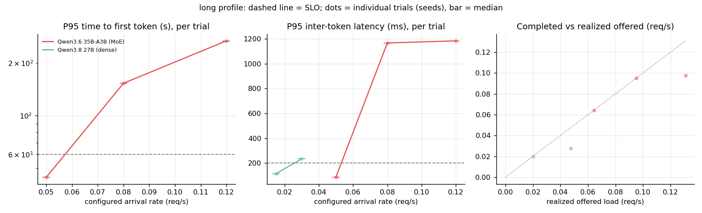

**Load test: long profile (MEASURED)**

SLO: P95 TTFT ≤ 60 s, P95 ITL ≤ 200 ms, zero failures. Percentiles are shown only when ≥ 20 requests completed; `n/a` means too few samples to judge.

| Model | Offered req/s | Seed | Dur (s) | Sent | Done | Failed | Realized offered req/s | Out tok/s | TTFT p50 (s) | TTFT p95 (s) | TTFT p99 (s) | ITL p50 (ms) | ITL p95 (ms) | E2E p50 (s) | E2E p95 (s) | Peak sys used (GiB) | SLO |
|---|---:|---:|---:|---:|---:|---:|---:|---:|---:|---:|---:|---:|---:|---:|---:|---:|---:|
| Qwen3.6 35B-A3B (MoE) | 0.05 | 1 | 420 | 27 | 27 | 0 | 0.064 | 23.3 | 18.68 | 44.48 | 51.48 | 36 | 87 | 51.9 | 88.5 | 91.8 | PASS |
| Qwen3.6 35B-A3B (MoE) | 0.08 | 1 | 420 | 40 | 40 | 0 | 0.095 | 33.1 | 94.21 | 153.17 | 161.21 | 37 | 1167 | 128.6 | 181.4 | 91.3 | FAIL |
| Qwen3.6 35B-A3B (MoE) | 0.12 | 1 | 420 | 55 | 41 | 14 | 0.131 | 33.1 | 142.58 | 267.65 | 279.87 | 38 | 1184 | 195.0 | 300.7 | 91.2 | FAIL |
| Qwen3.8 27B (dense) | 0.015 | 1 | 400 | 8 | 8 | 0 | 0.020 | 8.5 | – | – | – | 100 | 114 | – | – | 92.9 | n/a (n<20) |
| Qwen3.8 27B (dense) | 0.03 | 1 | 400 | 19 | 11 | 8 | 0.048 | 10.6 | – | – | – | 112 | 234 | – | – | 91.9 | n/a (n<20) |

**Load test: mixed profile (MEASURED)**

SLO: P95 TTFT ≤ 60 s, P95 ITL ≤ 200 ms, zero failures. Percentiles are shown only when ≥ 20 requests completed; `n/a` means too few samples to judge.

| Model | Offered req/s | Seed | Dur (s) | Sent | Done | Failed | Realized offered req/s | Out tok/s | TTFT p50 (s) | TTFT p95 (s) | TTFT p99 (s) | ITL p50 (ms) | ITL p95 (ms) | E2E p50 (s) | E2E p95 (s) | Peak sys used (GiB) | SLO |
|---|---:|---:|---:|---:|---:|---:|---:|---:|---:|---:|---:|---:|---:|---:|---:|---:|---:|
| Qwen3.6 35B-A3B (MoE) | 0.3 | 1 | 240 | 68 | 68 | 0 | 0.283 | 67.0 | 6.88 | 26.10 | 28.69 | 32 | 37 | 20.2 | 38.1 | 91.1 | PASS |

**Per-rate results across independent trials (MEASURED; each trial = a different random seed)**

A trial passes only if P95 TTFT and P95 ITL meet the SLO, nothing failed, and at least 20 requests completed; a trial with fewer than 20 completions has no verdict and is excluded from the pass count (shown as n<20). TTFT p95 is the median over trials, with the min–max range in brackets; with n of 3–5 trials the range, not a confidence interval, is the honest measure of spread.

| Profile | Model | Offered req/s | Trials | Realized offered req/s (range) | Valid trials passing | Failed requests (total) | P95 TTFT (s), median (range) | Rate verdict |
|---|---|---:|---:|---:|---:|---:|---:|---|
| chat | Qwen3.6 35B-A3B (MoE) | 0.2 | 4 | 0.107–0.267 | 3/3 (+1 n<20) | 0 | 0.79 (0.69–0.94) | PASS (all valid trials) |
| chat | Qwen3.6 35B-A3B (MoE) | 0.25 | 4 | 0.140–0.300 | 3/4 | 0 | 1.18 (0.54–4.66) | MIXED |
| chat | Qwen3.6 35B-A3B (MoE) | 0.3 | 4 | 0.193–0.340 | 2/4 | 0 | 2.13 (0.68–9.25) | MIXED |
| chat | Qwen3.6 35B-A3B (MoE) | 0.35 | 4 | 0.267–0.393 | 2/4 | 0 | 3.44 (0.68–12.61) | MIXED |
| chat | Qwen3.6 35B-A3B (MoE) | 0.4 | 4 | 0.300–0.447 | 0/4 | 0 | 7.15 (2.32–15.10) | FAIL (all valid trials) |
| chat | Qwen3.6 35B-A3B (MoE) | 0.7 | 1 | 0.740–0.740 | 0/1 | 0 | 78.58 (78.58–78.58) | FAIL (all valid trials) |
| chat | Qwen3.6 35B-A3B (MoE) | 1.0 | 1 | 1.080–1.080 | 0/1 | 41 | 119.96 (119.96–119.96) | FAIL (all valid trials) |
| chat | Qwen3.8 27B (dense) | 0.05 | 4 | 0.027–0.064 | 3/3 (+1 n<20) | 0 | 1.82 (1.68–1.84) | PASS (all valid trials) |
| chat | Qwen3.8 27B (dense) | 0.075 | 4 | 0.040–0.100 | 0/3 (+1 n<20) | 0 | 6.32 (2.02–10.12) | FAIL (all valid trials) |
| chat | Qwen3.8 27B (dense) | 0.1 | 4 | 0.053–0.133 | 0/3 (+1 n<20) | 0 | 14.93 (2.65–29.07) | FAIL (all valid trials) |
| chat | Qwen3.8 27B (dense) | 0.15 | 1 | 0.200–0.200 | 0/1 | 0 | 58.41 (58.41–58.41) | FAIL (all valid trials) |
| chat | Qwen3.8 27B (dense) | 0.2 | 1 | 0.267–0.267 | 0/1 | 0 | 104.01 (104.01–104.01) | FAIL (all valid trials) |
| long | Qwen3.6 35B-A3B (MoE) | 0.05 | 1 | 0.064–0.064 | 1/1 | 0 | 44.48 (44.48–44.48) | PASS (all valid trials) |
| long | Qwen3.6 35B-A3B (MoE) | 0.08 | 1 | 0.095–0.095 | 0/1 | 0 | 153.17 (153.17–153.17) | FAIL (all valid trials) |
| long | Qwen3.6 35B-A3B (MoE) | 0.12 | 1 | 0.131–0.131 | 0/1 | 14 | 267.65 (267.65–267.65) | FAIL (all valid trials) |
| long | Qwen3.8 27B (dense) | 0.015 | 1 | 0.020–0.020 | 0/0 (+1 n<20) | 0 | – | no verdict |
| long | Qwen3.8 27B (dense) | 0.03 | 1 | 0.048–0.048 | 0/0 (+1 n<20) | 8 | – | no verdict |
| mixed | Qwen3.6 35B-A3B (MoE) | 0.3 | 1 | 0.283–0.283 | 1/1 | 0 | 26.10 (26.10–26.10) | PASS (all valid trials) |

**Capacity bracket under the SLO (MEASURED; preliminary, a bracket and not a maximum)**

"Highest passing" = the highest tested rate at which every trial met the SLO, with no lower rate failing. "Lowest rate not passing" = the lowest tested rate where any trial failed. Rates with mixed outcomes lie inside the uncertain region. Capacity is somewhere in this bracket; the number of trials is in brackets after each rate.

| Profile | Model | Rates tested (req/s) | Highest rate passing in all trials | Lowest rate not passing | Rates with mixed outcomes | Rates with no verdict (n<20) |
|---|---|---|---:|---:|---:|---:|
| chat | Qwen3.6 35B-A3B (MoE) | 0.2 (n=4), 0.25 (n=4), 0.3 (n=4), 0.35 (n=4), 0.4 (n=4), 0.7 (n=1), 1.0 (n=1) | 0.2 req/s | 0.25 | 0.25, 0.3, 0.35 | – |
| chat | Qwen3.8 27B (dense) | 0.05 (n=4), 0.075 (n=4), 0.1 (n=4), 0.15 (n=1), 0.2 (n=1) | 0.05 req/s | 0.075 | – | – |
| long | Qwen3.6 35B-A3B (MoE) | 0.05 (n=1), 0.08 (n=1), 0.12 (n=1) | 0.05 req/s | 0.08 | – | – |
| long | Qwen3.8 27B (dense) | 0.015 (n=1), 0.03 (n=1) | none tested | – | – | 0.015, 0.03 |
| mixed | Qwen3.6 35B-A3B (MoE) | 0.3 (n=1) | 0.3 req/s | – | – | – |

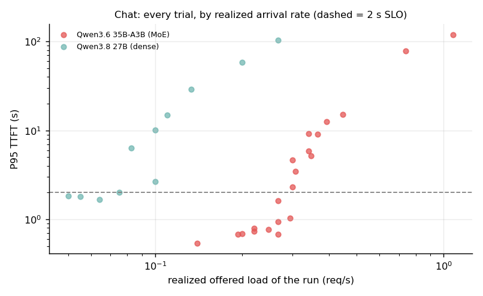

**Outcome versus realized arrival rate (EXPLORATORY, post hoc)**

Because each run is a short Poisson window, the realized rate (arrivals ÷ duration) differs a lot from the configured rate. This table re-sorts the same runs by realized rate. It was chosen after seeing the data, so it is a description, not a tested threshold, and it holds only for these window lengths: a longer window lets a queue build further before it ends.

| Profile | Model | Runs with a verdict | Highest realized rate that passed (req/s) | Lowest realized rate that failed (req/s) | Pass/fail ranges | Failures below highest pass |
|---|---|---:|---:|---:|---|---:|
| chat | Qwen3.6 35B-A3B (MoE) | 21 | 0.293 | 0.300 | separated | 0 |
| chat | Qwen3.8 27B (dense) | 11 | 0.064 | 0.075 | separated | 0 |

What it shows:

- **Interactive capacity is much lower than aggregate throughput implies, and the boundary is a region, not a point.** For the 35B-A3B, every trial with a verdict passed the chat SLO at a configured 0.2 req/s (3 valid trials, P95 TTFT 0.69–0.94 s) and all 4 failed at 0.4 (2.3–15.1 s); at 0.25, 0.3 and 0.35 the outcome depended on the seed (3, 2 and 2 of 4 passed). For the dense 27B, all 3 valid trials passed at 0.05 (P95 TTFT 1.68–1.84 s, close to the 2 s limit) and all 3 failed at 0.075 (2.02–10.1 s; the best of those missed the limit by 0.02 s) and at 0.1. Capacity is therefore bracketed at roughly **0.2–0.4 req/s** (35B-A3B) and **0.05–0.075 req/s** (27B), configured. These are preliminary brackets from 3–4 trials per rate, not precise maxima, and with trials this few no confidence interval is claimed.
- **Why outcomes are mixed: the realized rate varies a lot between short windows.** A configured 0.2 req/s produced between 16 and 40 arrivals in 150 s (0.107–0.267 req/s). Re-sorting the 35B-A3B runs by *realized* rate separates them cleanly: the highest passing run was at 0.293 req/s and the lowest failing at 0.300 (21 runs with a verdict, none overlapping). The 27B likewise separates between 0.064 (pass) and 0.075 (fail) (11 runs). This reading was formed after seeing the data and holds only for these window lengths (a longer window lets a queue grow further), so treat it as a description of what happened, not a tested threshold.
- **The SLO-compliant output rate was roughly 40% of the batched aggregate.** The highest-throughput passing chat trials carried 66 tok/s (35B-A3B) and 15.7 tok/s (27B), against 155 and 43 tok/s aggregate at 4 streams in §4.2 (43% and 37%). Queueing for one of only 4 slots, and variance in arrival and output length, consume the rest. The batched figures are single runs (§4.2).
- **The failure mode is queueing, not slow decoding.** P95 ITL stayed flat (21–35 ms for the MoE across all chat trials) while P95 TTFT climbed from under a second to about two minutes.
- **The dense 27B sits at the edge of a 10 tok/s-per-user target.** Its P95 ITL was 90–100 ms even at light load (4 streams share one weight read).
- **Long prompts stall everyone.** For the 35B-A3B, P95 ITL rose from 87 ms at 0.05 long req/s to **1.17 s** at 0.08, while the median stayed at 37 ms: long prefills occupy the GPU and delay other users' decoding. TTFT P95 went from 44 s (pass) to 153 s; at 0.12 req/s, 14 of 55 requests had not finished when the test stopped.
- **27B long-context: no verdict.** At its slow capacity (about one 16k request every ~50 s per slot) even 400 s yields too few completions for percentiles. At 0.03 req/s, 8 of 19 requests were unfinished at the end, which is itself informative.
- **The mixed point is one run, not a capacity limit.** The 35B-A3B passed its (lenient) SLO at 0.3 req/s (P95 TTFT 26 s).

**Limits of this measurement.**

- **Few trials.** 3–4 trials per chat rate near the boundary (1 elsewhere); one run for the long and mixed profiles. The long and mixed results are single runs and are not capacity limits.
- **Trials without a verdict.** One of four seeds (seed 3) drew only 16 arrivals at the 27B's rates and at the 35B's 0.2 req/s, so it has fewer than the 20 completions required and is excluded from pass counts (shown as n<20). This reduces the 27B's evidence to 3 valid trials per rate.
- **Shared seeds across rates.** The same seed gives the same arrival pattern and request lengths, only stretched in time, so trials at different rates with the same seed are correlated (an advantage for comparing rates, but the cross-rate trials are not independent). Independence holds across seeds.
- **Configured versus realized rate.** Short Poisson windows realize rates far from the target (see the tables); the realized rate, not the configured one, tracked pass/fail.
- **Two sessions and unequal windows.** The original sweep and the repeats ran in different server instances. The 27B at 0.05 req/s ran 420 s in the original sweep and 600 s in the repeats, to carry enough requests for percentiles.
- **Only 4 slots were tested;** more slots change the picture. The other two production models were resident but idle, so "peak system used" in the tables is machine-wide (~89–93 GiB) and not a per-server figure.
- **Queue wait is not observable separately;** it is inside TTFT. P95 over 20–60 requests is itself noisy.

### Power and thermals

During the sustained round-1 benchmarks the GPU drew **31–52 W** on average (idle: ~7 W), peaked at **82 °C** and reported **no throttle events**.

---

## 5. Does quantizing hurt? (MEASURED, perplexity only)

Perplexity on the wikitext-2 test set (SHA-256 `173c87a5…`), 2048-token windows, identical settings for every file. Perplexity is comparable only **between quantizations of the same model**, so each family has its own reference. `llama-perplexity` was built from the same llama.cpp commit.

**Perplexity, wikitext-2 test set, 2048-token windows (MEASURED)**

| Model | Quant | Weights (GiB) | PPL ± stat. error | Δ vs reference |
|---|---:|---:|---:|---:|
| Qwen3 8B | BF16 | 15.3 | 8.5248 ± 0.065 | reference |
| Qwen3 8B | Q8_0 | 8.1 | 8.5499 ± 0.065 | +0.29% |
| Qwen3 8B | Q4_K_M | 4.7 | 8.6049 ± 0.065 | +0.94% |
| Gemma 3 12B | Q8_0 | 11.7 | 7.7891 ± 0.058 | reference |
| Gemma 3 12B | Q4_K_M | 6.8 | 7.8513 ± 0.058 | +0.80% |

- The ordering is monotone in bit-width in both families, and the cost of Q4_K_M is **under 1%** in perplexity.
- The `±` is the statistical error of each estimate. The quantizations were scored on the *same* text, so the paired differences are tighter than the `±` suggests, but this tool does not report a paired error, so I do not claim any single difference is statistically significant.
- **This is not a task-quality ranking.** Perplexity on one general-text corpus says nothing certain about coding, reasoning, long-context retrieval or structured output. Use it to rule out gross damage, then test your own task. The Gemma comparison is against Q8_0, not the BF16 original.
- The Qwen3-8B Q8_0/Q4_K_M files came from `unsloth/Qwen3-8B-GGUF`. I did not verify that the on-disk BF16 file shares that provenance; hashes are recorded.

---

## 6. Recommendations

1. **Budget memory as weights + KV cache (GPU process) + host RSS (a few GiB, measured 2.6–6.7 GiB after use) + whatever else shares the machine.** Weights from `params × bits / 8`; KV from `layers × kv_heads × head_dim × 4 bytes` per token (f16) times the total context you configure, because it is reserved at launch (§2.6).
2. **Check the architecture before choosing a context length.** Hybrid-attention models make 128k contexts cheap; conventional ones can make long context cost more than the weights.
3. **For interactive use on bandwidth-limited hardware, prefer MoE.** The 35B-A3B gave 5× the generation speed of the dense 27B, and its configured-rate bracket under the same SLO (0.2–0.4 vs 0.05–0.075 req/s) was roughly 3–8× higher. Use dense models when you need them and plan for ~13 tok/s.
4. **4-bit is the sweet spot for speed per byte, with a small measured perplexity cost.** On Qwen3-8B, BF16 → Q8_0 → Q4_K_M ran at 15.5 → 29.1 → 44.0 tok/s for +0.29% and +0.94% perplexity. Q8_0 on Gemma 12B used 1.7× the memory for 1.6× slower generation than Q4_K_M. Verify on your task.
5. **Do not size a deployment from aggregate throughput.** Batching raises total tokens/s 3–5×, but the number of users you can serve at a latency target was about 40% of that, and long prompts degrade everyone's inter-token latency. Define an SLO and load-test with arrivals like yours (`scripts/load_test.py`).
6. **Isolate long-context traffic, or cap prompt length.** Mixed long and short requests share the GPU, and a pool-sized request can crowd out others (§2.6).
7. **For generation speed, bandwidth is the main limit here; for what you can run at all, capacity still matters.** More RAM would not make the tested models decode faster, but the 121 GiB pool bounds model size, configured context (KV pool), concurrency (shared pool, §2.6) and how many models stay resident (~89–93 GiB used with three production models loaded). Plan both.
8. **KV-cache quantization saves 19–33% total memory on Gemma 3 12B at 128k**, but evaluate quality first.

---

## 7. Method, provenance and caveats

Everything is reproducible from [`scripts/`](scripts/) and the raw output in [`raw/`](raw/) (round 1) and [`raw2/`](raw2/) (round 2). Tables and figures are generated from the raw files, and this README is built from `README.template.md` by `scripts/build_readme.py`, which injects the generated tables.

| Measurement | Script | Notes |
|---|---|---|
| Speed vs depth | `bench_speed.sh` | `llama-bench`, 512/2048-token prompts, 128 generated, depths 0/16k(/64k), 1 warm-up + 3 reps, GPU clocks/power sampled every 2 s |
| Memory vs context | `bench_memory.sh` | fresh server per point, 1 slot, 1 request, `nvidia-smi` per-process memory (single measurement) |
| Batched concurrency | `bench_concurrency.sh` | `llama-batched-bench`, 512-token prompt, 128 generated, 1/2/4/8 streams (single run) |
| Bandwidth | `membw.cu` | streaming read/write/copy kernels, 20 iterations after 3 warm-ups |
| Bytes per token | `streamed_bytes.py` | from the GGUF tensor table |
| Quantization ladder | `llama-bench` | Qwen3-8B BF16/Q8_0/Q4_K_M, 5 repetitions, per-run samples kept in `raw2/ladder/` |
| Perplexity | `bench_perplexity.sh` | wikitext-2 test set, 2048-token windows |
| Memory lifecycle | `memory_lifecycle.py`, `bench_memory_lifecycle.sh` | 0.5 s sampling; every request validated |
| Serving capacity | `load_test.py`, `bench_latency.sh`, `bench_latency_repeat.sh` | open-loop Poisson arrivals, rate sweep, SLOs fixed in advance; repeats with seeds 1–4 and intermediate rates |

**Conditions.** Round 1 ran with the two production models unloaded (baseline 12.5 GiB used). Round 2 ran with them loaded but idle (baseline ~59 GiB used, GPU at 0%), since the machine was shared. Absolute throughput could differ between rounds; see the prompt-speed caveat in §3.1.

**What went wrong and was fixed (kept in the data, not hidden):**

- *Overlapping benchmarks.* During round 1 I accidentally started a second benchmark while one was running; I killed both, deleted their output, and reran everything clean.
- *Silent request failures.* The first lifecycle runs did not check responses, so fast failures looked like fast successes. Requests are now validated against exact token counts, and the superseded data is kept in `raw2/memlife_v1_unvalidated/`.
- *A circular bandwidth argument.* Round 1 inferred a "233 GiB/s ceiling" from the best dense result and then used it to infer MoE traffic. That is replaced by the microbenchmark and a stated prediction error (§3.2).
- *One flawed first draft of the stability claim.* The earlier text implied prompt speed was stable to <5%; that holds within a session only (§3.1).

**Limitations, stated plainly:**

- One machine, one `llama.cpp` build, one day. Kernels improve quickly.
- `llama-bench` uses synthetic tokens at batch size 1. Real servers add sampling and scheduling overhead.
- **No task-quality evaluation.** Perplexity covers one corpus and a few quantizations.
- Bandwidth is measured with a simple kernel and is not a hardware counter reading. MoE bytes per token are inferred.
- Round-1 memory and batched-concurrency points are single runs. The round-2 memory lifecycle is one run per model; the chat load tests have 3–4 valid trials per rate near the boundary and the long and mixed tests are single runs. Capacity points are brackets, not precise values.
- `nvidia-smi` per-process memory on unified memory is not isolated VRAM; the GPU/host split is blurry, so differences under ~1 GiB should not be over-interpreted.
- Gemma and gpt-oss were tested to 16k depth only; Qwen3 8B BF16 memory to 32k (its 128k KV figure is extrapolated).
- Only 4 server slots and one runtime were tested. Results do not transfer to other GPUs or engines without testing.
