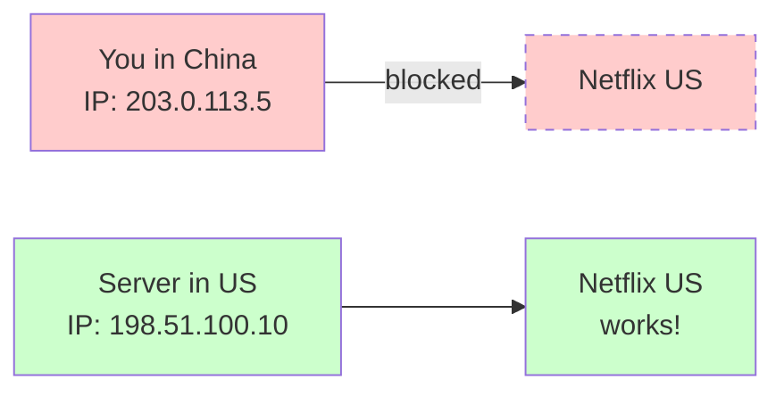
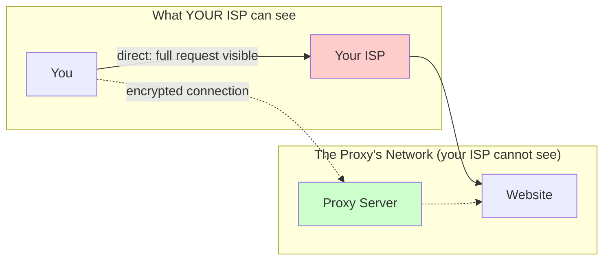
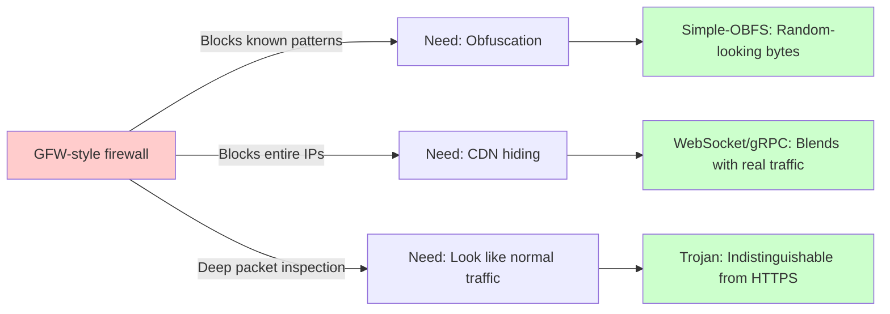
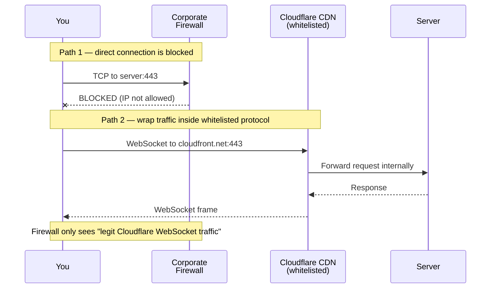

# Module 1: What Is a Proxy?

A proxy is an intermediary that forwards your requests to the internet on your behalf. This module explains why proxies exist, how they work, and you'll build one from scratch.

---

## Lesson 1: The Problem Proxies Solve

### Scenario: Geographic Restrictions



Without a proxy: Your Chinese IP gets blocked by Netflix.
With a proxy: Your request goes through a US server, which Netflix sees as domestic traffic.

### Scenario: Privacy



Without proxy: Your ISP sees your request → their network → the website. Everything is visible to your ISP.

With proxy: Your ISP only sees an encrypted connection to the Proxy Server. The path from the proxy to the website happens on a completely different network — your ISP has no visibility into it.

---

## Lesson 2: Level 1 — HTTP Proxy (The Easiest)

An HTTP proxy understands web traffic. It reads HTTP requests and forwards them.

### How a Direct Request Works

```bash
# Direct connection — your browser talks straight to the server
curl -v https://httpbin.org/ip 2>&1 | grep '"origin"'
# Output: "origin": "YOUR_REAL_IP"
```

### How an HTTP Proxy Changes It

```bash
# Use an HTTP proxy (we'll create a dummy one first, then explain)
curl -x http://localhost:8080 https://httpbin.org/ip
```

The proxy receives your request, forwards it to `httpbin.org`, gets the response, and sends it back. The `origin` field now shows the **proxy's IP**, not yours.

### Building a Basic HTTP Proxy in Python

```python
# Save as basic_http_proxy.py
import socket
import threading
import re

def handle_client(client_sock, addr):
    print(f"[Proxy] Connection from {addr}")
    
    # Read the HTTP request
    data = b''
    while b'\r\n\r\n' not in data:
        chunk = client_sock.recv(4096)
        if not chunk:
            break
        data += chunk
    
    request_line = data.split(b'\r\n')[0].decode()
    print(f"[Proxy] Received: {request_line}")
    
    # Parse the destination from CONNECT or GET request
    if b'CONNECT' in data:
        # HTTPS through proxy (CONNECT method)
        match = re.search(rb'CONNECT (\S+):(\d+)', data)
        if match:
            host, port = match.group(1).decode(), int(match.group(2))
            print(f"[Proxy] CONNECT {host}:{port}")
            
            # Establish connection to target
            target = socket.socket(socket.AF_INET, socket.SOCK_STREAM)
            target.connect((host, port))
            
            client_sock.sendall(b'HTTP/1.1 200 Connection Established\r\n\r\n')
            
            # Forward data both ways
            def forward(src, dst):
                try:
                    while True:
                        buf = src.recv(4096)
                        if not buf:
                            break
                        dst.sendall(buf)
                except:
                    pass
            
            threading.Thread(target=forward, args=(client_sock, target), daemon=True).start()
            threading.Thread(target=forward, args=(target, client_sock), daemon=True).start()
    else:
        # Regular HTTP proxy (GET/POST)
        match = re.search(rb'(GET|POST|PUT|DELETE) (\S+)', data)
        if match:
            method, path = match.group(1).decode(), match.group(2).decode()
            
            # Extract host from headers
            host_match = re.search(rb'Host:\s+(\S+)', data)
            host = host_match.group(1).decode() if host_match else 'localhost'
            
            # Parse port (default 80 for HTTP)
            port = 80
            if ':' in host:
                host, port = host.rsplit(':', 1)
                port = int(port)
            
            print(f"[Proxy] {method} {path} -> {host}:{port}")
            
            # Connect to target and forward
            target = socket.socket(socket.AF_INET, socket.SOCK_STREAM)
            target.connect((host, port))
            target.sendall(data)
            
            # Send response back
            while True:
                buf = target.recv(4096)
                if not buf:
                    break
                client_sock.sendall(buf)
    
    client_sock.close()

print("[HTTP Proxy] Listening on port 8080...")
server = socket.socket(socket.AF_INET, socket.SOCK_STREAM)
server.setsockopt(socket.SOL_SOCKET, socket.SO_REUSEADDR, 1)
server.bind(('127.0.0.1', 8080))
server.listen(5)

while True:
    client, addr = server.accept()
    threading.Thread(target=handle_client, args=(client, addr), daemon=True).start()
```

### Test Your Proxy

```bash
# Terminal 1 — Start your proxy
python3 basic_http_proxy.py

# Terminal 2 — Use it with curl (HTTP only)
curl -x http://127.0.0.1:8080 http://httpbin.org/ip

# You should see your request go through port 8080
# Check the proxy terminal for connection logs
```

### What Your Proxy Does, Step by Step

```mermaid
sequenceDiagram
    participant C as curl (Client)
    participant P = localhost:8080
    participant S = httpbin.org
    C->>P: "GET /ip HTTP/1.1\r\nHost: httpbin.org"
    P->>S: "GET /ip HTTP/1.1\r\nHost: httpbin.org"
    S-->>P: "HTTP/1.1 200 OK\r\n{\"origin\": \"...\"}"
    P-->>C: "HTTP/1.1 200 OK\r\n{same JSON}"
```

Your proxy is a **man-in-the-middle** — it sits between you and the server, forwarding everything.

---

## Lesson 3: Level 2 — SOCKS5 Proxy (The Universal One)

An HTTP proxy only understands HTTP. A **SOCKS proxy** understands any TCP traffic. It doesn't read the content — it just forwards bytes.

### SOCKS5 Handshake

```bash
# SOCKS5 requires a 3-step handshake before using it
# Step 1: Client sends supported authentication methods
# Step 2: Server picks one (0x00 = no auth)
# Step 3: Client sends connection request with destination

python3 -c "
import struct, socket

sock = socket.socket(socket.AF_INET, socket.SOCK_STREAM)
sock.connect(('127.0.0.1', 1080))  # Standard SOCKS5 port

# Step 1: Send auth methods (no auth = method 0x00)
methods = bytes([0x05, 0x01, 0x00])  # Version 5, 1 method, no auth
sock.sendall(methods)
response = sock.recv(2)
print(f'Server chose method: 0x{response[1]:02x}')  # Should be 0x00

# Step 2: Request connection to destination
# Command 1 = CONNECT, ATYP 1 = IPv4, DstPort + DstAddr
dest = bytes([0x05, 0x01, 0x00, 0x01])  # Ver, CMD, RSV, IP type
dest += socket.inet_aton('93.184.216.34')  # example.com IP
dest += struct.pack('!H', 80)               # Port 80
sock.sendall(dest)
response = sock.recv(4)
print(f'Connection status: {response[3]} (0=success)')
"
```

### Building a Minimal SOCKS5 Proxy

```python
# Save as socks5_proxy.py
import socket
import struct
import threading

def socks5_handshake(client):
    # Read client's auth methods
    header = client.recv(2)
    if header[0] != 0x05:
        return False
    n_methods = header[1]
    methods = client.recv(n_methods)
    
    # Respond: version 5, no auth required
    client.sendall(bytes([0x05, 0x00]))
    return True

def socks5_connect(client):
    # Read the request: ver, cmd, rsv, atyp, addr, port
    header = client.recv(4)
    if header[0] != 0x05 or header[1] != 0x01:  # CONNECT command
        client.sendall(bytes([0x05, 0x08, 0x00, 0x00]))  # Command not supported
        return None
    
    atyp = header[3]
    if atyp == 0x01:  # IPv4
        addr_bytes = client.recv(4)
        port_bytes = client.recv(2)
        dest_addr = socket.inet_ntoa(addr_bytes)
        dest_port = struct.unpack('!H', port_bytes)[0]
    elif atyp == 0x03:  # Domain name
        n = client.recv(1)[0]
        dest_addr = client.recv(n).decode()
        port_bytes = client.recv(2)
        dest_port = struct.unpack('!H', port_bytes)[0]
    else:
        client.sendall(bytes([0x05, 0x08, 0x00, 0x00]))
        return None
    
    # Connect to the destination
    try:
        target = socket.socket(socket.AF_INET, socket.SOCK_STREAM)
        target.settimeout(5)
        target.connect((dest_addr, dest_port))
        
        # Send success response
        client.sendall(bytes([0x05, 0x00, 0x00, 0x01]))
        client.sendall(socket.inet_aton('127.0.0.1') + struct.pack('!H', 0))
        
        return target
    except Exception as e:
        print(f"[SOCKS5] Connection failed: {e}")
        client.sendall(bytes([0x05, 0x04, 0x00, 0x01]))  # Host unreachable
        return None

def forward(src, dst):
    try:
        while True:
            data = src.recv(4096)
            if not data:
                break
            dst.sendall(data)
    except:
        pass

def handle_client(client, addr):
    print(f"[SOCKS5] {addr} connected")
    
    if not socks5_handshake(client):
        client.close()
        return
    
    target = socks5_connect(client)
    if target is None:
        client.close()
        return
    
    # Forward traffic both directions
    threading.Thread(target=forward, args=(client, target), daemon=True).start()
    forward(target, client)
    
    client.close()
    target.close()

print("[SOCKS5 Proxy] Listening on port 1080...")
server = socket.socket(socket.AF_INET, socket.SOCK_STREAM)
server.setsockopt(socket.SOL_SOCKET, socket.SO_REUSEADDR, 1)
server.bind(('127.0.0.1', 1080))
server.listen(5)

while True:
    client, addr = server.accept()
    threading.Thread(target=handle_client, args=(client, addr), daemon=True).start()
```

### Test Your SOCKS5 Proxy

```bash
# Terminal 1 — Start the SOCKS proxy
python3 socks5_proxy.py

# Terminal 2 — Use curl with it
curl -x socks5h://127.0.0.1:1080 http://httpbin.org/ip -s | jq .

# Terminal 3 — Test with wget (different tool, same proxy)
wget --proxy=socks5://127.0.0.1:1080 -qO- http://httpbin.org/user-agent
```

The key difference from HTTP proxy: **SOCKS doesn't understand the content**. It just opens a TCP connection to whatever destination the client requests, then blindly forwards all data. This means it can handle any protocol — HTTP, FTP, SSH, etc.

---

## Lesson 4: Proxy Types Compared

```mermaid
graph TB
    subgraph "Layer 7 — Application"
        A[HTTP Proxy<br/>Reads & modifies HTTP]
    end
    subgraph "Layer 4 — Transport"
        B[SOCKS5 Proxy<br/>Forwards any TCP/UDP]
    end
    subgraph "Encrypted Layer"
        C[TLS/SSL Tunnel<br/>Encrypts all traffic]
    end
    
    A -.->|Can't handle non-HTTP| X❌
    B -.->|Handles everything| Y✅
    
    style A fill:#e1f5ff
    style B fill:#fff4e1
    style C fill:#ffe1f5
```

| Feature | HTTP Proxy | SOCKS5 |
|---------|-----------|--------|
| **Understands content** | Yes (HTTP only) | No (binary opaque) |
| **Protocols** | HTTP/HTTPS only | Any TCP, some UDP |
| **Speed** | Slower (parsing overhead) | Faster (no parsing) |
| **Caching** | Can cache responses | No caching |
| **Common ports** | 8080, 3128 | 1080 |
| **Used by** | Web browsers, web apps | All traffic routing |

---

## Lesson 5: Why One Proxy Isn't Enough

Real proxy tools like sing-box don't use a single protocol. They support many because:

### Different Obstacles Require Different Approaches



### Real-World Example: Behind a Corporate Firewall



This is why sing-box supports multiple transports — **different environments block different things**. A corporate firewall blocks port 443 to unknown IPs, but can't block Cloudflare. Wrapping your proxy inside a CDN-visible protocol bypasses the restriction entirely.

---

## Exercises

### Exercise 1: See the Difference Between HTTP and SOCKS Proxies

```bash
# First, start a simple HTTP server
python3 -c "
from http.server import HTTPServer, BaseHTTPRequestHandler
class H(BaseHTTPRequestHandler):
    def do_GET(self):
        self.send_response(200)
        self.end_headers()
        self.wfile.write(b'Hello from port 9000')
HTTPServer(('127.0.0.1', 9000), H).serve_forever()
" &
sleep 1

# HTTP proxy handles it fine
curl -x http://127.0.0.1:8080 http://127.0.0.1:9000/  # (start proxy first)

# Now try something HTTP can't handle — a raw TCP service
socat TCP-LISTEN:9001,reuseaddr SYSTEM:'echo "Raw TCP service"'
# HTTP proxy would FAIL here — it expects HTTP responses
# SOCKS5 would SUCCEED — it just forwards bytes blindly
```

### Exercise 2: Build a Chain Proxy (Proxy Through Proxy)

```python
# Save as chain_proxy.py
import socket, threading

def forward(src, dst):
    try:
        while True:
            data = src.recv(4096)
            if not data:
                break
            dst.sendall(data)
    except:
        pass

def first_hop(client, addr):
    """This proxy connects to the second proxy"""
    print(f"[Proxy 1] {addr} connected")
    
    # Read HTTP request
    data = b''
    while b'\r\n\r\n' not in data:
        data += client.recv(4096)
    
    # Instead of connecting to the target, connect to proxy 2
    target = socket.socket(socket.AF_INET, socket.SOCK_STREAM)
    target.connect(('127.0.0.1', 8081))  # Forward to second proxy
    
    # Send the request through the chain
    target.sendall(data)
    
    threading.Thread(target=forward, args=(client, target), daemon=True).start()
    forward(target, client)

def second_hop(client, addr):
    """This proxy connects to the real target"""
    print(f"[Proxy 2] {addr} connected")
    
    data = b''
    while b'\r\n\r\n' not in data:
        data += client.recv(4096)
    
    # Parse destination
    import re
    match = re.search(rb'Host:\s+(\S+)', data)
    if match:
        host_port = match.group(1).decode()
        host, port = host_port.rsplit(':', 1) if ':' in host_port else (host_port, 80)
        port = int(port)
        
        target = socket.socket(socket.AF_INET, socket.SOCK_STREAM)
        target.connect((host, port))
        target.sendall(data)
        
        threading.Thread(target=forward, args=(client, target), daemon=True).start()
        forward(target, client)

print("[Proxy 1] Listening on 8080 (first hop)")
s1 = socket.socket(socket.AF_INET, socket.SOCK_STREAM)
s1.setsockopt(socket.SOL_SOCKET, socket.SO_REUSEADDR, 1)
s1.bind(('127.0.0.1', 8080))
s1.listen(5)

print("[Proxy 2] Listening on 8081 (second hop)")
s2 = socket.socket(socket.AF_INET, socket.SOCK_STREAM)
s2.setsockopt(socket.SOL_SOCKET, socket.SO_REUSEADDR, 1)
s2.bind(('127.0.0.1', 8081))
s2.listen(5)

while True:
    client, addr = s1.accept()
    threading.Thread(target=first_hop, args=(client, addr), daemon=True).start()
    client, addr = s2.accept()
    threading.Thread(target=second_hop, args=(client, addr), daemon=True).start()
```

Test it:
```bash
# Start proxy chain
python3 chain_proxy.py &
sleep 1

# Request goes through: You → Proxy 1 → Proxy 2 → Internet
curl -x http://127.0.0.1:8080 http://httpbin.org/ip
```

---

*Next: [Module 2: Transport Wrapping](02_transport-wrapping.md) — How to hide proxy traffic inside normal-looking protocols.*
