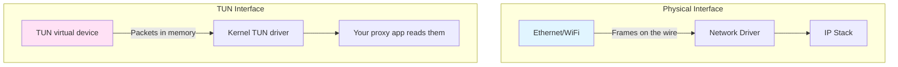
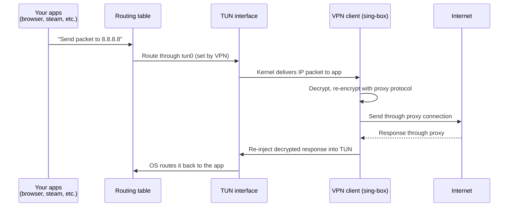
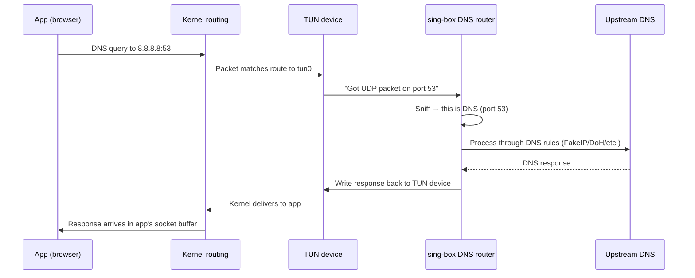
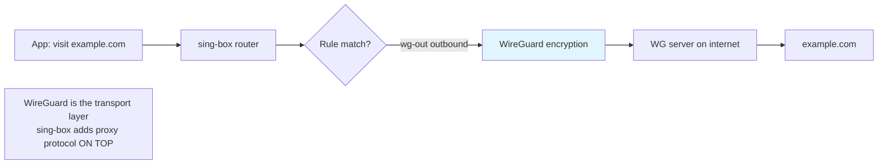

# Module 6: TUN & VPN — Capturing All Traffic

This module explains how virtual network interfaces work, how they capture traffic at the OS level, and how sing-box's TUN inbound turns your proxy into a system-wide VPN.

---

## Lesson 1: What Is a TUN Interface?

A **TUN interface** is a virtual network card created by software. The OS routes IP packets through it just like real hardware — but there's no physical wire attached. Instead, the data goes to your application.

### Physical vs Virtual Network



### Creating a TUN Interface Manually (Linux)

```bash
# Create a TUN interface with an IP address
sudo ip tuntap add dev tun0 mode tun
sudo ip addr add 172.16.0.2/30 dev tun0
sudo ip link set tun0 up

# Verify it exists
ip addr show tun0
# Output: inet 172.16.0.2/30 scope global tun0

# Test: anything you send to tun0 appears in your app
echo "Hello TUN" | nc -u 172.16.0.1 9999 &
```

The `/30` subnet means only 2 usable IPs — `172.16.0.1` (the other end) and `172.16.0.2` (your machine).

---

## Lesson 2: How VPNs Use TUN

A VPN app works by:



### The Key Trick: IP Re-injection

The VPN client receives encrypted packets from the internet, decrypts them, and needs to deliver them **back** to the apps that initiated the request. It does this by writing directly into the TUN interface:

```python
# save as tun_inject.py — Simulating TUN write/read cycle
import socket
import struct
import os
import fcntl

def read_tun_packet(tun_fd):
    """Read an IP packet from a TUN device"""
    try:
        packet = os.read(tun_fd, 65535)
        return packet
    except BlockingIOError:
        return None

def write_tun_packet(tun_fd, packet):
    """Write an IP packet back into the TUN device"""
    os.write(tun_fd, packet)

def parse_ip_header(data):
    """Extract source and destination from IP header"""
    if len(data) < 20:
        return None, None
    version_ihl = data[0]
    header_length = (version_ihl & 0x0f) * 4
    src_ip = '.'.join(str(b) for b in data[12:16])
    dst_ip = '.'.join(str(b) for b in data[16:20])
    protocol = data[9]  # 6=TCP, 17=UDP
    return src_ip, dst_ip

# This demonstrates the concept:
print("=== TUN Packet Flow ===\n")
print("1. App sends packet to destination (e.g., 8.8.8.8)")
print("2. OS routing table directs it to tun0")
print("3. Kernel delivers raw IP packet to VPN app's file descriptor")
print("4. VPN app reads the packet, decrypts if needed")
print("5. VPN app decides: direct or through proxy?")
print("6. If proxy: send through proxy connection to server")
print("7. Response comes back from proxy server")
print("8. VPN app writes decrypted response into TUN file descriptor")
print("9. OS delivers response to the original app")
print("\nThe app never knows a VPN exists — it just reads its responses.")
```

---

## Lesson 3: sing-box TUN Inbound

### How It Works in Practice

In sing-box, the TUN inbound is configured like this:

```jsonc
{
  "inbounds": [{
    "type": "tun",
    "tag": "tun-in",
    "inet4_address": "172.19.0.1/30",          // IPv4 subnet for TUN
    "inet6_address": "fdfe:dcba:9876::1/126",  // IPv6 subnet (optional)
    "auto_route": true,                          // Set routing table entries
    "strict_route": true,                        // Drop traffic not through TUN
    "sniff": true,                               // Enable protocol sniffing
    "stack": "mixed"                             // TCP/UDP stack: system, gvisor, or mixed
  }]
}
```

### The Routing Auto-Setup

When `auto_route: true`, sing-box automatically configures your OS routing table:

```bash
# What sing-box does under the hood:
# 1. Create TUN interface
sudo ip link add sing-box type tun
sudo ip addr add 172.19.0.2/30 dev sing-box
sudo ip link set sing-box up

# 2. Route all traffic through TUN (or specific networks)
# Route everything except your local network
sudo ip route add 0.0.0.0/1 dev sing-box     # Upper half of IP space
sudo ip route add 128.0.0.0/1 dev sing-box    # Lower half of IP space

# Or route specific subnets (selective proxy)
sudo ip route add 8.8.8.0/24 dev sing-box     # Google DNS only
sudo ip route add 1.1.1.0/24 dev sing-box     # Cloudflare DNS only

# 3. Enable IP forwarding (optional, for NAT)
sudo sysctl net.ipv4.ip_forward=1
```

---

## Lesson 4: TCP Stack Options — System vs gVisor vs Mixed

sing-box offers three different network stacks for handling traffic through TUN:

```python
# save as tcp_stack.py
"""
Three stack implementations in sing-box, each with tradeoffs:

system    — Uses the OS kernel's TCP/IP stack (fastest)
gvisor    — Go implementation of TCP/IP in userspace (portable, safer)
mixed     — System TCP + gVisor UDP (best of both worlds)
"""

stacks = {
    'system': {
        'description': 'OS kernel handles TCP/UDP',
        'performance': '★★★★★ (native kernel speed)',
        'tcp': 'Kernel TCP stack (fully optimized)',
        'udp': 'Kernel UDP stack',
        'portability': 'Linux, macOS, Windows — varies by OS',
        'reliability': 'Depends on OS network stack quality',
    },
    'gvisor': {
        'description': 'Go reimplements the entire TCP/IP stack',
        'performance': '★★★☆☆ (userspace overhead)',
        'tcp': 'Go userspace TCP (consistent across platforms)',
        'udp': 'Go userspace UDP',
        'portability': 'Same behavior on all platforms',
        'reliability': 'Very high — Go has fewer edge cases than C kernels',
    },
    'mixed': {
        'description': 'System TCP + gVisor UDP',
        'performance': '★★★★☆ (fast TCP, moderate UDP)',
        'tcp': 'Kernel TCP stack (best web performance)',
        'udp': 'gVisor UDP (consistent DNS over UDP)',
        'portability': 'Better UDP consistency',
        'reliability': 'Good — balances speed and consistency',
    }
}

for name, info in stacks.items():
    print(f"\n{name.upper()} Stack:")
    for key, value in info.items():
        print(f"  {key:18} {value}")

print("\n=== Recommendation ===")
print("web_only     → system stack (fastest for browsers)")
print("gaming/udp   → mixed stack (UDP via gVisor)")
print("cross-platform consistency → gvisor (same everywhere)")
```

Run it:
```bash
python3 tcp_stack.py
```

### Why gVisor Matters

The system kernel is fast but **platform-specific**. A bug in Linux's TCP retransmission logic affects only Linux. A bug in Go's gVisor stack affects all platforms consistently — which can be an advantage for debugging and testing.

---

## Lesson 5: DNS Hijacking via TUN

sing-box intercepts DNS traffic (port 53) automatically when TUN mode is enabled:



The app sent a DNS query to 8.8.8.8 but never left its own network namespace — sing-box intercepted the packet at the TUN interface, processed it through DNS rules (FakeIP/DoH/etc.), and wrote the response back. The app receives the answer without ever touching the real 8.8.8.8 server.

### See It in Action

```bash
# Start a server that logs TUN traffic (requires root)
sudo sing-box run -c config.json &

# Make a DNS query from another terminal
dig example.com @172.19.0.1 +short  # Point to your TUN interface

# Check the logs — you'll see sing-box processing the DNS request
journalctl -u sing-box --since "30 sec ago" | tail -10

# The response goes through sing-box's DNS rules (FakeIP, DoH, etc.)
```

---

## Lesson 6: WireGuard as an Outbound

sing-box can also act as a WireGuard endpoint — connecting to a WireGuard server as one of its outbounds:

```jsonc
{
  "outbounds": [{
    "type": "wireguard",
    "tag": "wg-out",
    "server": "wg.example.com",
    "server_port": 51820,
    "system_interface": false,           // Don't create OS-level WireGuard
    "interface_name": "sing-wg0",        // Internal name
    "local_address": ["10.0.0.2/32"],    // Your WG IP
    "private_key": "your-private-key-here",
    "peers": [{
      "address": "wg.example.com",
      "port": 51820,
      "public_key": "peer-public-key",
      "allowed_ips": ["0.0.0.0/0"],     // Route ALL traffic through WG
      "reserved": [0, 0, 0]
    }],
    "worker_count": 4                    // Parallel workers for performance
  }]
}
```

### How WireGuard Fits Into the Proxy Model



The WireGuard tunnel provides encrypted transport. sing-box can then run proxy protocols (VMess, Trojan) **inside** that tunnel for double encryption.

---

## Exercises

### Exercise 1: Create and Test a TUN Interface Manually

```bash
# Step 1: Create the TUN interface (requires root)
sudo ip tuntap add dev tun-test mode tun user $(whoami) group network
sudo ip addr add 10.200.200.2/30 dev tun-test
sudo ip link set tun-test up

# Step 2: Start a TCP server that reads from the TUN device
python3 -c "
import os, select

tun_fd = os.open('/dev/net/tun-test' if False else '/dev/net/tun', os.O_RDONLY)
print(f'TUN fd: {tun_fd}')

# Actually, let's use the tun interface differently — 
# send a raw IP packet and read it back
import socket

# Create a raw socket to send/receive at IP layer
raw = socket.socket(socket.AF_PACKET, socket.SOCK_RAW)
print('Send raw packet test...')
" 2>&1 || echo "Raw TUN access requires root. Use: sudo python3 tun_test.py"

# Step 3: Clean up
sudo ip link delete tun-test
```

### Exercise 2: Trace Your Routing Table Changes

```bash
# Before running your proxy, check the routing table
echo "=== Default routes ==="
ip route show default | head -5

# After starting sing-box with auto_route=true, check again:
# ip route show default | head -10

# You'll see new routes pointing to the TUN interface
# The routing priority (metric) determines which route wins

# Test: what interface would a packet to 8.8.8.8 use?
ip route get 8.8.8.8 | grep -o 'dev [^ ]*'
```

### Exercise 3: Simulate TUN Packet Handling

```python
# save as tun_sim.py — Simulate reading/writing IP packets from TUN
import struct
import random

def build_ip_packet(src_ip, dst_ip, payload):
    """Create a minimal IPv4 packet"""
    # Version (4) + IHL (4) = 20 bytes header, no options
    version_ihl = 0x45
    # DSCP + ECN
    dscp_ecn = 0x00
    # Total length = header + payload
    total_length = 20 + len(payload)
    # Identification (random), Flags (DF) + Fragment offset
    ident_flags = 0x4000 | random.randint(0, 0xFFFF)
    # TTL + Protocol (17 = UDP)
    ttl_protocol = 0x4011  # TTL=64, UDP
    
    # Header checksum (simplified — not actually computed correctly here)
    header_checksum = 0
    
    # Source and destination IP
    src_bytes = bytes(int(x) for x in src_ip.split('.'))
    dst_bytes = bytes(int(x) for x in dst_ip.split('.'))
    
    header = struct.pack('!BBHHHBB', 
        version_ihl, dscp_ecn, total_length, ident_flags, 
        0x4011, header_checksum) + src_bytes + dst_bytes
    
    return header + payload

def parse_ip_packet(packet):
    """Extract source and destination from a raw IP packet"""
    if len(packet) < 20:
        return None, None
    
    version = (packet[0] >> 4) & 0x0f
    ihl = packet[0] & 0x0f
    header_len = ihl * 4
    
    src_ip = '.'.join(str(b) for b in packet[12:16])
    dst_ip = '.'.join(str(b) for b in packet[16:20])
    protocol = packet[9]
    
    protocols = {1: 'ICMP', 6: 'TCP', 17: 'UDP'}
    proto_name = protocols.get(protocol, f'Unknown({protocol})')
    
    return src_ip, dst_ip, proto_name, header_len

# Simulate a packet flowing through TUN
print("=== TUN Packet Simulation ===\n")

payload = b'\x00\x17' + b'\x00\x35' + b'\x00' * 8 + b'Hello from browser!\n'
packet = build_ip_packet('172.19.0.2', '8.8.8.8', payload)

print(f"Built IP packet: {len(packet)} bytes total")
print(f"Header ({len(packet)-len(payload)} bytes) + UDP payload ({len(payload)} bytes)")

# Simulate TUN receiving this packet
src, dst, proto, hdr_len = parse_ip_packet(packet)
print(f"\nTUN device reads:")
print(f"  Source: {src}")
print(f"  Destination: {dst}")
print(f"  Protocol: {proto}")

# sing-box processes it
if proto == 'UDP' and len(payload) >= 4:
    print(f"  → UDP packet detected, port 53 check for DNS hijacking")
    print(f"  → Handled by DNS router (FakeIP/DoH/etc.)")
elif proto == 'TCP':
    print(f"  → TCP packet, run pre-match sniffing")
    print(f"  → Match against routing rules")

# Simulate writing response back
response_packet = build_ip_packet('8.8.8.8', '172.19.0.2', b'DNS response data')
print(f"\nResponse written to TUN: {len(response_packet)} bytes")
print("  OS kernel delivers it to the app that initiated the request")
```

Run it:
```bash
python3 tun_sim.py
```

---

*Next: [Module 7: Complete Request Journey](07_complete-journey.md) — Following a single request through every layer of sing-box from start to finish.*
