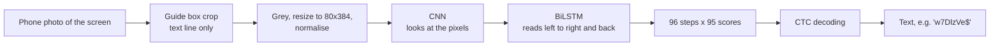

# ocr-camera: read random passwords from a phone photo of a screen

A small OCR model (CRNN + CTC) that reads one line of password-like text (94 printable ASCII characters, no space) from a phone-camera photo of a screen. It is trained on photos of a web page I wrote, so it works for **HTML password fields shown on a screen**. It is not a general OCR engine.

All strings used for data collection and testing were random throwaway strings, never real passwords.

## Result

Scored on **held-out strings** (the test split is by string, so the model never saw those strings in training).

| Test set | n | This model, exact | char acc. | RapidOCR, exact | char acc. |
|---|---|---|---|---|---|
| All real test photos | 249 | **79.9%** | 97.4% | 37.3% | 75.3% |
| Phone photos of the field page | 153 | **78.4%** | 98.0% | 26.8% | 65.8% |
| Photos of the collection page | 96 | **82.3%** | 96.2% | 54.2% | 91.7% |
| Test crops tilted -8° / +8° | 249 | 74.3% / 75.1% | 96.7% / 96.9% | | |
| Fonts never used in synthetic training | 16 | 81.2% | 97.9% | 68.8% | 93.7% |

"Exact" means the whole string is right. The reader page can also read the photo at 9 small tilts and take a vote (`tilt-robust`): on the held-out phone reads this gives **84.1% exact / 98.6% char** (single read: 81.1% / 98.1%).

For comparison, the first version of the model scored 13% exact on my first 15 phone photos.

### What still goes wrong
- `l` vs `I` is about half of all errors (`l`, `I` and `|` look nearly the same in many sans-serif fonts). The image alone cannot settle it.
- Dropped characters (`'`, `` ` ``, `\`, `/`), and `*` read as `^`.
- Long strings: accuracy falls from 87% (8-15 characters) to 61% at 24 characters.
- `{` and `(` were confused often in my live phone test, but I could only find 2 such errors in 34 held-out cases, so I could not confirm it from the data.
- **Several text lines in one photo.** The model reads one line, so they merged into one string. The reader page now has a *multi-line* option that splits the crop into lines (`webapp/lines.py`). It is tested only on photos I stacked together, **not on real multi-line photos**.

### Limits of the evidence
- All photos come from one phone and one monitor setup.
- The model has seen about 80% of the phone strings in training; only the test split is held out. A different screen or phone has not been tested.
- Dark mode was the weak spot of the first model. I did not score dark and light separately for this one.

## The setup, step by step

**The problem.** A phone photographs a screen showing a password. We want the text back as a string. A password is hard for OCR: it is random (no words to guess from), it mixes 94 characters that look alike (`l I | 1`, `0 O`, `' \``), and the photo has glare, blur and moiré (the wavy pattern you get when a camera photographs a screen).

**The idea.** Treat it as "image in, string out" and train one small neural network for exactly this job, instead of using a general OCR engine. RapidOCR, a general engine, got 37% of strings fully right on the same test photos. A specialised model can do better because it only has to handle one kind of image.



### 1. What goes in
- One **grey image, 80 pixels high and 384 wide**. The crop is resized in two steps (to 768x247, then 384x80) so thin strokes survive, then each image is standardised (subtract its own mean, divide by its own spread). That makes dark and light screens look alike to the network.
- Pixel values only. The network is never told the font, the screen or the string.

### 2. The network (4.1 million numbers to learn)

| Part | Layers | What it does | Output shape |
|---|---|---|---|
| Input | | grey image | 1 x 80 x 384 |
| CNN | 6 convolution layers (32, 64, 128, 128, 256, 256 filters), each with batch-norm and ReLU, and 3 max-pool steps that halve the size | finds strokes, then corners and curves, then whole characters. Height shrinks 80 to 5; width shrinks 384 to 96 (so 96 columns, each about 4 pixels wide) | 256 x 5 x 96 |
| Projection | 1 linear layer | squeezes each column's 256x5 numbers into 256 | 96 x 256 |
| BiLSTM | 2 layers, 256 units each way | reads the 96 columns left to right and right to left, so each column knows what is around it (is this stroke the top of an `l` or an `I`? it depends on the neighbours) | 96 x 512 |
| Output | 1 linear layer | for each column, a score for each of the 95 classes: 94 characters plus a "blank" | 96 x 95 |

That is about 1.1 M parameters in the CNN, 2.6 M in the LSTM, the rest in the linear layers. The model file is 16.6 MB.

### 3. What comes out, and why CTC
The network does not output "character 5 is `D`". We do not know where each character sits, and the width of letters varies. Instead it gives 96 guesses, one per image column, and **CTC** (Connectionist Temporal Classification) turns them into a string by two rules: merge repeated guesses, then drop the blanks.

```
column guesses:  _ _ w w _ 7 7 _ D _ l l _ z _ V V e _ $ _ ...
merge repeats:   _ w _ 7 _ D _ l _ z _ V e _ $ _
drop blanks:     w 7 D l z V e $
```
The blank is what lets the model write a double letter (`l`, blank, `l`) as `ll`. CTC training needs only the image and the final string, with no per-letter boxes, which is why labelling photos was cheap. Each emitted letter also comes with a probability, which the reader page shows in orange when below 80%.

### 4. What goes into training

| Data | Count | Where it comes from | Used for |
|---|---|---|---|
| Real photos of the collection page | 956 crops | `webapp/server.py` shows a random string with 4 corner squares; `crop.py` finds them and flattens the page | train / val / test |
| Real phone photos of the password-field page | about 1,430 | `/display` on the reader app, with auto-capture; the label is known because the page chose the string | train / val / test |
| Synthetic images | made fresh each epoch | the generator in `train.ipynb` | train only |

- **Split by string, 80 / 10 / 10.** The same string never appears in both train and test. Splitting by photo would let the model memorise strings and look better than it is.
- **Why synthetic data at all.** About 1,900 real training crops are few. The generator can make unlimited random strings in many fonts. It draws them on a light or dark field with moiré, blur (Gaussian, motion and defocus), glow around bright text, lifted blacks, small rotations and lower resolution, all things the phone photos show. Training on both beat real photos alone by about 23 points in an earlier test.
- **Why random strings, not words.** The model must read exactly what is on the screen, not guess from language. A character-by-character model that never sees real words cannot "autocorrect".
- **Why a small tilt is trained in.** A crop can be a few degrees off. Rotating training images by up to 10 degrees keeps accuracy near 75% at 8 degrees; the earlier model fell to 6% at 10.

### 5. How it is trained

| | Stage 1: pretrain | Stage 2: fine-tune |
|---|---|---|
| Data | synthetic only, 40,000 fresh images per epoch | real training crops repeated 8 times (with light changes) plus 8,000 fresh synthetic images |
| Epochs | 20 | 30 |
| Learning rate | 0.001 | 0.0005 |
| Why | learn what letters look like from unlimited data | adapt to real camera look |

Common to both: CTC loss, AdamW optimiser (weight decay 0.01), a one-cycle learning-rate schedule, gradient clipping at 5, batch size 64. After every epoch it scores the **validation** photos and keeps the best checkpoint; the test photos are used once, at the end. The whole run took about 1 hour 50 minutes on a shared GPU.

### 6. Reading in the app
`webapp/reader_server.py` runs the exported ONNX model on CPU. Options on the page:
- **Tilt-robust (default):** reads the crop at 9 angles from -8 to +8 degrees and picks the string most of the angles agree on (ties go to the higher confidence). This lifts exact match from 81.1% to 84.1% and makes tilt matter much less.
- **Multi-line:** splits the crop into text lines and reads each; see the limits above.
- **Save for review:** keeps the crop and the result so reads can be labelled and used later.

## Files

| Path | What |
|---|---|
| `train.ipynb` | whole pipeline: data, synthetic generator, training, evaluation (outputs from the final run are kept) |
| `ocr_model.py` | model, preprocessing, CTC decoding (shared by training and serving) |
| `crop.py`, `build_crops.py` | corner-marker detection and crop building |
| `phone_data.py` | turns saved phone reads into training records |
| `export_onnx.py` | checkpoint to ONNX |
| `webapp/reader_server.py`, `webapp/static/reader.html` | the reader app (phone camera) |
| `webapp/server.py`, `webapp/static/display.html` | the collection app |
| `webapp/lines.py`, `webapp/deskew.py` | line splitting, tilt voting |
| `eval_reader_log.py` | score saved phone reads with the current model |
| `model/` | best model: `crnn_final_synthetic.pt` (PyTorch) and `crnn.onnx` (what the app loads) |

The photos are not included.

## Run the web app with the model (Docker)

```bash
cd ocr-camera
docker build -t ocr-camera .
docker run --rm -p 8444:8444 -v ocr-reads:/logs ocr-camera
```

Open `https://<your-computer-ip>:8444/` **on the phone** and accept the certificate warning (it is a self-signed certificate made at start-up; phone cameras only work on HTTPS pages). Allow the camera, frame the text inside the guide box, and press the shoot button.

- `https://<ip>:8444/display` shows a test password field on a second screen to photograph.
- Ticking "save for review" stores photos and results in the `ocr-reads` volume. These can contain whatever you photographed, so delete it when done: `docker volume rm ocr-reads`.
- To use a different model: `-v /path/to/other.onnx:/app/model/crnn.onnx`.

## Train it yourself

Needs PyTorch with CUDA, the fonts the notebook lists, and your own photos from the collection page. Run `train.ipynb` top to bottom, then `python export_onnx.py data/crnn_final_synthetic.pt model/crnn.onnx`. The notebook expects `data/crops.jsonl` and `data/crops/` (and optionally `data/reader_log/`), which are not in this repo.
